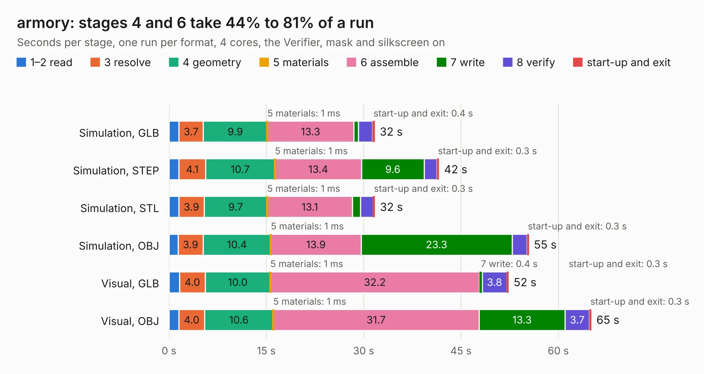

# 2956. armory

Board 2,956 of the 3,119 of [Corpus Testing](../Corpus-Testing.md), on [Corpus Page 28](../CorpusTestingPages/Corpus-Testing-28.md#2956-armory).

| Mode and format | 1–2 read | 3 resolve | 4 geometry | 5 materials | 6 assemble | 7 write | 8 verify | start-up and exit | Total |
|---|---:|---:|---:|---:|---:|---:|---:|---:|---:|
| Simulation, GLB | 1.5 | 3.7 | 9.9 | 1&nbsp;ms | 13.3 | 0.7 | 2.1 | 0.4 | 31.7 |
| Simulation, STEP | 1.5 | 4.1 | 10.7 | 1&nbsp;ms | 13.4 | 9.6 | 2.0 | 0.3 | 41.6 |
| Simulation, STL | 1.5 | 3.9 | 9.7 | 1&nbsp;ms | 13.1 | 1.2 | 1.9 | 0.3 | 31.7 |
| Simulation, OBJ | 1.4 | 3.9 | 10.4 | 1&nbsp;ms | 13.9 | 23.3 | 2.3 | 0.3 | 55.5 |
| Visual, GLB | 1.6 | 4.0 | 10.0 | 1&nbsp;ms | 32.2 | 0.4 | 3.8 | 0.3 | 52.3 |
| Visual, OBJ | 1.5 | 4.0 | 10.6 | 1&nbsp;ms | 31.7 | 13.3 | 3.7 | 0.3 | 65.1 |

<table align="center"><tr><td valign="top">

| Board | Repo: [usbarmory/usbarmory](https://github.com/usbarmory/usbarmory) Board: `armory.kicad_pcb` |
|---|---|
| Folder | hardware / mark-two-lan |
| Complexity | 445&nbsp;/&nbsp;1000 (size&nbsp;320, features&nbsp;125) |
| KESE&nbsp;features | through vias, slotted holes, rounded, trapezoid or chamfered pads, filled zones, copper text, curved board outline, stack-up, dielectric εr and tanδ, copper finish, mask and silkscreen colours |
| Tested | 9th November 2026 |
| Copper&nbsp;layers | 6 |
| File&nbsp;format | KiCad 7 (20221018) |
| Parts,&nbsp;tracks,&nbsp;vias | 194, 17,001, 371 |
| Triangles,&nbsp;simulation | 3,979,384 in 422 parts |
| Verifier | PASS in all six runs |

</td><td valign="top">

<table>
<tr><th>File type</th><th>File size</th><th>Peak memory used</th></tr>
<tr><th colspan="3" align="left">Simulation</th></tr>
<tr><td>GLB</td><td align="right">136&nbsp;MB</td><td align="right">1.1&nbsp;GB</td></tr>
<tr><td>STEP</td><td align="right">616&nbsp;MB</td><td align="right">1.4&nbsp;GB</td></tr>
<tr><td>STL</td><td align="right">199&nbsp;MB</td><td align="right">1.1&nbsp;GB</td></tr>
<tr><td>OBJ</td><td align="right">426&nbsp;MB</td><td align="right">2.6&nbsp;GB</td></tr>
<tr><th colspan="3" align="left">Visual</th></tr>
<tr><td>GLB</td><td align="right">75&nbsp;MB</td><td align="right">1.4&nbsp;GB</td></tr>
<tr><td>OBJ</td><td align="right">242&nbsp;MB</td><td align="right">1.7&nbsp;GB</td></tr>
</table>

</td></tr></table>

| Previous | Next |
|:---|---:|
| [2955. accessory](b2955b_usbarmory_accessory.md) | [2957. armory](b2957b_usbarmory_hardware-mark-two_armory.md) |
