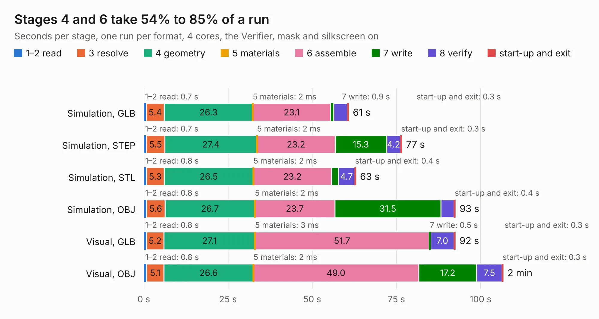

# 2957. altair-8800b-display-control-pcb

Board 2,957 of the 3,103 of [Corpus Testing](../Corpus-Testing.md), on [Corpus Page 28](../CorpusTestingPages/Corpus-Testing-28.md#2957-altair-8800b-display-control-pcb).

| Mode and format | 1–2 read | 3 resolve | 4 geometry | 5 materials | 6 assemble | 7 write | 8 verify | start-up and exit | Total |
|---|---:|---:|---:|---:|---:|---:|---:|---:|---:|
| Simulation, GLB | 0.7 | 5.4 | 26.3 | 2&nbsp;ms | 23.1 | 0.9 | 4.1 | 0.3 | 60.8 |
| Simulation, STEP | 0.7 | 5.5 | 27.4 | 2&nbsp;ms | 23.2 | 15.3 | 4.2 | 0.3 | 76.6 |
| Simulation, STL | 0.8 | 5.3 | 26.5 | 2&nbsp;ms | 23.2 | 2.1 | 4.7 | 0.4 | 62.9 |
| Simulation, OBJ | 0.8 | 5.6 | 26.7 | 2&nbsp;ms | 23.7 | 31.5 | 3.9 | 0.4 | 92.5 |
| Visual, GLB | 0.8 | 5.2 | 27.1 | 3&nbsp;ms | 51.7 | 0.5 | 7.0 | 0.3 | 92.5 |
| Visual, OBJ | 0.8 | 5.1 | 26.6 | 2&nbsp;ms | 49.0 | 17.2 | 7.5 | 0.3 | 106.7 |

<table align="center"><tr><td valign="top">

| Board | Repo: [warmech/altair-8800b-display-control-pcb](https://github.com/warmech/altair-8800b-display-control-pcb) Board: `altair-8800b-display-control-pcb.kicad_pcb` |
|---|---|
| Folder | cad |
| Complexity | 250&nbsp;/&nbsp;1000 (size&nbsp;215, features&nbsp;35) |
| KESE&nbsp;features | through vias, slotted holes, curved board outline |
| Tested | 9th November 2026 |
| Copper&nbsp;layers | 2 |
| File&nbsp;format | KiCad 7 (20221018) |
| Parts,&nbsp;tracks,&nbsp;vias | 231, 3,782, 372 |
| Triangles,&nbsp;simulation | 5,441,458 in 443 parts |
| Verifier | PASS in all six runs |

</td><td valign="top">

<table>
<tr><th>File type</th><th>File size</th><th>Peak memory used</th></tr>
<tr><th colspan="3" align="left">Simulation</th></tr>
<tr><td>GLB</td><td align="right">182&nbsp;MB</td><td align="right">1.5&nbsp;GB</td></tr>
<tr><td>STEP</td><td align="right">841&nbsp;MB</td><td align="right">2.1&nbsp;GB</td></tr>
<tr><td>STL</td><td align="right">272&nbsp;MB</td><td align="right">1.5&nbsp;GB</td></tr>
<tr><td>OBJ</td><td align="right">572&nbsp;MB</td><td align="right">4.5&nbsp;GB</td></tr>
<tr><th colspan="3" align="left">Visual</th></tr>
<tr><td>GLB</td><td align="right">112&nbsp;MB</td><td align="right">1.9&nbsp;GB</td></tr>
<tr><td>OBJ</td><td align="right">358&nbsp;MB</td><td align="right">2.2&nbsp;GB</td></tr>
</table>

</td></tr></table>

| Previous | Next |
|:---|---:|
| [2956. altair-8800b-cpu-card](b2956b_altair-8800b-cpu-card_altair-8800b-cpu-card.md) | [2958. lisa-2mb-ram-card](b2958b_lisa-2mb-ram-card_lisa-2mb-ram-card.md) |
