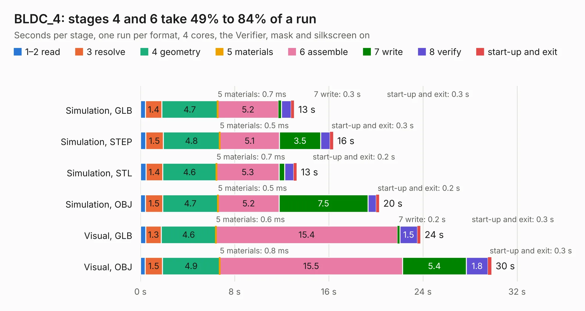

# 2957. BLDC_4

Board 2,957 of the 3,110 of [Corpus Testing](../Corpus-Testing.md), on [Corpus Page 28](../CorpusTestingPages/Corpus-Testing-28.md#2957-bldc_4).

| Mode and format | 1–2 read | 3 resolve | 4 geometry | 5 materials | 6 assemble | 7 write | 8 verify | start-up and exit | Total |
|---|---:|---:|---:|---:|---:|---:|---:|---:|---:|
| Simulation, GLB | 0.4 | 1.4 | 4.7 | 0.7&nbsp;ms | 5.2 | 0.3 | 0.8 | 0.3 | 13.1 |
| Simulation, STEP | 0.4 | 1.5 | 4.8 | 0.5&nbsp;ms | 5.1 | 3.5 | 0.8 | 0.3 | 16.4 |
| Simulation, STL | 0.5 | 1.4 | 4.6 | 0.7&nbsp;ms | 5.3 | 0.5 | 0.8 | 0.2 | 13.3 |
| Simulation, OBJ | 0.4 | 1.5 | 4.7 | 0.5&nbsp;ms | 5.2 | 7.5 | 0.7 | 0.2 | 20.3 |
| Visual, GLB | 0.4 | 1.3 | 4.6 | 0.6&nbsp;ms | 15.4 | 0.2 | 1.5 | 0.3 | 23.8 |
| Visual, OBJ | 0.4 | 1.5 | 4.9 | 0.8&nbsp;ms | 15.5 | 5.4 | 1.8 | 0.3 | 29.8 |

<table align="center"><tr><td valign="top">

| Board | Repo: [vedderb/bldc-hardware](https://github.com/vedderb/bldc-hardware) Board: `BLDC_4.kicad_pcb` |
|---|---|
| Folder | design |
| Complexity | 303&nbsp;/&nbsp;1000 (size&nbsp;258, features&nbsp;45) |
| KESE&nbsp;features | through vias, filled zones, curved board outline |
| Tested | 9th November 2026 |
| Copper&nbsp;layers | 4 |
| File&nbsp;format | KiCad 4 (4) |
| Parts,&nbsp;tracks,&nbsp;vias | 117, 1,671, 187 |
| Triangles,&nbsp;simulation | 1,473,188 in 129 parts |
| Verifier | PASS in all six runs |

</td><td valign="top">

<table>
<tr><th>File type</th><th>File size</th><th>Peak memory used</th></tr>
<tr><th colspan="3" align="left">Simulation</th></tr>
<tr><td>GLB</td><td align="right">51&nbsp;MB</td><td align="right">623&nbsp;MB</td></tr>
<tr><td>STEP</td><td align="right">222&nbsp;MB</td><td align="right">636&nbsp;MB</td></tr>
<tr><td>STL</td><td align="right">74&nbsp;MB</td><td align="right">620&nbsp;MB</td></tr>
<tr><td>OBJ</td><td align="right">153&nbsp;MB</td><td align="right">1.0&nbsp;GB</td></tr>
<tr><th colspan="3" align="left">Visual</th></tr>
<tr><td>GLB</td><td align="right">36&nbsp;MB</td><td align="right">702&nbsp;MB</td></tr>
<tr><td>OBJ</td><td align="right">108&nbsp;MB</td><td align="right">786&nbsp;MB</td></tr>
</table>

</td></tr></table>

| Previous | Next |
|:---|---:|
| [2956. omower](b2956b_omower_omower.md) | [2958. VB-IoT1_v1](b2958b_VB-IoT1_VB-IoT1-v1.md) |
