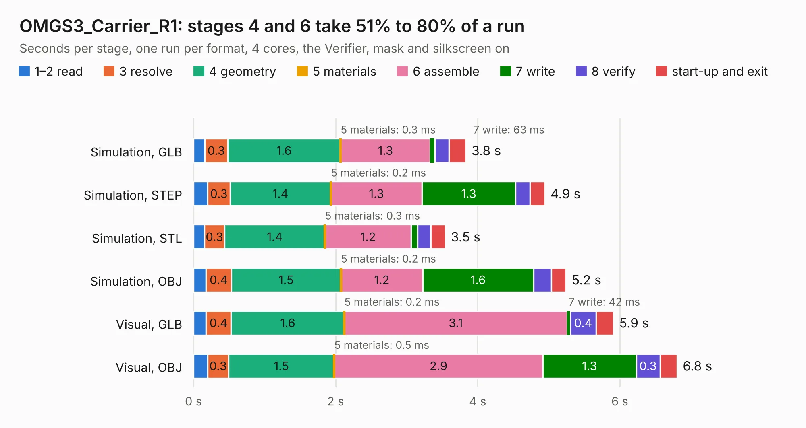

# 2957. OMGS3_Carrier_R1

Board 2,957 of the 3,125 of [Corpus Testing](../Corpus-Testing.md), on [Corpus Page 28](../CorpusTestingPages/Corpus-Testing-28.md#2957-omgs3_carrier_r1).

| Mode and format | 1–2 read | 3 resolve | 4 geometry | 5 materials | 6 assemble | 7 write | 8 verify | start-up and exit | Total |
|---|---:|---:|---:|---:|---:|---:|---:|---:|---:|
| Simulation, GLB | 0.2 | 0.3 | 1.6 | 0.3&nbsp;ms | 1.3 | 63&nbsp;ms | 0.2 | 0.2 | 3.8 |
| Simulation, STEP | 0.2 | 0.3 | 1.4 | 0.2&nbsp;ms | 1.3 | 1.3 | 0.2 | 0.2 | 4.9 |
| Simulation, STL | 0.2 | 0.3 | 1.4 | 0.3&nbsp;ms | 1.2 | 87&nbsp;ms | 0.2 | 0.2 | 3.5 |
| Simulation, OBJ | 0.2 | 0.4 | 1.5 | 0.2&nbsp;ms | 1.2 | 1.6 | 0.3 | 0.2 | 5.2 |
| Visual, GLB | 0.2 | 0.4 | 1.6 | 0.2&nbsp;ms | 3.1 | 42&nbsp;ms | 0.4 | 0.2 | 5.9 |
| Visual, OBJ | 0.2 | 0.3 | 1.5 | 0.5&nbsp;ms | 2.9 | 1.3 | 0.3 | 0.2 | 6.8 |

<table align="center"><tr><td valign="top">

| Board | Repo: [UnexpectedMaker/esp32s3](https://github.com/UnexpectedMaker/esp32s3) Board: `OMGS3_Carrier_R1.kicad_pcb` |
|---|---|
| Folder | kicad / OMGS3 Carrier |
| Complexity | 269&nbsp;/&nbsp;1000 (size&nbsp;144, features&nbsp;125) |
| KESE&nbsp;features | through vias, slotted holes, custom pads, rounded, trapezoid or chamfered pads, filled zones, copper drawings, curved board outline, stack-up, dielectric εr and tanδ, mask and silkscreen colours |
| Tested | 9th November 2026 |
| Copper&nbsp;layers | 2 |
| File&nbsp;format | KiCad 8 (20240108) |
| Parts,&nbsp;tracks,&nbsp;vias | 15, 134, 80 |
| Triangles,&nbsp;simulation | 353,816 in 40 parts |
| Verifier | PASS in all six runs |

</td><td valign="top">

<table>
<tr><th>File type</th><th>File size</th><th>Peak memory used</th></tr>
<tr><th colspan="3" align="left">Simulation</th></tr>
<tr><td>GLB</td><td align="right">12&nbsp;MB</td><td align="right">259&nbsp;MB</td></tr>
<tr><td>STEP</td><td align="right">52&nbsp;MB</td><td align="right">290&nbsp;MB</td></tr>
<tr><td>STL</td><td align="right">18&nbsp;MB</td><td align="right">252&nbsp;MB</td></tr>
<tr><td>OBJ</td><td align="right">36&nbsp;MB</td><td align="right">292&nbsp;MB</td></tr>
<tr><th colspan="3" align="left">Visual</th></tr>
<tr><td>GLB</td><td align="right">8.9&nbsp;MB</td><td align="right">278&nbsp;MB</td></tr>
<tr><td>OBJ</td><td align="right">26&nbsp;MB</td><td align="right">279&nbsp;MB</td></tr>
</table>

</td></tr></table>

| Previous | Next |
|:---|---:|
| [2956. NanoS3_Carrier](b2956b_esp32s3_NanoS3-Carrier.md) | [2958. EdgeS3D_Carrier_P1](b2958b_esp32s3_EdgeS3D-Carrier-P1.md) |
