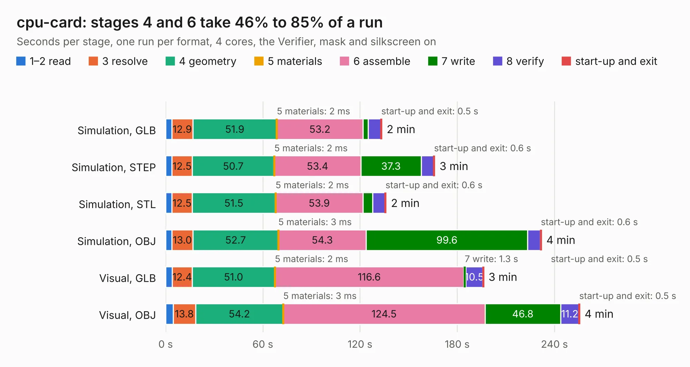

# 2957. cpu-card

Board 2,957 of the 3,101 of [Corpus Testing](../Corpus-Testing.md), on [Corpus Page 28](../CorpusTestingPages/Corpus-Testing-28.md#2957-cpu-card).

| Mode and format | 1–2 read | 3 resolve | 4 geometry | 5 materials | 6 assemble | 7 write | 8 verify | start-up and exit | Total |
|---|---:|---:|---:|---:|---:|---:|---:|---:|---:|
| Simulation, GLB | 3.8 | 12.9 | 51.9 | 2&nbsp;ms | 53.2 | 3.1 | 8.0 | 0.5 | 133.4 |
| Simulation, STEP | 3.9 | 12.5 | 50.7 | 2&nbsp;ms | 53.4 | 37.3 | 7.6 | 0.6 | 166.0 |
| Simulation, STL | 3.9 | 12.5 | 51.5 | 2&nbsp;ms | 53.9 | 5.9 | 7.7 | 0.6 | 136.0 |
| Simulation, OBJ | 3.8 | 13.0 | 52.7 | 3&nbsp;ms | 54.3 | 99.6 | 7.9 | 0.6 | 231.9 |
| Visual, GLB | 4.0 | 12.4 | 51.0 | 2&nbsp;ms | 116.6 | 1.3 | 10.5 | 0.5 | 196.3 |
| Visual, OBJ | 4.6 | 13.8 | 54.2 | 3&nbsp;ms | 124.5 | 46.8 | 11.2 | 0.5 | 255.5 |

<table align="center"><tr><td valign="top">

| Board | Repo: [warmech/lisa-cpu-card](https://github.com/warmech/lisa-cpu-card) Board: `cpu-card.kicad_pcb` |
|---|---|
| Folder | cad |
| Complexity | 397&nbsp;/&nbsp;1000 (size&nbsp;242, features&nbsp;155) |
| KESE&nbsp;features | through vias, custom pads, arc tracks, filled zones, copper drawings, copper text, curved board outline, knockout text, TrueType text, stack-up, dielectric εr and tanδ |
| Tested | 9th November 2026 |
| Copper&nbsp;layers | 4 |
| File&nbsp;format | KiCad 7 (20221018) |
| Parts,&nbsp;tracks,&nbsp;vias | 140, 9,460, 1,038 |
| Triangles,&nbsp;simulation | 14,992,174 in 395 parts |
| Verifier | PASS in all six runs |

</td><td valign="top">

<table>
<tr><th>File type</th><th>File size</th><th>Peak memory used</th></tr>
<tr><th colspan="3" align="left">Simulation</th></tr>
<tr><td>GLB</td><td align="right">515&nbsp;MB</td><td align="right">3.6&nbsp;GB</td></tr>
<tr><td>STEP</td><td align="right">2.1&nbsp;GB</td><td align="right">4.3&nbsp;GB</td></tr>
<tr><td>STL</td><td align="right">750&nbsp;MB</td><td align="right">3.5&nbsp;GB</td></tr>
<tr><td>OBJ</td><td align="right">1.6&nbsp;GB</td><td align="right">9.5&nbsp;GB</td></tr>
<tr><th colspan="3" align="left">Visual</th></tr>
<tr><td>GLB</td><td align="right">252&nbsp;MB</td><td align="right">4.2&nbsp;GB</td></tr>
<tr><td>OBJ</td><td align="right">830&nbsp;MB</td><td align="right">5.4&nbsp;GB</td></tr>
</table>

</td></tr></table>

| Previous | Next |
|:---|---:|
| [2956. lisa-2mb-ram-card](b2956b_lisa-2mb-ram-card_lisa-2mb-ram-card.md) | [2958. altimeter](b2958b_canhw_altimeter.md) |
