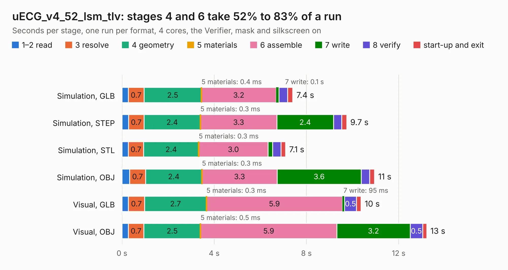

# 2958. uECG_v4_52_lsm_tlv

Board 2,958 of the 3,128 of [Corpus Testing](../Corpus-Testing.md), on [Corpus Page 28](../CorpusTestingPages/Corpus-Testing-28.md#2958-uecg_v4_52_lsm_tlv).

| Mode and format | 1–2 read | 3 resolve | 4 geometry | 5 materials | 6 assemble | 7 write | 8 verify | start-up and exit | Total |
|---|---:|---:|---:|---:|---:|---:|---:|---:|---:|
| Simulation, GLB | 0.3 | 0.7 | 2.5 | 0.4&nbsp;ms | 3.2 | 0.1 | 0.4 | 0.2 | 7.4 |
| Simulation, STEP | 0.3 | 0.7 | 2.4 | 0.3&nbsp;ms | 3.3 | 2.4 | 0.4 | 0.2 | 9.7 |
| Simulation, STL | 0.3 | 0.7 | 2.4 | 0.3&nbsp;ms | 3.0 | 0.2 | 0.4 | 0.2 | 7.1 |
| Simulation, OBJ | 0.3 | 0.7 | 2.4 | 0.3&nbsp;ms | 3.3 | 3.6 | 0.4 | 0.2 | 11.0 |
| Visual, GLB | 0.3 | 0.7 | 2.7 | 0.3&nbsp;ms | 5.9 | 95&nbsp;ms | 0.5 | 0.2 | 10.4 |
| Visual, OBJ | 0.3 | 0.7 | 2.5 | 0.5&nbsp;ms | 5.9 | 3.2 | 0.5 | 0.2 | 13.2 |

<table align="center"><tr><td valign="top">

| Board | Repo: [ultimaterobotics/uECG_pcb](https://github.com/ultimaterobotics/uECG_pcb) Board: `uECG_v4_52_lsm_tlv.kicad_pcb` |
|---|---|
| Folder | uECG_v4_52_lsm_tlv |
| Complexity | 310&nbsp;/&nbsp;1000 (size&nbsp;220, features&nbsp;90) |
| KESE&nbsp;features | through vias, rounded, trapezoid or chamfered pads, filled zones, curved board outline, stack-up, dielectric εr and tanδ, mask and silkscreen colours |
| Tested | 9th November 2026 |
| Copper&nbsp;layers | 2 |
| File&nbsp;format | KiCad 6 (20211014) |
| Parts,&nbsp;tracks,&nbsp;vias | 71, 814, 147 |
| Triangles,&nbsp;simulation | 754,512 in 97 parts |
| Verifier | PASS in all six runs |

</td><td valign="top">

<table>
<tr><th>File type</th><th>File size</th><th>Peak memory used</th></tr>
<tr><th colspan="3" align="left">Simulation</th></tr>
<tr><td>GLB</td><td align="right">26&nbsp;MB</td><td align="right">390&nbsp;MB</td></tr>
<tr><td>STEP</td><td align="right">140&nbsp;MB</td><td align="right">483&nbsp;MB</td></tr>
<tr><td>STL</td><td align="right">38&nbsp;MB</td><td align="right">394&nbsp;MB</td></tr>
<tr><td>OBJ</td><td align="right">77&nbsp;MB</td><td align="right">525&nbsp;MB</td></tr>
<tr><th colspan="3" align="left">Visual</th></tr>
<tr><td>GLB</td><td align="right">23&nbsp;MB</td><td align="right">570&nbsp;MB</td></tr>
<tr><td>OBJ</td><td align="right">69&nbsp;MB</td><td align="right">528&nbsp;MB</td></tr>
</table>

</td></tr></table>

| Previous | Next |
|:---|---:|
| [2957. uECG_v4_5](b2957b_uECG-pcb_uECG-v4-5.md) | [2959. NanoS3_Carrier](b2959b_esp32s3_NanoS3-Carrier.md) |
