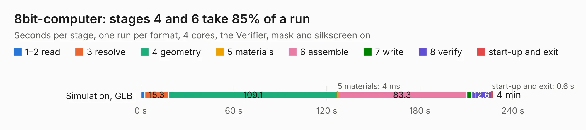

# 2960. 8bit-computer

Board 2,960 of the 3,116 of [Corpus Testing](../Corpus-Testing.md), on [Corpus Page 28](../CorpusTestingPages/Corpus-Testing-28.md#2960-8bit-computer).

| Mode and format | 1–2 read | 3 resolve | 4 geometry | 5 materials | 6 assemble | 7 write | 8 verify | start-up and exit | Total |
|---|---:|---:|---:|---:|---:|---:|---:|---:|---:|
| Simulation, GLB | 2.6 | 15.3 | 109.1 | 4&nbsp;ms | 83.3 | 3.4 | 12.6 | 0.6 | 226.7 |
| Simulation, STEP | 2.8 | 15.7 | 112.8 | 3&nbsp;ms | 84.7 | 50.1 | 12.8 | 0.6 | 279.4 |
| Simulation, STL | 2.8 | 15.8 | 112.0 | 3&nbsp;ms | 84.4 | 7.6 | 13.0 | 0.6 | 236.3 |
| Simulation, OBJ | 3.0 | 16.3 | 114.0 | 2&nbsp;ms | 84.3 | 110.7 | 12.8 | 0.5 | 341.7 |
| Visual, GLB | 2.8 | 16.0 | 113.4 | 3&nbsp;ms | 192.7 | 1.7 | 17.2 | 0.4 | 344.2 |
| Visual, OBJ | 2.8 | 16.1 | 113.3 | 3&nbsp;ms | 195.3 | 60.9 | 17.3 | 0.5 | 406.1 |

<table align="center"><tr><td valign="top">

| Board | Repo: [vascofazza/8bit-cpu](https://github.com/vascofazza/8bit-cpu) Board: `8bit-computer.kicad_pcb` |
|---|---|
| Folder | MK1_CPU / 8bit-computer |
| Complexity | 387&nbsp;/&nbsp;1000 (size&nbsp;287, features&nbsp;100) |
| KESE&nbsp;features | through vias, slotted holes, custom pads, rounded, trapezoid or chamfered pads, filled zones, copper drawings, copper text, curved board outline |
| Tested | 9th November 2026 |
| Copper&nbsp;layers | 2 |
| File&nbsp;format | KiCad 5 (20171130) |
| Parts,&nbsp;tracks,&nbsp;vias | 328, 11,197, 441 |
| Triangles,&nbsp;simulation | 15,245,230 in 586 parts |
| Verifier | PASS in all six runs |

</td><td valign="top">

<table>
<tr><th>File type</th><th>File size</th><th>Peak memory used</th></tr>
<tr><th colspan="3" align="left">Simulation</th></tr>
<tr><td>GLB</td><td align="right">527&nbsp;MB</td><td align="right">3.5&nbsp;GB</td></tr>
<tr><td>STEP</td><td align="right">2.9&nbsp;GB</td><td align="right">4.9&nbsp;GB</td></tr>
<tr><td>STL</td><td align="right">762&nbsp;MB</td><td align="right">3.3&nbsp;GB</td></tr>
<tr><td>OBJ</td><td align="right">1.7&nbsp;GB</td><td align="right">9.8&nbsp;GB</td></tr>
<tr><th colspan="3" align="left">Visual</th></tr>
<tr><td>GLB</td><td align="right">328&nbsp;MB</td><td align="right">5.1&nbsp;GB</td></tr>
<tr><td>OBJ</td><td align="right">1.0&nbsp;GB</td><td align="right">6.5&nbsp;GB</td></tr>
</table>

</td></tr></table>

| Previous | Next |
|:---|---:|
| [2959. display_interface](b2959b_8bit-cpu_display-interface.md) | [2961. programming_interface](b2961b_8bit-cpu_programming-interface.md) |
