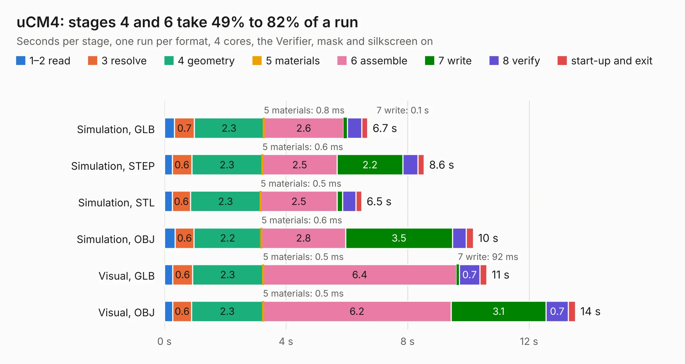

# 2961. uCM4

Board 2,961 of the 3,121 of [Corpus Testing](../Corpus-Testing.md), on [Corpus Page 28](../CorpusTestingPages/Corpus-Testing-28.md#2961-ucm4).

| Mode and format | 1–2 read | 3 resolve | 4 geometry | 5 materials | 6 assemble | 7 write | 8 verify | start-up and exit | Total |
|---|---:|---:|---:|---:|---:|---:|---:|---:|---:|
| Simulation, GLB | 0.3 | 0.7 | 2.3 | 0.8&nbsp;ms | 2.6 | 0.1 | 0.5 | 0.2 | 6.7 |
| Simulation, STEP | 0.3 | 0.6 | 2.3 | 0.6&nbsp;ms | 2.5 | 2.2 | 0.5 | 0.2 | 8.6 |
| Simulation, STL | 0.3 | 0.6 | 2.3 | 0.5&nbsp;ms | 2.5 | 0.2 | 0.4 | 0.2 | 6.5 |
| Simulation, OBJ | 0.4 | 0.6 | 2.2 | 0.6&nbsp;ms | 2.8 | 3.5 | 0.5 | 0.2 | 10.2 |
| Visual, GLB | 0.3 | 0.6 | 2.3 | 0.5&nbsp;ms | 6.4 | 92&nbsp;ms | 0.7 | 0.2 | 10.6 |
| Visual, OBJ | 0.3 | 0.6 | 2.3 | 0.5&nbsp;ms | 6.2 | 3.1 | 0.7 | 0.2 | 13.5 |

<table align="center"><tr><td valign="top">

| Board | Repo: [v3l0c1r4pt0r/ucm4](https://github.com/v3l0c1r4pt0r/ucm4) Board: `uCM4.kicad_pcb` |
|---|---|
| Complexity | 285&nbsp;/&nbsp;1000 (size&nbsp;175, features&nbsp;110) |
| KESE&nbsp;features | through vias, slotted holes, rounded, trapezoid or chamfered pads, drill offsets, filled zones, curved board outline, stack-up, dielectric εr and tanδ, mask and silkscreen colours |
| Tested | 9th November 2026 |
| Copper&nbsp;layers | 2 |
| File&nbsp;format | KiCad 6 (20210228) |
| Parts,&nbsp;tracks,&nbsp;vias | 30, 1,280, 109 |
| Triangles,&nbsp;simulation | 649,970 in 177 parts |
| Verifier | PASS in all six runs |

</td><td valign="top">

<table>
<tr><th>File type</th><th>File size</th><th>Peak memory used</th></tr>
<tr><th colspan="3" align="left">Simulation</th></tr>
<tr><td>GLB</td><td align="right">23&nbsp;MB</td><td align="right">382&nbsp;MB</td></tr>
<tr><td>STEP</td><td align="right">117&nbsp;MB</td><td align="right">417&nbsp;MB</td></tr>
<tr><td>STL</td><td align="right">33&nbsp;MB</td><td align="right">384&nbsp;MB</td></tr>
<tr><td>OBJ</td><td align="right">66&nbsp;MB</td><td align="right">473&nbsp;MB</td></tr>
<tr><th colspan="3" align="left">Visual</th></tr>
<tr><td>GLB</td><td align="right">20&nbsp;MB</td><td align="right">533&nbsp;MB</td></tr>
<tr><td>OBJ</td><td align="right">59&nbsp;MB</td><td align="right">525&nbsp;MB</td></tr>
</table>

</td></tr></table>

| Previous | Next |
|:---|---:|
| [2960. milight-hub-base](b2960b_milight-hub_milight-hub-base.md) | [2962. bus_breakout](b2962b_8bit-cpu_bus-breakout.md) |
