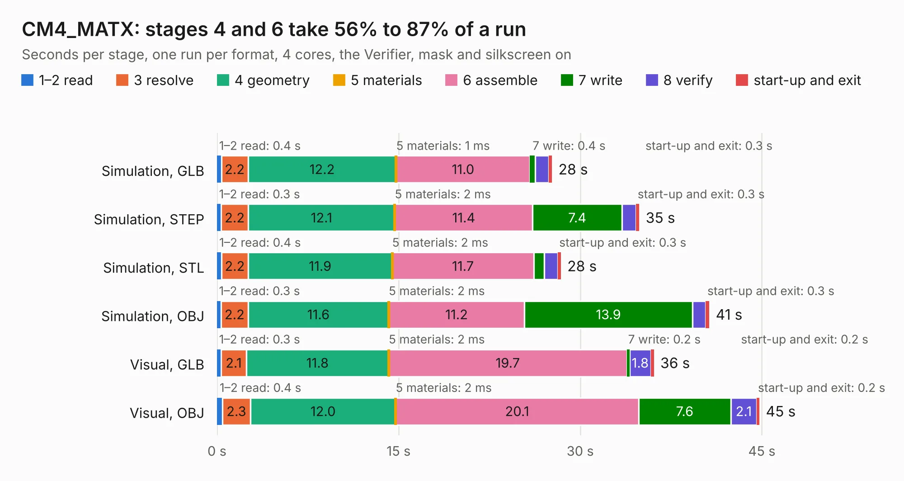

# 2962. CM4_MATX

Board 2,962 of the 3,110 of [Corpus Testing](../Corpus-Testing.md), on [Corpus Page 28](../CorpusTestingPages/Corpus-Testing-28.md#2962-cm4_matx).

| Mode and format | 1–2 read | 3 resolve | 4 geometry | 5 materials | 6 assemble | 7 write | 8 verify | start-up and exit | Total |
|---|---:|---:|---:|---:|---:|---:|---:|---:|---:|
| Simulation, GLB | 0.4 | 2.2 | 12.2 | 1&nbsp;ms | 11.0 | 0.4 | 1.1 | 0.3 | 27.7 |
| Simulation, STEP | 0.3 | 2.2 | 12.1 | 2&nbsp;ms | 11.4 | 7.4 | 1.2 | 0.3 | 34.9 |
| Simulation, STL | 0.4 | 2.2 | 11.9 | 2&nbsp;ms | 11.7 | 0.9 | 1.1 | 0.3 | 28.4 |
| Simulation, OBJ | 0.3 | 2.2 | 11.6 | 2&nbsp;ms | 11.2 | 13.9 | 1.1 | 0.3 | 40.7 |
| Visual, GLB | 0.3 | 2.1 | 11.8 | 2&nbsp;ms | 19.7 | 0.2 | 1.8 | 0.2 | 36.1 |
| Visual, OBJ | 0.4 | 2.3 | 12.0 | 2&nbsp;ms | 20.1 | 7.6 | 2.1 | 0.2 | 44.8 |

<table align="center"><tr><td valign="top">

| Board | Repo: [volkertb/CM4_MATX](https://github.com/volkertb/CM4_MATX) Board: `CM4_MATX.kicad_pcb` |
|---|---|
| Folder | KiCad |
| Complexity | 111&nbsp;/&nbsp;1000 (size&nbsp;101, features&nbsp;10) |
| KESE&nbsp;features | curved board outline |
| Tested | 9th November 2026 |
| Copper&nbsp;layers | 2 |
| File&nbsp;format | KiCad 5 (20171130) |
| Parts,&nbsp;tracks,&nbsp;vias | 31, 0, 0 |
| Triangles,&nbsp;simulation | 2,451,152 in 596 parts |
| Verifier | PASS in all six runs |

</td><td valign="top">

<table>
<tr><th>File type</th><th>File size</th><th>Peak memory used</th></tr>
<tr><th colspan="3" align="left">Simulation</th></tr>
<tr><td>GLB</td><td align="right">80&nbsp;MB</td><td align="right">747&nbsp;MB</td></tr>
<tr><td>STEP</td><td align="right">273&nbsp;MB</td><td align="right">987&nbsp;MB</td></tr>
<tr><td>STL</td><td align="right">123&nbsp;MB</td><td align="right">741&nbsp;MB</td></tr>
<tr><td>OBJ</td><td align="right">259&nbsp;MB</td><td align="right">1.6&nbsp;GB</td></tr>
<tr><th colspan="3" align="left">Visual</th></tr>
<tr><td>GLB</td><td align="right">46&nbsp;MB</td><td align="right">996&nbsp;MB</td></tr>
<tr><td>OBJ</td><td align="right">142&nbsp;MB</td><td align="right">1.1&nbsp;GB</td></tr>
</table>

</td></tr></table>

| Previous | Next |
|:---|---:|
| [2961. Tangenta](b2961b_tangenta_Tangenta.md) | [2963. altair-8800b-cpu-card](b2963b_altair-8800b-cpu-card_altair-8800b-cpu-card.md) |
