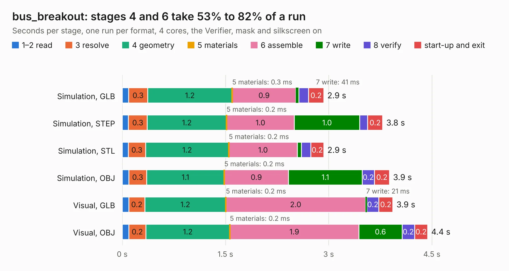

# 2964. bus_breakout

Board 2,964 of the 3,123 of [Corpus Testing](../Corpus-Testing.md), on [Corpus Page 28](../CorpusTestingPages/Corpus-Testing-28.md#2964-bus_breakout).

| Mode and format | 1–2 read | 3 resolve | 4 geometry | 5 materials | 6 assemble | 7 write | 8 verify | start-up and exit | Total |
|---|---:|---:|---:|---:|---:|---:|---:|---:|---:|
| Simulation, GLB | 93&nbsp;ms | 0.3 | 1.2 | 0.3&nbsp;ms | 0.9 | 41&nbsp;ms | 0.1 | 0.2 | 2.9 |
| Simulation, STEP | 90&nbsp;ms | 0.3 | 1.2 | 0.2&nbsp;ms | 1.0 | 1.0 | 0.1 | 0.2 | 3.8 |
| Simulation, STL | 89&nbsp;ms | 0.3 | 1.2 | 0.2&nbsp;ms | 1.0 | 59&nbsp;ms | 0.1 | 0.2 | 2.9 |
| Simulation, OBJ | 96&nbsp;ms | 0.3 | 1.1 | 0.2&nbsp;ms | 0.9 | 1.1 | 0.2 | 0.2 | 3.9 |
| Visual, GLB | 97&nbsp;ms | 0.2 | 1.2 | 0.2&nbsp;ms | 2.0 | 21&nbsp;ms | 0.2 | 0.2 | 3.9 |
| Visual, OBJ | 96&nbsp;ms | 0.2 | 1.2 | 0.2&nbsp;ms | 1.9 | 0.6 | 0.2 | 0.2 | 4.4 |

<table align="center"><tr><td valign="top">

| Board | Repo: [vascofazza/8bit-cpu](https://github.com/vascofazza/8bit-cpu) Board: `bus_breakout.kicad_pcb` |
|---|---|
| Folder | bus_breakout |
| Complexity | 124&nbsp;/&nbsp;1000 (size&nbsp;104, features&nbsp;20) |
| KESE&nbsp;features | copper text, curved board outline |
| Tested | 9th November 2026 |
| Copper&nbsp;layers | 2 |
| File&nbsp;format | KiCad 5 (20171130) |
| Parts,&nbsp;tracks,&nbsp;vias | 4, 72, 0 |
| Triangles,&nbsp;simulation | 248,268 in 30 parts |
| Verifier | PASS in all six runs |

</td><td valign="top">

<table>
<tr><th>File type</th><th>File size</th><th>Peak memory used</th></tr>
<tr><th colspan="3" align="left">Simulation</th></tr>
<tr><td>GLB</td><td align="right">8.6&nbsp;MB</td><td align="right">227&nbsp;MB</td></tr>
<tr><td>STEP</td><td align="right">43&nbsp;MB</td><td align="right">235&nbsp;MB</td></tr>
<tr><td>STL</td><td align="right">12&nbsp;MB</td><td align="right">226&nbsp;MB</td></tr>
<tr><td>OBJ</td><td align="right">25&nbsp;MB</td><td align="right">227&nbsp;MB</td></tr>
<tr><th colspan="3" align="left">Visual</th></tr>
<tr><td>GLB</td><td align="right">5.1&nbsp;MB</td><td align="right">203&nbsp;MB</td></tr>
<tr><td>OBJ</td><td align="right">15&nbsp;MB</td><td align="right">202&nbsp;MB</td></tr>
</table>

</td></tr></table>

| Previous | Next |
|:---|---:|
| [2963. uCM4](b2963b_ucm4_uCM4.md) | [2965. arduino_eeprom_programmer](b2965b_8bit-cpu_arduino-eeprom-programmer.md) |
