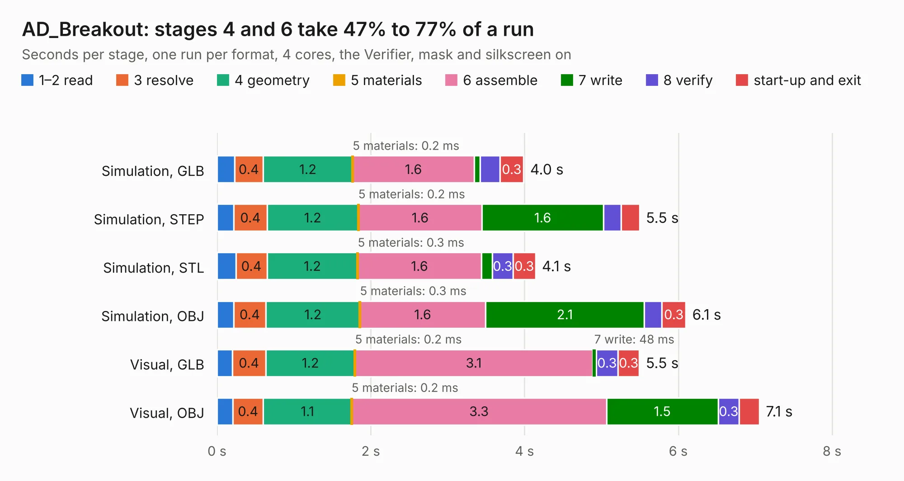

# 2967. AD_Breakout

Board 2,967 of the 3,106 of [Corpus Testing](../Corpus-Testing.md), on [Corpus Page 28](../CorpusTestingPages/Corpus-Testing-28.md#2967-ad_breakout).

| Mode and format | 1–2 read | 3 resolve | 4 geometry | 5 materials | 6 assemble | 7 write | 8 verify | start-up and exit | Total |
|---|---:|---:|---:|---:|---:|---:|---:|---:|---:|
| Simulation, GLB | 0.2 | 0.4 | 1.2 | 0.2&nbsp;ms | 1.6 | 77&nbsp;ms | 0.3 | 0.3 | 4.0 |
| Simulation, STEP | 0.2 | 0.4 | 1.2 | 0.2&nbsp;ms | 1.6 | 1.6 | 0.2 | 0.2 | 5.5 |
| Simulation, STL | 0.2 | 0.4 | 1.2 | 0.3&nbsp;ms | 1.6 | 0.1 | 0.3 | 0.3 | 4.1 |
| Simulation, OBJ | 0.2 | 0.4 | 1.2 | 0.3&nbsp;ms | 1.6 | 2.1 | 0.2 | 0.3 | 6.1 |
| Visual, GLB | 0.2 | 0.4 | 1.2 | 0.2&nbsp;ms | 3.1 | 48&nbsp;ms | 0.3 | 0.3 | 5.5 |
| Visual, OBJ | 0.2 | 0.4 | 1.1 | 0.2&nbsp;ms | 3.3 | 1.5 | 0.3 | 0.3 | 7.1 |

<table align="center"><tr><td valign="top">

| Board | Repo: [waterloo-rocketry/canhw](https://github.com/waterloo-rocketry/canhw) Board: `AD_Breakout.kicad_pcb` |
|---|---|
| Folder | CanardBoard / AD_Breakout_Board |
| Complexity | 259&nbsp;/&nbsp;1000 (size&nbsp;174, features&nbsp;85) |
| KESE&nbsp;features | through vias, rounded, trapezoid or chamfered pads, filled zones, curved board outline, stack-up, dielectric εr and tanδ |
| Tested | 10th November 2026 |
| Copper&nbsp;layers | 4 |
| File&nbsp;format | KiCad 9 (20241229) |
| Parts,&nbsp;tracks,&nbsp;vias | 39, 268, 61 |
| Triangles,&nbsp;simulation | 352,802 in 48 parts |
| Verifier | PASS in all six runs |

</td><td valign="top">

<table>
<tr><th>File type</th><th>File size</th><th>Peak memory used</th></tr>
<tr><th colspan="3" align="left">Simulation</th></tr>
<tr><td>GLB</td><td align="right">12&nbsp;MB</td><td align="right">257&nbsp;MB</td></tr>
<tr><td>STEP</td><td align="right">47&nbsp;MB</td><td align="right">293&nbsp;MB</td></tr>
<tr><td>STL</td><td align="right">18&nbsp;MB</td><td align="right">255&nbsp;MB</td></tr>
<tr><td>OBJ</td><td align="right">35&nbsp;MB</td><td align="right">267&nbsp;MB</td></tr>
<tr><th colspan="3" align="left">Visual</th></tr>
<tr><td>GLB</td><td align="right">8.6&nbsp;MB</td><td align="right">275&nbsp;MB</td></tr>
<tr><td>OBJ</td><td align="right">25&nbsp;MB</td><td align="right">274&nbsp;MB</td></tr>
</table>

</td></tr></table>

| Previous | Next |
|:---|---:|
| [2966. CAN_relay](b2966b_canhw_CAN-relay.md) | [2968. CanardBoard](b2968b_canhw_CanardBoard.md) |
