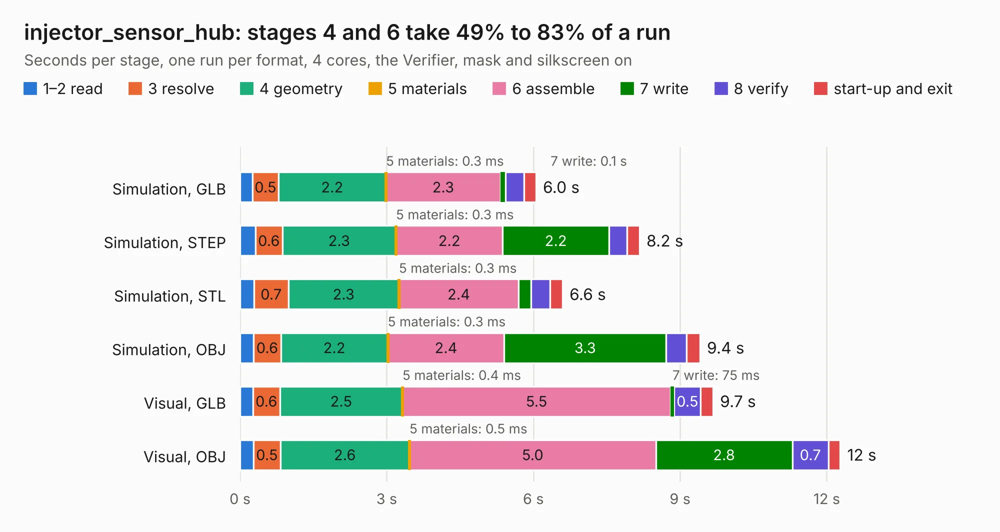

# 2967. injector_sensor_hub

Board 2,967 of the 3,102 of [Corpus Testing](../Corpus-Testing.md), on [Corpus Page 28](../CorpusTestingPages/Corpus-Testing-28.md#2967-injector_sensor_hub).

| Mode and format | 1–2 read | 3 resolve | 4 geometry | 5 materials | 6 assemble | 7 write | 8 verify | start-up and exit | Total |
|---|---:|---:|---:|---:|---:|---:|---:|---:|---:|
| Simulation, GLB | 0.3 | 0.5 | 2.2 | 0.3&nbsp;ms | 2.3 | 0.1 | 0.4 | 0.2 | 6.0 |
| Simulation, STEP | 0.3 | 0.6 | 2.3 | 0.3&nbsp;ms | 2.2 | 2.2 | 0.4 | 0.2 | 8.2 |
| Simulation, STL | 0.3 | 0.7 | 2.3 | 0.3&nbsp;ms | 2.4 | 0.3 | 0.4 | 0.3 | 6.6 |
| Simulation, OBJ | 0.3 | 0.6 | 2.2 | 0.3&nbsp;ms | 2.4 | 3.3 | 0.4 | 0.3 | 9.4 |
| Visual, GLB | 0.3 | 0.6 | 2.5 | 0.4&nbsp;ms | 5.5 | 75&nbsp;ms | 0.5 | 0.3 | 9.7 |
| Visual, OBJ | 0.3 | 0.5 | 2.6 | 0.5&nbsp;ms | 5.0 | 2.8 | 0.7 | 0.2 | 12.3 |

<table align="center"><tr><td valign="top">

| Board | Repo: [waterloo-rocketry/canhw](https://github.com/waterloo-rocketry/canhw) Board: `injector_sensor_hub.kicad_pcb` |
|---|---|
| Folder | injector_sensor_hub |
| Complexity | 215&nbsp;/&nbsp;1000 (size&nbsp;160, features&nbsp;55) |
| KESE&nbsp;features | through vias, rounded, trapezoid or chamfered pads, filled zones, curved board outline |
| Tested | 9th November 2026 |
| Copper&nbsp;layers | 2 |
| File&nbsp;format | KiCad 8 (20240108) |
| Parts,&nbsp;tracks,&nbsp;vias | 48, 278, 68 |
| Triangles,&nbsp;simulation | 650,724 in 58 parts |
| Verifier | PASS in all six runs |

</td><td valign="top">

<table>
<tr><th>File type</th><th>File size</th><th>Peak memory used</th></tr>
<tr><th colspan="3" align="left">Simulation</th></tr>
<tr><td>GLB</td><td align="right">22&nbsp;MB</td><td align="right">337&nbsp;MB</td></tr>
<tr><td>STEP</td><td align="right">113&nbsp;MB</td><td align="right">401&nbsp;MB</td></tr>
<tr><td>STL</td><td align="right">33&nbsp;MB</td><td align="right">330&nbsp;MB</td></tr>
<tr><td>OBJ</td><td align="right">66&nbsp;MB</td><td align="right">472&nbsp;MB</td></tr>
<tr><th colspan="3" align="left">Visual</th></tr>
<tr><td>GLB</td><td align="right">17&nbsp;MB</td><td align="right">425&nbsp;MB</td></tr>
<tr><td>OBJ</td><td align="right">51&nbsp;MB</td><td align="right">468&nbsp;MB</td></tr>
</table>

</td></tr></table>

| Previous | Next |
|:---|---:|
| [2966. gps_2](b2966b_canhw_gps-2.md) | [2968. telemetry_transmitter](b2968b_canhw_telemetry-transmitter.md) |
