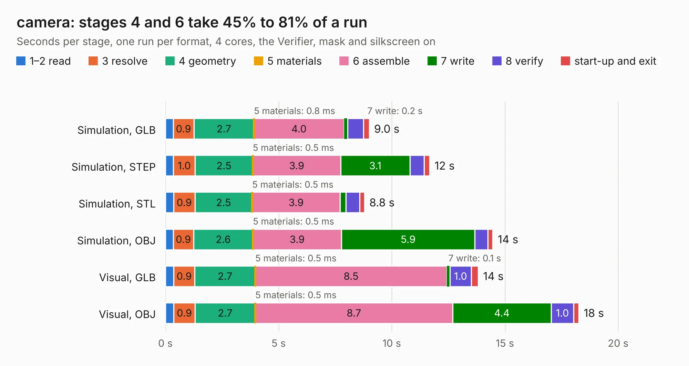

# 2968. camera

Board 2,968 of the 3,110 of [Corpus Testing](../Corpus-Testing.md), on [Corpus Page 28](../CorpusTestingPages/Corpus-Testing-28.md#2968-camera).

| Mode and format | 1–2 read | 3 resolve | 4 geometry | 5 materials | 6 assemble | 7 write | 8 verify | start-up and exit | Total |
|---|---:|---:|---:|---:|---:|---:|---:|---:|---:|
| Simulation, GLB | 0.3 | 0.9 | 2.7 | 0.8&nbsp;ms | 4.0 | 0.2 | 0.7 | 0.3 | 9.0 |
| Simulation, STEP | 0.4 | 1.0 | 2.5 | 0.5&nbsp;ms | 3.9 | 3.1 | 0.6 | 0.2 | 11.7 |
| Simulation, STL | 0.4 | 0.9 | 2.5 | 0.5&nbsp;ms | 3.9 | 0.3 | 0.6 | 0.2 | 8.8 |
| Simulation, OBJ | 0.3 | 0.9 | 2.6 | 0.5&nbsp;ms | 3.9 | 5.9 | 0.6 | 0.2 | 14.5 |
| Visual, GLB | 0.4 | 0.9 | 2.7 | 0.5&nbsp;ms | 8.5 | 0.1 | 1.0 | 0.3 | 13.8 |
| Visual, OBJ | 0.4 | 0.9 | 2.7 | 0.5&nbsp;ms | 8.7 | 4.4 | 1.0 | 0.2 | 18.3 |

<table align="center"><tr><td valign="top">

| Board | Repo: [waterloo-rocketry/canhw](https://github.com/waterloo-rocketry/canhw) Board: `camera.kicad_pcb` |
|---|---|
| Folder | camera |
| Complexity | 334&nbsp;/&nbsp;1000 (size&nbsp;234, features&nbsp;100) |
| KESE&nbsp;features | through vias, rounded, trapezoid or chamfered pads, arc tracks, filled zones, curved board outline, stack-up, dielectric εr and tanδ |
| Tested | 9th November 2026 |
| Copper&nbsp;layers | 4 |
| File&nbsp;format | KiCad 9 (20241229) |
| Parts,&nbsp;tracks,&nbsp;vias | 58, 754, 165 |
| Triangles,&nbsp;simulation | 1,060,698 in 133 parts |
| Verifier | PASS in all six runs |

</td><td valign="top">

<table>
<tr><th>File type</th><th>File size</th><th>Peak memory used</th></tr>
<tr><th colspan="3" align="left">Simulation</th></tr>
<tr><td>GLB</td><td align="right">36&nbsp;MB</td><td align="right">457&nbsp;MB</td></tr>
<tr><td>STEP</td><td align="right">147&nbsp;MB</td><td align="right">576&nbsp;MB</td></tr>
<tr><td>STL</td><td align="right">53&nbsp;MB</td><td align="right">457&nbsp;MB</td></tr>
<tr><td>OBJ</td><td align="right">107&nbsp;MB</td><td align="right">729&nbsp;MB</td></tr>
<tr><th colspan="3" align="left">Visual</th></tr>
<tr><td>GLB</td><td align="right">26&nbsp;MB</td><td align="right">694&nbsp;MB</td></tr>
<tr><td>OBJ</td><td align="right">77&nbsp;MB</td><td align="right">653&nbsp;MB</td></tr>
</table>

</td></tr></table>

| Previous | Next |
|:---|---:|
| [2967. altimeter](b2967b_canhw_altimeter.md) | [2969. camera_interface_CAN_board](b2969b_canhw_camera-interface-CAN-board.md) |
