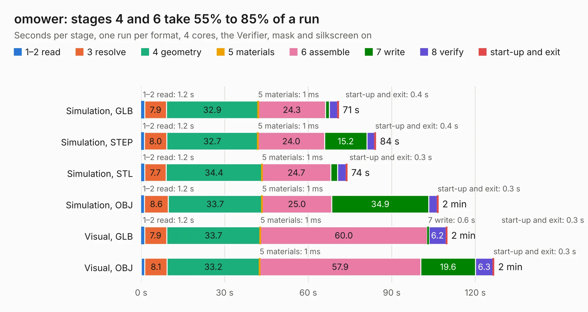

# 2968. omower

Board 2,968 of the 3,122 of [Corpus Testing](../Corpus-Testing.md), on [Corpus Page 28](../CorpusTestingPages/Corpus-Testing-28.md#2968-omower).

| Mode and format | 1–2 read | 3 resolve | 4 geometry | 5 materials | 6 assemble | 7 write | 8 verify | start-up and exit | Total |
|---|---:|---:|---:|---:|---:|---:|---:|---:|---:|
| Simulation, GLB | 1.2 | 7.9 | 32.9 | 1&nbsp;ms | 24.3 | 1.3 | 2.9 | 0.4 | 70.9 |
| Simulation, STEP | 1.2 | 8.0 | 32.7 | 1&nbsp;ms | 24.0 | 15.2 | 2.8 | 0.4 | 84.3 |
| Simulation, STL | 1.2 | 7.7 | 34.4 | 1&nbsp;ms | 24.7 | 2.4 | 3.1 | 0.3 | 74.0 |
| Simulation, OBJ | 1.2 | 8.6 | 33.7 | 1&nbsp;ms | 25.0 | 34.9 | 3.0 | 0.3 | 106.7 |
| Visual, GLB | 1.2 | 7.9 | 33.7 | 1&nbsp;ms | 60.0 | 0.6 | 6.2 | 0.3 | 109.9 |
| Visual, OBJ | 1.3 | 8.1 | 33.2 | 1&nbsp;ms | 57.9 | 19.6 | 6.3 | 0.3 | 126.7 |

<table align="center"><tr><td valign="top">

| Board | Repo: [vasimv/omower](https://github.com/vasimv/omower) Board: `omower.kicad_pcb` |
|---|---|
| Folder | hardware / OMower |
| Complexity | 337&nbsp;/&nbsp;1000 (size&nbsp;282, features&nbsp;55) |
| KESE&nbsp;features | through vias, slotted holes, rounded, trapezoid or chamfered pads, filled zones |
| Tested | 9th November 2026 |
| Copper&nbsp;layers | 4 |
| File&nbsp;format | KiCad 4 (4) |
| Parts,&nbsp;tracks,&nbsp;vias | 402, 4,619, 537 |
| Triangles,&nbsp;simulation | 5,924,968 in 351 parts |
| Verifier | PASS in all six runs |

</td><td valign="top">

<table>
<tr><th>File type</th><th>File size</th><th>Peak memory used</th></tr>
<tr><th colspan="3" align="left">Simulation</th></tr>
<tr><td>GLB</td><td align="right">207&nbsp;MB</td><td align="right">1.4&nbsp;GB</td></tr>
<tr><td>STEP</td><td align="right">824&nbsp;MB</td><td align="right">1.9&nbsp;GB</td></tr>
<tr><td>STL</td><td align="right">296&nbsp;MB</td><td align="right">1.5&nbsp;GB</td></tr>
<tr><td>OBJ</td><td align="right">642&nbsp;MB</td><td align="right">3.9&nbsp;GB</td></tr>
<tr><th colspan="3" align="left">Visual</th></tr>
<tr><td>GLB</td><td align="right">114&nbsp;MB</td><td align="right">1.8&nbsp;GB</td></tr>
<tr><td>OBJ</td><td align="right">362&nbsp;MB</td><td align="right">2.5&nbsp;GB</td></tr>
</table>

</td></tr></table>

| Previous | Next |
|:---|---:|
| [2967. programming_interface](b2967b_8bit-cpu_programming-interface.md) | [2969. BLDC_4](b2969b_bldc-hardware_BLDC-4.md) |
