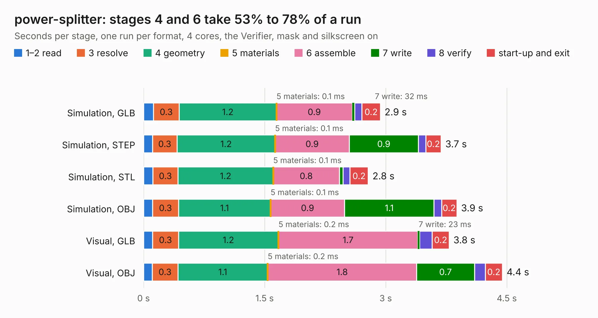

# 2969. power-splitter

Board 2,969 of the 3,101 of [Corpus Testing](../Corpus-Testing.md), on [Corpus Page 28](../CorpusTestingPages/Corpus-Testing-28.md#2969-power-splitter).

| Mode and format | 1–2 read | 3 resolve | 4 geometry | 5 materials | 6 assemble | 7 write | 8 verify | start-up and exit | Total |
|---|---:|---:|---:|---:|---:|---:|---:|---:|---:|
| Simulation, GLB | 0.1 | 0.3 | 1.2 | 0.1&nbsp;ms | 0.9 | 32&nbsp;ms | 89&nbsp;ms | 0.2 | 2.9 |
| Simulation, STEP | 0.1 | 0.3 | 1.2 | 0.1&nbsp;ms | 0.9 | 0.9 | 90&nbsp;ms | 0.2 | 3.7 |
| Simulation, STL | 0.1 | 0.3 | 1.2 | 0.1&nbsp;ms | 0.8 | 46&nbsp;ms | 86&nbsp;ms | 0.2 | 2.8 |
| Simulation, OBJ | 0.1 | 0.3 | 1.1 | 0.1&nbsp;ms | 0.9 | 1.1 | 94&nbsp;ms | 0.2 | 3.9 |
| Visual, GLB | 0.1 | 0.3 | 1.2 | 0.2&nbsp;ms | 1.7 | 23&nbsp;ms | 0.2 | 0.2 | 3.8 |
| Visual, OBJ | 0.1 | 0.3 | 1.1 | 0.2&nbsp;ms | 1.8 | 0.7 | 0.1 | 0.2 | 4.4 |

<table align="center"><tr><td valign="top">

| Board | Repo: [waterloo-rocketry/canhw](https://github.com/waterloo-rocketry/canhw) Board: `power-splitter.kicad_pcb` |
|---|---|
| Folder | live_telemetry / power-splitter |
| Complexity | 234&nbsp;/&nbsp;1000 (size&nbsp;139, features&nbsp;95) |
| KESE&nbsp;features | through vias, rounded, trapezoid or chamfered pads, filled zones, copper drawings, curved board outline, stack-up, dielectric εr and tanδ |
| Tested | 9th November 2026 |
| Copper&nbsp;layers | 2 |
| File&nbsp;format | KiCad 9 (20241229) |
| Parts,&nbsp;tracks,&nbsp;vias | 7, 9, 140 |
| Triangles,&nbsp;simulation | 198,584 in 14 parts |
| Verifier | PASS in all six runs |

</td><td valign="top">

<table>
<tr><th>File type</th><th>File size</th><th>Peak memory used</th></tr>
<tr><th colspan="3" align="left">Simulation</th></tr>
<tr><td>GLB</td><td align="right">6.8&nbsp;MB</td><td align="right">223&nbsp;MB</td></tr>
<tr><td>STEP</td><td align="right">15&nbsp;MB</td><td align="right">238&nbsp;MB</td></tr>
<tr><td>STL</td><td align="right">9.9&nbsp;MB</td><td align="right">226&nbsp;MB</td></tr>
<tr><td>OBJ</td><td align="right">20&nbsp;MB</td><td align="right">223&nbsp;MB</td></tr>
<tr><th colspan="3" align="left">Visual</th></tr>
<tr><td>GLB</td><td align="right">4.7&nbsp;MB</td><td align="right">201&nbsp;MB</td></tr>
<tr><td>OBJ</td><td align="right">14&nbsp;MB</td><td align="right">205&nbsp;MB</td></tr>
</table>

</td></tr></table>

| Previous | Next |
|:---|---:|
| [2968. LTT](b2968b_canhw_LTT.md) | [2970. novatel_gps_breakout](b2970b_canhw_novatel-gps-breakout.md) |
