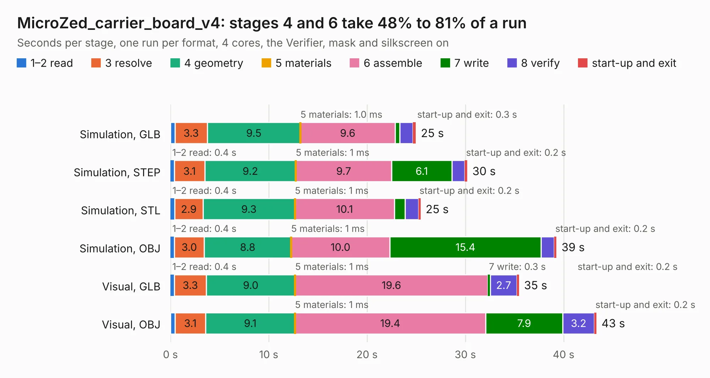

# 2969. MicroZed_carrier_board_v4

Board 2,969 of the 3,120 of [Corpus Testing](../Corpus-Testing.md), on [Corpus Page 28](../CorpusTestingPages/Corpus-Testing-28.md#2969-microzed_carrier_board_v4).

| Mode and format | 1–2 read | 3 resolve | 4 geometry | 5 materials | 6 assemble | 7 write | 8 verify | start-up and exit | Total |
|---|---:|---:|---:|---:|---:|---:|---:|---:|---:|
| Simulation, GLB | 0.5 | 3.3 | 9.5 | 1.0&nbsp;ms | 9.6 | 0.5 | 1.4 | 0.3 | 25.0 |
| Simulation, STEP | 0.4 | 3.1 | 9.2 | 1&nbsp;ms | 9.7 | 6.1 | 1.3 | 0.2 | 30.2 |
| Simulation, STL | 0.4 | 2.9 | 9.3 | 1&nbsp;ms | 10.1 | 1.1 | 1.4 | 0.2 | 25.5 |
| Simulation, OBJ | 0.4 | 3.0 | 8.8 | 1&nbsp;ms | 10.0 | 15.4 | 1.3 | 0.2 | 39.3 |
| Visual, GLB | 0.4 | 3.3 | 9.0 | 1&nbsp;ms | 19.6 | 0.3 | 2.7 | 0.2 | 35.5 |
| Visual, OBJ | 0.5 | 3.1 | 9.1 | 1&nbsp;ms | 19.4 | 7.9 | 3.2 | 0.2 | 43.3 |

<table align="center"><tr><td valign="top">

| Board | Repo: [viktor-nikolov/microzed-carrier-board](https://github.com/viktor-nikolov/microzed-carrier-board) Board: `MicroZed_carrier_board_v4.kicad_pcb` |
|---|---|
| Folder | KiCad_and_production_files |
| Complexity | 312&nbsp;/&nbsp;1000 (size&nbsp;222, features&nbsp;90) |
| KESE&nbsp;features | through vias, slotted holes, rounded, trapezoid or chamfered pads, arc tracks, curved board outline, stack-up, dielectric εr and tanδ |
| Tested | 9th November 2026 |
| Copper&nbsp;layers | 6 |
| File&nbsp;format | KiCad 7 (20221018) |
| Parts,&nbsp;tracks,&nbsp;vias | 91, 1,904, 296 |
| Triangles,&nbsp;simulation | 3,634,492 in 225 parts |
| Verifier | PASS in all six runs |

</td><td valign="top">

<table>
<tr><th>File type</th><th>File size</th><th>Peak memory used</th></tr>
<tr><th colspan="3" align="left">Simulation</th></tr>
<tr><td>GLB</td><td align="right">120&nbsp;MB</td><td align="right">995&nbsp;MB</td></tr>
<tr><td>STEP</td><td align="right">370&nbsp;MB</td><td align="right">1.3&nbsp;GB</td></tr>
<tr><td>STL</td><td align="right">182&nbsp;MB</td><td align="right">1.0&nbsp;GB</td></tr>
<tr><td>OBJ</td><td align="right">379&nbsp;MB</td><td align="right">2.3&nbsp;GB</td></tr>
<tr><th colspan="3" align="left">Visual</th></tr>
<tr><td>GLB</td><td align="right">63&nbsp;MB</td><td align="right">1.3&nbsp;GB</td></tr>
<tr><td>OBJ</td><td align="right">197&nbsp;MB</td><td align="right">1.4&nbsp;GB</td></tr>
</table>

</td></tr></table>

| Previous | Next |
|:---|---:|
| [2968. VB-IoT1_v1](b2968b_VB-IoT1_VB-IoT1-v1.md) | [2970. vimdrones_esc_development_board](b2970b_AM32-esc-development-board_vimdrones-esc-development-board.md) |
