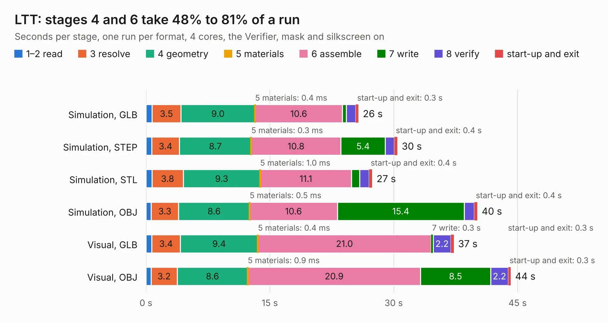

# 2971. LTT

Board 2,971 of the 3,104 of [Corpus Testing](../Corpus-Testing.md), on [Corpus Page 28](../CorpusTestingPages/Corpus-Testing-28.md#2971-ltt).

| Mode and format | 1–2 read | 3 resolve | 4 geometry | 5 materials | 6 assemble | 7 write | 8 verify | start-up and exit | Total |
|---|---:|---:|---:|---:|---:|---:|---:|---:|---:|
| Simulation, GLB | 0.7 | 3.5 | 9.0 | 0.4&nbsp;ms | 10.6 | 0.5 | 1.2 | 0.3 | 25.7 |
| Simulation, STEP | 0.7 | 3.4 | 8.7 | 0.3&nbsp;ms | 10.8 | 5.4 | 1.1 | 0.4 | 30.5 |
| Simulation, STL | 0.7 | 3.8 | 9.3 | 1.0&nbsp;ms | 11.1 | 1.0 | 1.2 | 0.4 | 27.4 |
| Simulation, OBJ | 0.6 | 3.3 | 8.6 | 0.5&nbsp;ms | 10.6 | 15.4 | 1.2 | 0.4 | 40.1 |
| Visual, GLB | 0.7 | 3.4 | 9.4 | 0.4&nbsp;ms | 21.0 | 0.3 | 2.2 | 0.3 | 37.3 |
| Visual, OBJ | 0.6 | 3.2 | 8.6 | 0.9&nbsp;ms | 20.9 | 8.5 | 2.2 | 0.3 | 44.2 |

<table align="center"><tr><td valign="top">

| Board | Repo: [waterloo-rocketry/canhw](https://github.com/waterloo-rocketry/canhw) Board: `LTT.kicad_pcb` |
|---|---|
| Folder | live_telemetry / LTT |
| Complexity | 353&nbsp;/&nbsp;1000 (size&nbsp;253, features&nbsp;100) |
| KESE&nbsp;features | through vias, rounded, trapezoid or chamfered pads, arc tracks, filled zones, curved board outline, stack-up, dielectric εr and tanδ |
| Tested | 10th November 2026 |
| Copper&nbsp;layers | 4 |
| File&nbsp;format | KiCad 9 (20241229) |
| Parts,&nbsp;tracks,&nbsp;vias | 100, 545, 705 |
| Triangles,&nbsp;simulation | 2,420,870 in 95 parts |
| Verifier | PASS in all six runs |

</td><td valign="top">

<table>
<tr><th>File type</th><th>File size</th><th>Peak memory used</th></tr>
<tr><th colspan="3" align="left">Simulation</th></tr>
<tr><td>GLB</td><td align="right">82&nbsp;MB</td><td align="right">946&nbsp;MB</td></tr>
<tr><td>STEP</td><td align="right">221&nbsp;MB</td><td align="right">1.2&nbsp;GB</td></tr>
<tr><td>STL</td><td align="right">121&nbsp;MB</td><td align="right">1.1&nbsp;GB</td></tr>
<tr><td>OBJ</td><td align="right">252&nbsp;MB</td><td align="right">1.6&nbsp;GB</td></tr>
<tr><th colspan="3" align="left">Visual</th></tr>
<tr><td>GLB</td><td align="right">47&nbsp;MB</td><td align="right">889&nbsp;MB</td></tr>
<tr><td>OBJ</td><td align="right">145&nbsp;MB</td><td align="right">1.0&nbsp;GB</td></tr>
</table>

</td></tr></table>

| Previous | Next |
|:---|---:|
| [2970. telemetry_transmitter](b2970b_canhw_telemetry-transmitter.md) | [2972. power-splitter](b2972b_canhw_power-splitter.md) |
