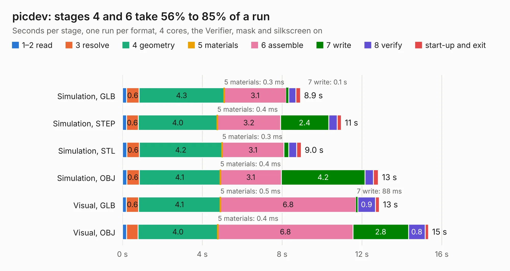

# 2971. picdev

Board 2,971 of the 3,101 of [Corpus Testing](../Corpus-Testing.md), on [Corpus Page 28](../CorpusTestingPages/Corpus-Testing-28.md#2971-picdev).

| Mode and format | 1–2 read | 3 resolve | 4 geometry | 5 materials | 6 assemble | 7 write | 8 verify | start-up and exit | Total |
|---|---:|---:|---:|---:|---:|---:|---:|---:|---:|
| Simulation, GLB | 0.2 | 0.6 | 4.3 | 0.3&nbsp;ms | 3.1 | 0.1 | 0.4 | 0.2 | 8.9 |
| Simulation, STEP | 0.2 | 0.6 | 4.0 | 0.4&nbsp;ms | 3.2 | 2.4 | 0.4 | 0.2 | 11.0 |
| Simulation, STL | 0.2 | 0.6 | 4.2 | 0.3&nbsp;ms | 3.1 | 0.2 | 0.4 | 0.2 | 9.0 |
| Simulation, OBJ | 0.2 | 0.6 | 4.1 | 0.4&nbsp;ms | 3.1 | 4.2 | 0.4 | 0.3 | 12.8 |
| Visual, GLB | 0.2 | 0.6 | 4.1 | 0.5&nbsp;ms | 6.8 | 88&nbsp;ms | 0.9 | 0.2 | 12.9 |
| Visual, OBJ | 0.2 | 0.6 | 4.0 | 0.4&nbsp;ms | 6.8 | 2.8 | 0.8 | 0.2 | 15.3 |

<table align="center"><tr><td valign="top">

| Board | Repo: [waterloo-rocketry/canhw](https://github.com/waterloo-rocketry/canhw) Board: `picdev.kicad_pcb` |
|---|---|
| Folder | picdev / picdev |
| Complexity | 185&nbsp;/&nbsp;1000 (size&nbsp;150, features&nbsp;35) |
| KESE&nbsp;features | through vias, filled zones |
| Tested | 9th November 2026 |
| Copper&nbsp;layers | 2 |
| File&nbsp;format | KiCad 5 (20171130) |
| Parts,&nbsp;tracks,&nbsp;vias | 45, 239, 12 |
| Triangles,&nbsp;simulation | 994,038 in 72 parts |
| Verifier | PASS in all six runs |

</td><td valign="top">

<table>
<tr><th>File type</th><th>File size</th><th>Peak memory used</th></tr>
<tr><th colspan="3" align="left">Simulation</th></tr>
<tr><td>GLB</td><td align="right">34&nbsp;MB</td><td align="right">449&nbsp;MB</td></tr>
<tr><td>STEP</td><td align="right">182&nbsp;MB</td><td align="right">505&nbsp;MB</td></tr>
<tr><td>STL</td><td align="right">50&nbsp;MB</td><td align="right">446&nbsp;MB</td></tr>
<tr><td>OBJ</td><td align="right">102&nbsp;MB</td><td align="right">704&nbsp;MB</td></tr>
<tr><th colspan="3" align="left">Visual</th></tr>
<tr><td>GLB</td><td align="right">22&nbsp;MB</td><td align="right">548&nbsp;MB</td></tr>
<tr><td>OBJ</td><td align="right">64&nbsp;MB</td><td align="right">558&nbsp;MB</td></tr>
</table>

</td></tr></table>

| Previous | Next |
|:---|---:|
| [2970. novatel_gps_breakout](b2970b_canhw_novatel-gps-breakout.md) | [2972. processor](b2972b_canhw_processor.md) |
