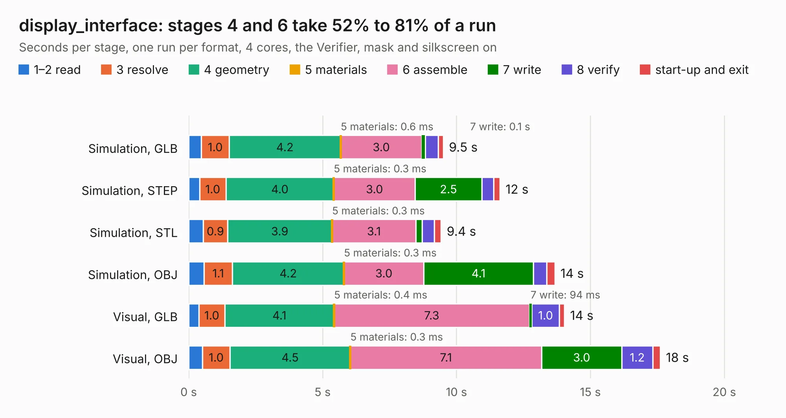

# 2972. display_interface

Board 2,972 of the 3,129 of [Corpus Testing](../Corpus-Testing.md), on [Corpus Page 28](../CorpusTestingPages/Corpus-Testing-28.md#2972-display_interface).

| Mode and format | 1–2 read | 3 resolve | 4 geometry | 5 materials | 6 assemble | 7 write | 8 verify | start-up and exit | Total |
|---|---:|---:|---:|---:|---:|---:|---:|---:|---:|
| Simulation, GLB | 0.5 | 1.0 | 4.2 | 0.6&nbsp;ms | 3.0 | 0.1 | 0.5 | 0.2 | 9.5 |
| Simulation, STEP | 0.4 | 1.0 | 4.0 | 0.3&nbsp;ms | 3.0 | 2.5 | 0.4 | 0.2 | 11.6 |
| Simulation, STL | 0.5 | 0.9 | 3.9 | 0.3&nbsp;ms | 3.1 | 0.2 | 0.5 | 0.3 | 9.4 |
| Simulation, OBJ | 0.6 | 1.1 | 4.2 | 0.3&nbsp;ms | 3.0 | 4.1 | 0.5 | 0.3 | 13.7 |
| Visual, GLB | 0.4 | 1.0 | 4.1 | 0.4&nbsp;ms | 7.3 | 94&nbsp;ms | 1.0 | 0.2 | 14.0 |
| Visual, OBJ | 0.5 | 1.0 | 4.5 | 0.3&nbsp;ms | 7.1 | 3.0 | 1.2 | 0.3 | 17.6 |

<table align="center"><tr><td valign="top">

| Board | Repo: [vascofazza/8bit-cpu](https://github.com/vascofazza/8bit-cpu) Board: `display_interface.kicad_pcb` |
|---|---|
| Folder | helix_display_interface / display_interface |
| Complexity | 227&nbsp;/&nbsp;1000 (size&nbsp;147, features&nbsp;80) |
| KESE&nbsp;features | through vias, custom pads, filled zones, copper drawings, copper text, curved board outline |
| Tested | 9th November 2026 |
| Copper&nbsp;layers | 2 |
| File&nbsp;format | KiCad 5 (20171130) |
| Parts,&nbsp;tracks,&nbsp;vias | 10, 554, 5 |
| Triangles,&nbsp;simulation | 871,560 in 43 parts |
| Verifier | PASS in all six runs |

</td><td valign="top">

<table>
<tr><th>File type</th><th>File size</th><th>Peak memory used</th></tr>
<tr><th colspan="3" align="left">Simulation</th></tr>
<tr><td>GLB</td><td align="right">31&nbsp;MB</td><td align="right">384&nbsp;MB</td></tr>
<tr><td>STEP</td><td align="right">172&nbsp;MB</td><td align="right">461&nbsp;MB</td></tr>
<tr><td>STL</td><td align="right">44&nbsp;MB</td><td align="right">389&nbsp;MB</td></tr>
<tr><td>OBJ</td><td align="right">90&nbsp;MB</td><td align="right">636&nbsp;MB</td></tr>
<tr><th colspan="3" align="left">Visual</th></tr>
<tr><td>GLB</td><td align="right">21&nbsp;MB</td><td align="right">483&nbsp;MB</td></tr>
<tr><td>OBJ</td><td align="right">63&nbsp;MB</td><td align="right">529&nbsp;MB</td></tr>
</table>

</td></tr></table>

| Previous | Next |
|:---|---:|
| [2971. arduino_eeprom_programmer](b2971b_8bit-cpu_arduino-eeprom-programmer.md) | [2973. 8bit-computer](b2973b_8bit-cpu_8bit-computer.md) |
