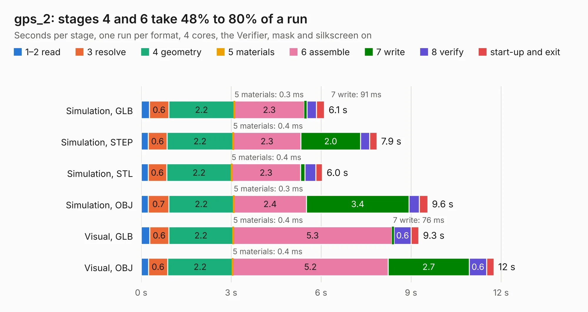

# 2973. gps_2

Board 2,973 of the 3,109 of [Corpus Testing](../Corpus-Testing.md), on [Corpus Page 28](../CorpusTestingPages/Corpus-Testing-28.md#2973-gps_2).

| Mode and format | 1–2 read | 3 resolve | 4 geometry | 5 materials | 6 assemble | 7 write | 8 verify | start-up and exit | Total |
|---|---:|---:|---:|---:|---:|---:|---:|---:|---:|
| Simulation, GLB | 0.3 | 0.6 | 2.2 | 0.3&nbsp;ms | 2.3 | 91&nbsp;ms | 0.3 | 0.3 | 6.1 |
| Simulation, STEP | 0.2 | 0.6 | 2.2 | 0.4&nbsp;ms | 2.3 | 2.0 | 0.3 | 0.2 | 7.9 |
| Simulation, STL | 0.2 | 0.6 | 2.2 | 0.4&nbsp;ms | 2.3 | 0.1 | 0.4 | 0.2 | 6.0 |
| Simulation, OBJ | 0.2 | 0.7 | 2.2 | 0.3&nbsp;ms | 2.4 | 3.4 | 0.3 | 0.3 | 9.6 |
| Visual, GLB | 0.3 | 0.6 | 2.2 | 0.4&nbsp;ms | 5.3 | 76&nbsp;ms | 0.6 | 0.3 | 9.3 |
| Visual, OBJ | 0.2 | 0.6 | 2.2 | 0.4&nbsp;ms | 5.2 | 2.7 | 0.6 | 0.2 | 11.8 |

<table align="center"><tr><td valign="top">

| Board | Repo: [waterloo-rocketry/canhw](https://github.com/waterloo-rocketry/canhw) Board: `gps_2.kicad_pcb` |
|---|---|
| Folder | gps |
| Complexity | 254&nbsp;/&nbsp;1000 (size&nbsp;164, features&nbsp;90) |
| KESE&nbsp;features | through vias, rounded, trapezoid or chamfered pads, filled zones, curved board outline, stack-up, dielectric εr and tanδ, mask and silkscreen colours |
| Tested | 9th November 2026 |
| Copper&nbsp;layers | 2 |
| File&nbsp;format | KiCad 9 (20241229) |
| Parts,&nbsp;tracks,&nbsp;vias | 37, 264, 151 |
| Triangles,&nbsp;simulation | 566,746 in 57 parts |
| Verifier | PASS in all six runs |

</td><td valign="top">

<table>
<tr><th>File type</th><th>File size</th><th>Peak memory used</th></tr>
<tr><th colspan="3" align="left">Simulation</th></tr>
<tr><td>GLB</td><td align="right">20&nbsp;MB</td><td align="right">354&nbsp;MB</td></tr>
<tr><td>STEP</td><td align="right">93&nbsp;MB</td><td align="right">410&nbsp;MB</td></tr>
<tr><td>STL</td><td align="right">28&nbsp;MB</td><td align="right">337&nbsp;MB</td></tr>
<tr><td>OBJ</td><td align="right">58&nbsp;MB</td><td align="right">429&nbsp;MB</td></tr>
<tr><th colspan="3" align="left">Visual</th></tr>
<tr><td>GLB</td><td align="right">16&nbsp;MB</td><td align="right">415&nbsp;MB</td></tr>
<tr><td>OBJ</td><td align="right">49&nbsp;MB</td><td align="right">429&nbsp;MB</td></tr>
</table>

</td></tr></table>

| Previous | Next |
|:---|---:|
| [2972. DAQ CAN support](b2972b_canhw_DAQ-CAN-support.md) | [2974. injector_sensor_hub](b2974b_canhw_injector-sensor-hub.md) |
