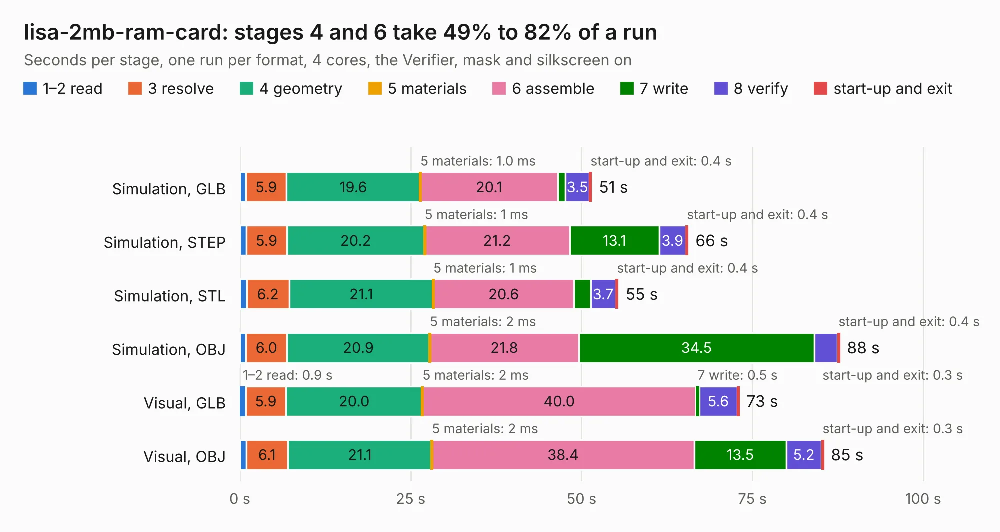

# 2974. lisa-2mb-ram-card

Board 2,974 of the 3,119 of [Corpus Testing](../Corpus-Testing.md), on [Corpus Page 28](../CorpusTestingPages/Corpus-Testing-28.md#2974-lisa-2mb-ram-card).

| Mode and format | 1–2 read | 3 resolve | 4 geometry | 5 materials | 6 assemble | 7 write | 8 verify | start-up and exit | Total |
|---|---:|---:|---:|---:|---:|---:|---:|---:|---:|
| Simulation, GLB | 0.9 | 5.9 | 19.6 | 1.0&nbsp;ms | 20.1 | 1.1 | 3.5 | 0.4 | 51.5 |
| Simulation, STEP | 1.0 | 5.9 | 20.2 | 1&nbsp;ms | 21.2 | 13.1 | 3.9 | 0.4 | 65.6 |
| Simulation, STL | 1.0 | 6.2 | 21.1 | 1&nbsp;ms | 20.6 | 2.4 | 3.7 | 0.4 | 55.4 |
| Simulation, OBJ | 0.9 | 6.0 | 20.9 | 2&nbsp;ms | 21.8 | 34.5 | 3.4 | 0.4 | 87.8 |
| Visual, GLB | 0.9 | 5.9 | 20.0 | 2&nbsp;ms | 40.0 | 0.5 | 5.6 | 0.3 | 73.1 |
| Visual, OBJ | 0.9 | 6.1 | 21.1 | 2&nbsp;ms | 38.4 | 13.5 | 5.2 | 0.3 | 85.5 |

<table align="center"><tr><td valign="top">

| Board | Repo: [warmech/lisa-2mb-ram-card](https://github.com/warmech/lisa-2mb-ram-card) Board: `lisa-2mb-ram-card.kicad_pcb` |
|---|---|
| Folder | cad |
| Complexity | 288&nbsp;/&nbsp;1000 (size&nbsp;213, features&nbsp;75) |
| KESE&nbsp;features | through vias, filled zones, curved board outline, stack-up, dielectric εr and tanδ |
| Tested | 9th November 2026 |
| Copper&nbsp;layers | 4 |
| File&nbsp;format | KiCad 7 (20221018) |
| Parts,&nbsp;tracks,&nbsp;vias | 74, 2,945, 150 |
| Triangles,&nbsp;simulation | 5,930,502 in 242 parts |
| Verifier | PASS in all six runs |

</td><td valign="top">

<table>
<tr><th>File type</th><th>File size</th><th>Peak memory used</th></tr>
<tr><th colspan="3" align="left">Simulation</th></tr>
<tr><td>GLB</td><td align="right">200&nbsp;MB</td><td align="right">1.5&nbsp;GB</td></tr>
<tr><td>STEP</td><td align="right">693&nbsp;MB</td><td align="right">1.9&nbsp;GB</td></tr>
<tr><td>STL</td><td align="right">297&nbsp;MB</td><td align="right">1.4&nbsp;GB</td></tr>
<tr><td>OBJ</td><td align="right">632&nbsp;MB</td><td align="right">3.7&nbsp;GB</td></tr>
<tr><th colspan="3" align="left">Visual</th></tr>
<tr><td>GLB</td><td align="right">88&nbsp;MB</td><td align="right">1.6&nbsp;GB</td></tr>
<tr><td>OBJ</td><td align="right">281&nbsp;MB</td><td align="right">2.0&nbsp;GB</td></tr>
</table>

</td></tr></table>

| Previous | Next |
|:---|---:|
| [2973. altair-8800b-display-control-pcb](b2973b_altair-8800b-display-control-pcb_altair-8800b-display-control-pcb.md) | [2975. cpu-card](b2975b_lisa-cpu-card_cpu-card.md) |
