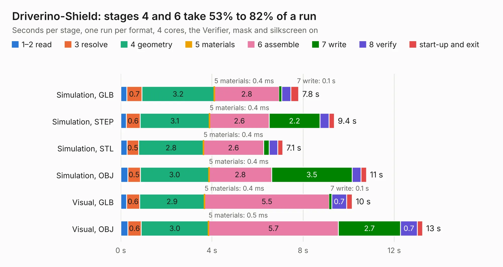

# 2976. Driverino-Shield

Board 2,976 of the 3,100 of [Corpus Testing](../Corpus-Testing.md), on [Corpus Page 28](../CorpusTestingPages/Corpus-Testing-28.md#2976-driverino-shield).

| Mode and format | 1–2 read | 3 resolve | 4 geometry | 5 materials | 6 assemble | 7 write | 8 verify | start-up and exit | Total |
|---|---:|---:|---:|---:|---:|---:|---:|---:|---:|
| Simulation, GLB | 0.3 | 0.7 | 3.2 | 0.4&nbsp;ms | 2.8 | 0.1 | 0.4 | 0.4 | 7.8 |
| Simulation, STEP | 0.2 | 0.6 | 3.1 | 0.4&nbsp;ms | 2.6 | 2.2 | 0.4 | 0.2 | 9.4 |
| Simulation, STL | 0.3 | 0.5 | 2.8 | 0.4&nbsp;ms | 2.6 | 0.2 | 0.4 | 0.2 | 7.1 |
| Simulation, OBJ | 0.3 | 0.5 | 3.0 | 0.4&nbsp;ms | 2.8 | 3.5 | 0.4 | 0.2 | 10.8 |
| Visual, GLB | 0.3 | 0.6 | 2.9 | 0.4&nbsp;ms | 5.5 | 0.1 | 0.7 | 0.2 | 10.2 |
| Visual, OBJ | 0.3 | 0.6 | 3.0 | 0.5&nbsp;ms | 5.7 | 2.7 | 0.7 | 0.2 | 13.2 |

<table align="center"><tr><td valign="top">

| Board | Repo: [weirdgyn/Driverino-Shield](https://github.com/weirdgyn/Driverino-Shield) Board: `Driverino-Shield.kicad_pcb` |
|---|---|
| Folder | PCB |
| Complexity | 241&nbsp;/&nbsp;1000 (size&nbsp;196, features&nbsp;45) |
| KESE&nbsp;features | through vias, rounded, trapezoid or chamfered pads, filled zones |
| Tested | 9th November 2026 |
| Copper&nbsp;layers | 2 |
| File&nbsp;format | KiCad 8 (20240108) |
| Parts,&nbsp;tracks,&nbsp;vias | 52, 229, 45 |
| Triangles,&nbsp;simulation | 743,350 in 58 parts |
| Verifier | PASS in all six runs |

</td><td valign="top">

<table>
<tr><th>File type</th><th>File size</th><th>Peak memory used</th></tr>
<tr><th colspan="3" align="left">Simulation</th></tr>
<tr><td>GLB</td><td align="right">25&nbsp;MB</td><td align="right">372&nbsp;MB</td></tr>
<tr><td>STEP</td><td align="right">120&nbsp;MB</td><td align="right">455&nbsp;MB</td></tr>
<tr><td>STL</td><td align="right">37&nbsp;MB</td><td align="right">360&nbsp;MB</td></tr>
<tr><td>OBJ</td><td align="right">75&nbsp;MB</td><td align="right">551&nbsp;MB</td></tr>
<tr><th colspan="3" align="left">Visual</th></tr>
<tr><td>GLB</td><td align="right">18&nbsp;MB</td><td align="right">458&nbsp;MB</td></tr>
<tr><td>OBJ</td><td align="right">53&nbsp;MB</td><td align="right">442&nbsp;MB</td></tr>
</table>

</td></tr></table>

| Previous | Next |
|:---|---:|
| [2975. usbdbg](b2975b_canhw_usbdbg.md) | [2977. FourThirdsEye](b2977b_FourThirdsEye_FourThirdsEye.md) |
