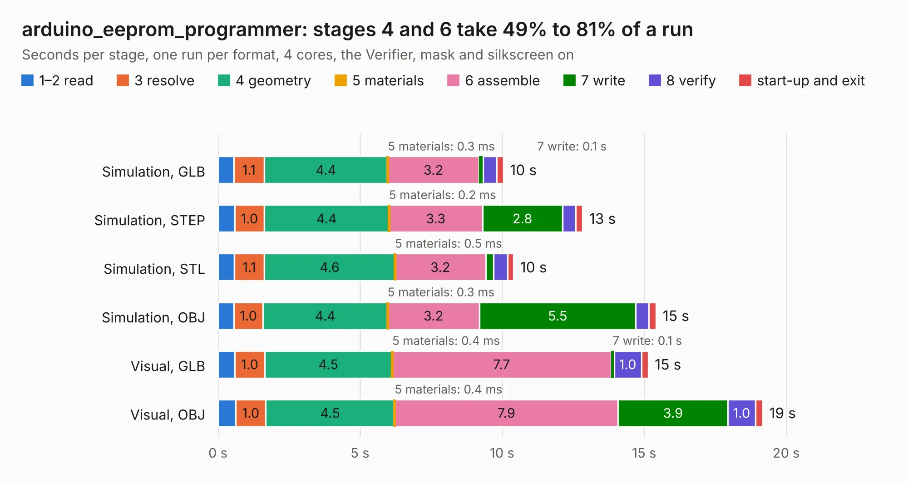

# 2980 arduino_eeprom_programmer

Board 2,980 of the 3,138 of [Corpus Testing](../Corpus-Testing.md), on [Corpus Page 28](../CorpusTestingPages/Corpus-Testing-28.md#2980-arduino_eeprom_programmer).

| Mode and format | 1–2 read | 3 resolve | 4 geometry | 5 materials | 6 assemble | 7 write | 8 verify | start-up and exit | Total |
|---|---:|---:|---:|---:|---:|---:|---:|---:|---:|
| Simulation, GLB | 0.6 | 1.1 | 4.4 | 0.3&nbsp;ms | 3.2 | 0.1 | 0.5 | 0.2 | 10.0 |
| Simulation, STEP | 0.6 | 1.0 | 4.4 | 0.2&nbsp;ms | 3.3 | 2.8 | 0.5 | 0.2 | 12.8 |
| Simulation, STL | 0.6 | 1.1 | 4.6 | 0.5&nbsp;ms | 3.2 | 0.3 | 0.5 | 0.2 | 10.4 |
| Simulation, OBJ | 0.6 | 1.0 | 4.4 | 0.3&nbsp;ms | 3.2 | 5.5 | 0.5 | 0.3 | 15.4 |
| Visual, GLB | 0.6 | 1.0 | 4.5 | 0.4&nbsp;ms | 7.7 | 0.1 | 1.0 | 0.2 | 15.1 |
| Visual, OBJ | 0.6 | 1.0 | 4.5 | 0.4&nbsp;ms | 7.9 | 3.9 | 1.0 | 0.3 | 19.2 |

<table align="center"><tr><td valign="top">

| Board | Repo: [vascofazza/8bit-cpu](https://github.com/vascofazza/8bit-cpu) Board: `arduino_eeprom_programmer.kicad_pcb` |
|---|---|
| Folder | eeprom_programmer / arduino_eeprom_programmer |
| Complexity | 191&nbsp;/&nbsp;1000 (size&nbsp;136, features&nbsp;55) |
| KESE&nbsp;features | through vias, filled zones, copper drawings, copper text |
| Tested | 9th November 2026 |
| Copper&nbsp;layers | 2 |
| File&nbsp;format | KiCad 5 (20171130) |
| Parts,&nbsp;tracks,&nbsp;vias | 8, 317, 4 |
| Triangles,&nbsp;simulation | 926,940 in 45 parts |
| Verifier | PASS in all six runs |

</td><td valign="top">

<table>
<tr><th>File type</th><th>File size</th><th>Peak memory used</th></tr>
<tr><th colspan="3" align="left">Simulation</th></tr>
<tr><td>GLB</td><td align="right">32&nbsp;MB</td><td align="right">418&nbsp;MB</td></tr>
<tr><td>STEP</td><td align="right">177&nbsp;MB</td><td align="right">482&nbsp;MB</td></tr>
<tr><td>STL</td><td align="right">46&nbsp;MB</td><td align="right">409&nbsp;MB</td></tr>
<tr><td>OBJ</td><td align="right">95&nbsp;MB</td><td align="right">669&nbsp;MB</td></tr>
<tr><th colspan="3" align="left">Visual</th></tr>
<tr><td>GLB</td><td align="right">22&nbsp;MB</td><td align="right">526&nbsp;MB</td></tr>
<tr><td>OBJ</td><td align="right">64&nbsp;MB</td><td align="right">533&nbsp;MB</td></tr>
</table>

</td></tr></table>

| Previous | Next |
|:---|---:|
| [2979 bus_breakout](b2979b_8bit-cpu_bus-breakout.md) | [2981 display_interface](b2981b_8bit-cpu_display-interface.md) |
