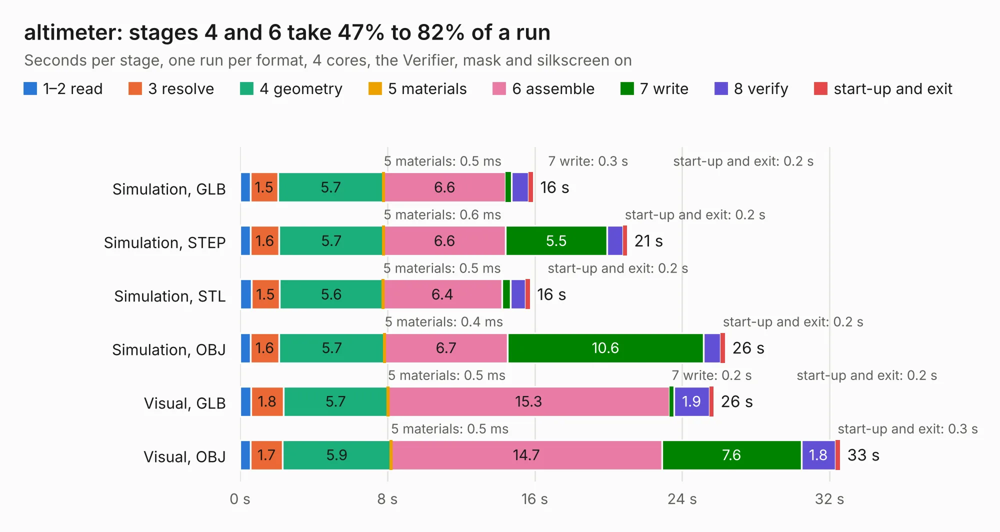

# 2980. altimeter

Board 2,980 of the 3,123 of [Corpus Testing](../Corpus-Testing.md), on [Corpus Page 28](../CorpusTestingPages/Corpus-Testing-28.md#2980-altimeter).

| Mode and format | 1–2 read | 3 resolve | 4 geometry | 5 materials | 6 assemble | 7 write | 8 verify | start-up and exit | Total |
|---|---:|---:|---:|---:|---:|---:|---:|---:|---:|
| Simulation, GLB | 0.6 | 1.5 | 5.7 | 0.5&nbsp;ms | 6.6 | 0.3 | 0.9 | 0.2 | 15.9 |
| Simulation, STEP | 0.6 | 1.6 | 5.7 | 0.6&nbsp;ms | 6.6 | 5.5 | 0.9 | 0.2 | 21.0 |
| Simulation, STL | 0.6 | 1.5 | 5.6 | 0.5&nbsp;ms | 6.4 | 0.5 | 0.8 | 0.2 | 15.7 |
| Simulation, OBJ | 0.6 | 1.6 | 5.7 | 0.4&nbsp;ms | 6.7 | 10.6 | 0.9 | 0.2 | 26.3 |
| Visual, GLB | 0.6 | 1.8 | 5.7 | 0.5&nbsp;ms | 15.3 | 0.2 | 1.9 | 0.2 | 25.7 |
| Visual, OBJ | 0.6 | 1.7 | 5.9 | 0.5&nbsp;ms | 14.7 | 7.6 | 1.8 | 0.3 | 32.6 |

<table align="center"><tr><td valign="top">

| Board | Repo: [waterloo-rocketry/canhw](https://github.com/waterloo-rocketry/canhw) Board: `altimeter.kicad_pcb` |
|---|---|
| Folder | altimeter |
| Complexity | 374&nbsp;/&nbsp;1000 (size&nbsp;249, features&nbsp;125) |
| KESE&nbsp;features | through vias, custom pads, rounded, trapezoid or chamfered pads, arc tracks, filled zones, copper drawings, curved board outline, stack-up, dielectric εr and tanδ |
| Tested | 9th November 2026 |
| Copper&nbsp;layers | 4 |
| File&nbsp;format | KiCad 8 (20240108) |
| Parts,&nbsp;tracks,&nbsp;vias | 137, 1,234, 161 |
| Triangles,&nbsp;simulation | 1,893,396 in 162 parts |
| Verifier | PASS in all six runs |

</td><td valign="top">

<table>
<tr><th>File type</th><th>File size</th><th>Peak memory used</th></tr>
<tr><th colspan="3" align="left">Simulation</th></tr>
<tr><td>GLB</td><td align="right">64&nbsp;MB</td><td align="right">731&nbsp;MB</td></tr>
<tr><td>STEP</td><td align="right">283&nbsp;MB</td><td align="right">849&nbsp;MB</td></tr>
<tr><td>STL</td><td align="right">95&nbsp;MB</td><td align="right">705&nbsp;MB</td></tr>
<tr><td>OBJ</td><td align="right">196&nbsp;MB</td><td align="right">1.3&nbsp;GB</td></tr>
<tr><th colspan="3" align="left">Visual</th></tr>
<tr><td>GLB</td><td align="right">46&nbsp;MB</td><td align="right">868&nbsp;MB</td></tr>
<tr><td>OBJ</td><td align="right">140&nbsp;MB</td><td align="right">979&nbsp;MB</td></tr>
</table>

</td></tr></table>

| Previous | Next |
|:---|---:|
| [2979. cpu-card](b2979b_lisa-cpu-card_cpu-card.md) | [2981. camera](b2981b_canhw_camera.md) |
