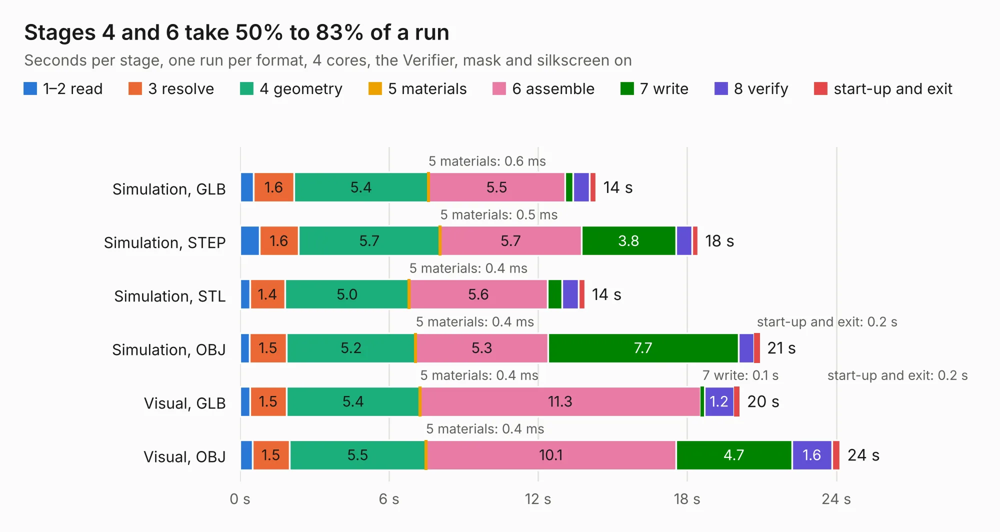

# 2982. vimdrones_esc_development_board

Board 2,982 of the 3,132 of [Corpus Testing](../Corpus-Testing.md), on [Corpus Page 28](../CorpusTestingPages/Corpus-Testing-28.md#2982-vimdrones_esc_development_board).

| Mode and format | 1–2 read | 3 resolve | 4 geometry | 5 materials | 6 assemble | 7 write | 8 verify | start-up and exit | Total |
|---|---:|---:|---:|---:|---:|---:|---:|---:|---:|
| Simulation, GLB | 0.5 | 1.6 | 5.4 | 0.6&nbsp;ms | 5.5 | 0.3 | 0.7 | 0.3 | 14.3 |
| Simulation, STEP | 0.8 | 1.6 | 5.7 | 0.5&nbsp;ms | 5.7 | 3.8 | 0.6 | 0.2 | 18.4 |
| Simulation, STL | 0.4 | 1.4 | 5.0 | 0.4&nbsp;ms | 5.6 | 0.6 | 0.7 | 0.3 | 13.9 |
| Simulation, OBJ | 0.4 | 1.5 | 5.2 | 0.4&nbsp;ms | 5.3 | 7.7 | 0.6 | 0.2 | 20.9 |
| Visual, GLB | 0.4 | 1.5 | 5.4 | 0.4&nbsp;ms | 11.3 | 0.1 | 1.2 | 0.2 | 20.1 |
| Visual, OBJ | 0.5 | 1.5 | 5.5 | 0.4&nbsp;ms | 10.1 | 4.7 | 1.6 | 0.3 | 24.1 |

<table align="center"><tr><td valign="top">

| Board | Repo: [VimDrones/AM32_esc_development_board](https://github.com/VimDrones/AM32_esc_development_board) Board: `vimdrones_esc_development_board.kicad_pcb` |
|---|---|
| Complexity | 366&nbsp;/&nbsp;1000 (size&nbsp;241, features&nbsp;125) |
| KESE&nbsp;features | through vias, custom pads, rounded, trapezoid or chamfered pads, filled zones, copper drawings, curved board outline, knockout text, stack-up, dielectric εr and tanδ |
| Tested | 9th November 2026 |
| Copper&nbsp;layers | 4 |
| File&nbsp;format | KiCad 8 (20240108) |
| Parts,&nbsp;tracks,&nbsp;vias | 82, 650, 292 |
| Triangles,&nbsp;simulation | 1,569,380 in 81 parts |
| Verifier | PASS in all six runs |

</td><td valign="top">

<table>
<tr><th>File type</th><th>File size</th><th>Peak memory used</th></tr>
<tr><th colspan="3" align="left">Simulation</th></tr>
<tr><td>GLB</td><td align="right">53&nbsp;MB</td><td align="right">564&nbsp;MB</td></tr>
<tr><td>STEP</td><td align="right">211&nbsp;MB</td><td align="right">712&nbsp;MB</td></tr>
<tr><td>STL</td><td align="right">78&nbsp;MB</td><td align="right">564&nbsp;MB</td></tr>
<tr><td>OBJ</td><td align="right">161&nbsp;MB</td><td align="right">1.0&nbsp;GB</td></tr>
<tr><th colspan="3" align="left">Visual</th></tr>
<tr><td>GLB</td><td align="right">32&nbsp;MB</td><td align="right">682&nbsp;MB</td></tr>
<tr><td>OBJ</td><td align="right">96&nbsp;MB</td><td align="right">740&nbsp;MB</td></tr>
</table>

</td></tr></table>

| Previous | Next |
|:---|---:|
| [2981. MicroZed_carrier_board_v4](b2981b_microzed-carrier-board_MicroZed-carrier-board-v4.md) | [2983. Tangenta](b2983b_tangenta_Tangenta.md) |
