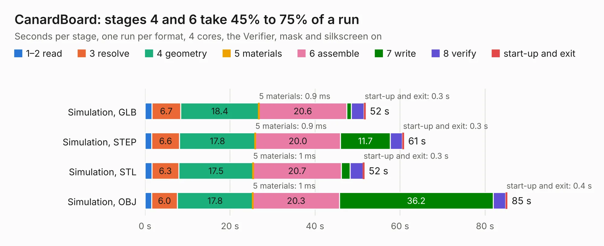

# 2982. CanardBoard

Board 2,982 of the 3,120 of [Corpus Testing](../Corpus-Testing.md), on [Corpus Page 28](../CorpusTestingPages/Corpus-Testing-28.md#2982-canardboard).

| Mode and format | 1–2 read | 3 resolve | 4 geometry | 5 materials | 6 assemble | 7 write | 8 verify | start-up and exit | Total |
|---|---:|---:|---:|---:|---:|---:|---:|---:|---:|
| Simulation, GLB | 1.7 | 6.7 | 18.4 | 0.9&nbsp;ms | 20.6 | 1.1 | 3.0 | 0.3 | 51.9 |
| Simulation, STEP | 1.6 | 6.6 | 17.8 | 0.9&nbsp;ms | 20.0 | 11.7 | 2.8 | 0.3 | 60.9 |
| Simulation, STL | 1.6 | 6.3 | 17.5 | 1&nbsp;ms | 20.7 | 2.1 | 3.0 | 0.3 | 51.6 |
| Simulation, OBJ | 1.6 | 6.0 | 17.8 | 1&nbsp;ms | 20.3 | 36.2 | 2.9 | 0.4 | 85.3 |
| Visual, GLB | 1.5 | 6.1 | 17.7 | 2&nbsp;ms | 57.4 | 0.4 | 3.9 | 0.3 | 87.4 |
| Visual, OBJ | 1.5 | 6.0 | 17.9 | 0.9&nbsp;ms | 60.8 | 16.6 | 3.7 | 0.3 | 106.7 |

<table align="center"><tr><td valign="top">

| Board | Repo: [waterloo-rocketry/canhw](https://github.com/waterloo-rocketry/canhw) Board: `CanardBoard.kicad_pcb` |
|---|---|
| Folder | CanardBoard |
| Complexity | 417&nbsp;/&nbsp;1000 (size&nbsp;282, features&nbsp;135) |
| KESE&nbsp;features | through vias, slotted holes, custom pads, rounded, trapezoid or chamfered pads, arc tracks, filled zones, copper drawings, curved board outline, stack-up, dielectric εr and tanδ |
| Tested | 9th November 2026 |
| Copper&nbsp;layers | 6 |
| File&nbsp;format | KiCad 9 (20241229) |
| Parts,&nbsp;tracks,&nbsp;vias | 253, 2,085, 863 |
| Triangles,&nbsp;simulation | 6,007,234 in 258 parts |
| Verifier | PASS in all six runs |

</td><td valign="top">

<table>
<tr><th>File type</th><th>File size</th><th>Peak memory used</th></tr>
<tr><th colspan="3" align="left">Simulation</th></tr>
<tr><td>GLB</td><td align="right">200&nbsp;MB</td><td align="right">1.4&nbsp;GB</td></tr>
<tr><td>STEP</td><td align="right">567&nbsp;MB</td><td align="right">1.9&nbsp;GB</td></tr>
<tr><td>STL</td><td align="right">300&nbsp;MB</td><td align="right">1.4&nbsp;GB</td></tr>
<tr><td>OBJ</td><td align="right">645&nbsp;MB</td><td align="right">3.8&nbsp;GB</td></tr>
<tr><th colspan="3" align="left">Visual</th></tr>
<tr><td>GLB</td><td align="right">95&nbsp;MB</td><td align="right">1.9&nbsp;GB</td></tr>
<tr><td>OBJ</td><td align="right">309&nbsp;MB</td><td align="right">2.1&nbsp;GB</td></tr>
</table>

</td></tr></table>

| Previous | Next |
|:---|---:|
| [2981. AD_Breakout](b2981b_canhw_AD-Breakout.md) | [2983. DAQ CAN support](b2983b_canhw_DAQ-CAN-support.md) |
