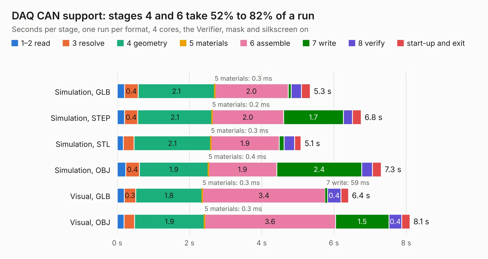

# 2983. DAQ CAN support

Board 2,983 of the 3,120 of [Corpus Testing](../Corpus-Testing.md), on [Corpus Page 28](../CorpusTestingPages/Corpus-Testing-28.md#2983-daq-can-support).

| Mode and format | 1–2 read | 3 resolve | 4 geometry | 5 materials | 6 assemble | 7 write | 8 verify | start-up and exit | Total |
|---|---:|---:|---:|---:|---:|---:|---:|---:|---:|
| Simulation, GLB | 0.2 | 0.4 | 2.1 | 0.3&nbsp;ms | 2.0 | 81&nbsp;ms | 0.3 | 0.2 | 5.3 |
| Simulation, STEP | 0.2 | 0.4 | 2.1 | 0.2&nbsp;ms | 2.0 | 1.7 | 0.3 | 0.2 | 6.8 |
| Simulation, STL | 0.2 | 0.3 | 2.1 | 0.3&nbsp;ms | 1.9 | 0.1 | 0.3 | 0.2 | 5.1 |
| Simulation, OBJ | 0.2 | 0.4 | 1.9 | 0.4&nbsp;ms | 1.9 | 2.4 | 0.3 | 0.2 | 7.3 |
| Visual, GLB | 0.2 | 0.3 | 1.8 | 0.3&nbsp;ms | 3.4 | 59&nbsp;ms | 0.4 | 0.2 | 6.4 |
| Visual, OBJ | 0.2 | 0.3 | 1.9 | 0.3&nbsp;ms | 3.6 | 1.5 | 0.4 | 0.2 | 8.1 |

<table align="center"><tr><td valign="top">

| Board | Repo: [waterloo-rocketry/canhw](https://github.com/waterloo-rocketry/canhw) Board: `DAQ CAN support.kicad_pcb` |
|---|---|
| Folder | DAQ CAN support |
| Complexity | 219&nbsp;/&nbsp;1000 (size&nbsp;149, features&nbsp;70) |
| KESE&nbsp;features | through vias, rounded, trapezoid or chamfered pads, arc tracks, filled zones, curved board outline |
| Tested | 9th November 2026 |
| Copper&nbsp;layers | 2 |
| File&nbsp;format | KiCad 7 (20221018) |
| Parts,&nbsp;tracks,&nbsp;vias | 33, 247, 20 |
| Triangles,&nbsp;simulation | 506,750 in 46 parts |
| Verifier | PASS in all six runs |

</td><td valign="top">

<table>
<tr><th>File type</th><th>File size</th><th>Peak memory used</th></tr>
<tr><th colspan="3" align="left">Simulation</th></tr>
<tr><td>GLB</td><td align="right">17&nbsp;MB</td><td align="right">305&nbsp;MB</td></tr>
<tr><td>STEP</td><td align="right">82&nbsp;MB</td><td align="right">367&nbsp;MB</td></tr>
<tr><td>STL</td><td align="right">25&nbsp;MB</td><td align="right">305&nbsp;MB</td></tr>
<tr><td>OBJ</td><td align="right">51&nbsp;MB</td><td align="right">396&nbsp;MB</td></tr>
<tr><th colspan="3" align="left">Visual</th></tr>
<tr><td>GLB</td><td align="right">12&nbsp;MB</td><td align="right">388&nbsp;MB</td></tr>
<tr><td>OBJ</td><td align="right">37&nbsp;MB</td><td align="right">353&nbsp;MB</td></tr>
</table>

</td></tr></table>

| Previous | Next |
|:---|---:|
| [2982. CanardBoard](b2982b_canhw_CanardBoard.md) | [2984. gps_2](b2984b_canhw_gps-2.md) |
