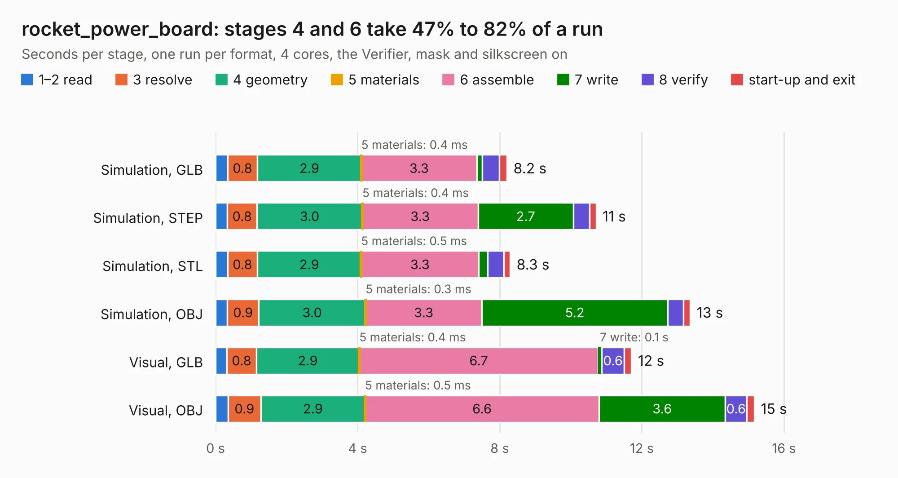

# 2983. rocket_power_board

Board 2,983 of the 3,109 of [Corpus Testing](../Corpus-Testing.md), on [Corpus Page 28](../CorpusTestingPages/Corpus-Testing-28.md#2983-rocket_power_board).

| Mode and format | 1–2 read | 3 resolve | 4 geometry | 5 materials | 6 assemble | 7 write | 8 verify | start-up and exit | Total |
|---|---:|---:|---:|---:|---:|---:|---:|---:|---:|
| Simulation, GLB | 0.3 | 0.8 | 2.9 | 0.4&nbsp;ms | 3.3 | 0.2 | 0.5 | 0.2 | 8.2 |
| Simulation, STEP | 0.3 | 0.8 | 3.0 | 0.4&nbsp;ms | 3.3 | 2.7 | 0.5 | 0.2 | 10.7 |
| Simulation, STL | 0.3 | 0.8 | 2.9 | 0.5&nbsp;ms | 3.3 | 0.2 | 0.5 | 0.2 | 8.3 |
| Simulation, OBJ | 0.3 | 0.9 | 3.0 | 0.3&nbsp;ms | 3.3 | 5.2 | 0.4 | 0.2 | 13.4 |
| Visual, GLB | 0.3 | 0.8 | 2.9 | 0.4&nbsp;ms | 6.7 | 0.1 | 0.6 | 0.2 | 11.7 |
| Visual, OBJ | 0.4 | 0.9 | 2.9 | 0.5&nbsp;ms | 6.6 | 3.6 | 0.6 | 0.2 | 15.2 |

<table align="center"><tr><td valign="top">

| Board | Repo: [waterloo-rocketry/canhw](https://github.com/waterloo-rocketry/canhw) Board: `rocket_power_board.kicad_pcb` |
|---|---|
| Folder | rocket_power_board |
| Complexity | 294&nbsp;/&nbsp;1000 (size&nbsp;194, features&nbsp;100) |
| KESE&nbsp;features | through vias, rounded, trapezoid or chamfered pads, arc tracks, filled zones, curved board outline, stack-up, dielectric εr and tanδ |
| Tested | 9th November 2026 |
| Copper&nbsp;layers | 4 |
| File&nbsp;format | KiCad 9 (20241229) |
| Parts,&nbsp;tracks,&nbsp;vias | 83, 553, 136 |
| Triangles,&nbsp;simulation | 1,134,474 in 71 parts |
| Verifier | PASS in all six runs |

</td><td valign="top">

<table>
<tr><th>File type</th><th>File size</th><th>Peak memory used</th></tr>
<tr><th colspan="3" align="left">Simulation</th></tr>
<tr><td>GLB</td><td align="right">39&nbsp;MB</td><td align="right">472&nbsp;MB</td></tr>
<tr><td>STEP</td><td align="right">167&nbsp;MB</td><td align="right">577&nbsp;MB</td></tr>
<tr><td>STL</td><td align="right">57&nbsp;MB</td><td align="right">487&nbsp;MB</td></tr>
<tr><td>OBJ</td><td align="right">115&nbsp;MB</td><td align="right">805&nbsp;MB</td></tr>
<tr><th colspan="3" align="left">Visual</th></tr>
<tr><td>GLB</td><td align="right">26&nbsp;MB</td><td align="right">616&nbsp;MB</td></tr>
<tr><td>OBJ</td><td align="right">79&nbsp;MB</td><td align="right">637&nbsp;MB</td></tr>
</table>

</td></tr></table>

| Previous | Next |
|:---|---:|
| [2982. remote_arming](b2982b_canhw_remote-arming.md) | [2984. usbdbg](b2984b_canhw_usbdbg.md) |
