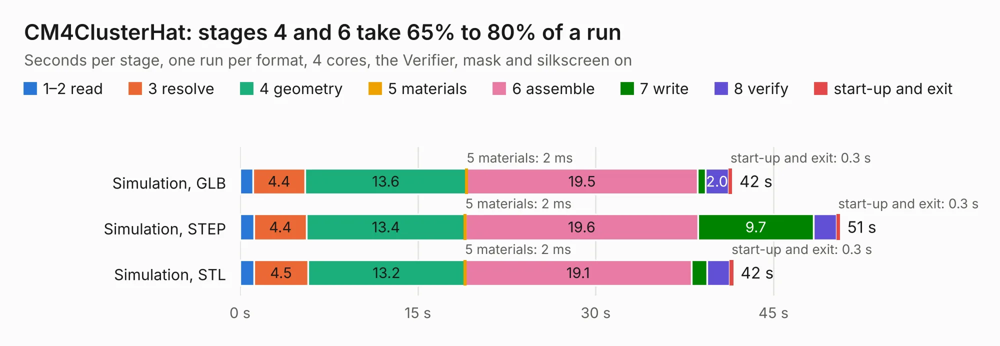

# 2984. CM4ClusterHat

Board 2,984 of the 3,103 of [Corpus Testing](../Corpus-Testing.md), on [Corpus Page 28](../CorpusTestingPages/Corpus-Testing-28.md#2984-cm4clusterhat).

| Mode and format | 1–2 read | 3 resolve | 4 geometry | 5 materials | 6 assemble | 7 write | 8 verify | start-up and exit | Total |
|---|---:|---:|---:|---:|---:|---:|---:|---:|---:|
| Simulation, GLB | 1.1 | 4.4 | 13.6 | 2&nbsp;ms | 19.5 | 0.7 | 2.0 | 0.3 | 41.5 |
| Simulation, STEP | 1.2 | 4.4 | 13.4 | 2&nbsp;ms | 19.6 | 9.7 | 1.9 | 0.3 | 50.6 |
| Simulation, STL | 1.2 | 4.5 | 13.2 | 2&nbsp;ms | 19.1 | 1.3 | 1.9 | 0.3 | 41.6 |
| Simulation, OBJ | 1.1 | 4.5 | 13.4 | 1&nbsp;ms | 19.2 | 17.6 | 1.8 | 0.3 | 57.8 |
| Visual, GLB | 1.2 | 4.5 | 12.9 | 0.9&nbsp;ms | 34.7 | 0.5 | 4.6 | 0.2 | 58.5 |
| Visual, OBJ | 1.2 | 4.1 | 13.3 | 0.9&nbsp;ms | 35.2 | 12.7 | 5.0 | 0.3 | 71.6 |

<table align="center"><tr><td valign="top">

| Board | Repo: [will127534/Miniature-CM4-Cluster](https://github.com/will127534/Miniature-CM4-Cluster) Board: `CM4ClusterHat.kicad_pcb` |
|---|---|
| Folder | ClusterHat |
| Complexity | 377&nbsp;/&nbsp;1000 (size&nbsp;277, features&nbsp;100) |
| KESE&nbsp;features | through vias, slotted holes, rounded, trapezoid or chamfered pads, filled zones, curved board outline, stack-up, dielectric εr and tanδ, mask and silkscreen colours |
| Tested | 9th November 2026 |
| Copper&nbsp;layers | 4 |
| File&nbsp;format | KiCad 6 (20210925) |
| Parts,&nbsp;tracks,&nbsp;vias | 236, 2,332, 758 |
| Triangles,&nbsp;simulation | 3,694,372 in 401 parts |
| Verifier | PASS in all six runs |

</td><td valign="top">

<table>
<tr><th>File type</th><th>File size</th><th>Peak memory used</th></tr>
<tr><th colspan="3" align="left">Simulation</th></tr>
<tr><td>GLB</td><td align="right">125&nbsp;MB</td><td align="right">1.2&nbsp;GB</td></tr>
<tr><td>STEP</td><td align="right">514&nbsp;MB</td><td align="right">1.6&nbsp;GB</td></tr>
<tr><td>STL</td><td align="right">185&nbsp;MB</td><td align="right">1.1&nbsp;GB</td></tr>
<tr><td>OBJ</td><td align="right">393&nbsp;MB</td><td align="right">2.4&nbsp;GB</td></tr>
<tr><th colspan="3" align="left">Visual</th></tr>
<tr><td>GLB</td><td align="right">88&nbsp;MB</td><td align="right">1.4&nbsp;GB</td></tr>
<tr><td>OBJ</td><td align="right">278&nbsp;MB</td><td align="right">1.8&nbsp;GB</td></tr>
</table>

</td></tr></table>

| Previous | Next |
|:---|---:|
| [2983. IMUArray_SensorBoard](b2983b_IMU-Array_IMUArray-SensorBoard.md) | [2985. CM4Card](b2985b_Miniature-CM4-Cluster_CM4Card.md) |
