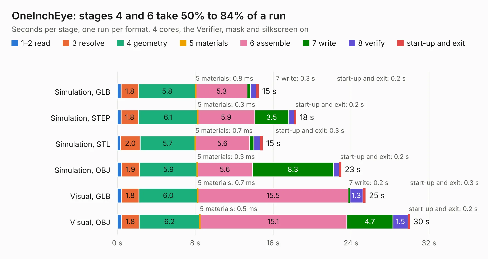

# 2984. OneInchEye

Board 2,984 of the 3,101 of [Corpus Testing](../Corpus-Testing.md), on [Corpus Page 28](../CorpusTestingPages/Corpus-Testing-28.md#2984-oneincheye).

| Mode and format | 1–2 read | 3 resolve | 4 geometry | 5 materials | 6 assemble | 7 write | 8 verify | start-up and exit | Total |
|---|---:|---:|---:|---:|---:|---:|---:|---:|---:|
| Simulation, GLB | 0.4 | 1.8 | 5.8 | 0.8&nbsp;ms | 5.3 | 0.3 | 0.6 | 0.2 | 14.5 |
| Simulation, STEP | 0.4 | 1.8 | 6.1 | 0.3&nbsp;ms | 5.9 | 3.5 | 0.6 | 0.2 | 18.4 |
| Simulation, STL | 0.4 | 2.0 | 5.7 | 0.7&nbsp;ms | 5.6 | 0.5 | 0.7 | 0.3 | 14.9 |
| Simulation, OBJ | 0.4 | 1.9 | 5.9 | 0.3&nbsp;ms | 5.6 | 8.3 | 0.6 | 0.2 | 23.0 |
| Visual, GLB | 0.4 | 1.8 | 6.0 | 0.7&nbsp;ms | 15.5 | 0.2 | 1.3 | 0.3 | 25.5 |
| Visual, OBJ | 0.4 | 1.8 | 6.2 | 0.5&nbsp;ms | 15.1 | 4.7 | 1.5 | 0.2 | 30.1 |

<table align="center"><tr><td valign="top">

| Board | Repo: [will127534/OneInchEye](https://github.com/will127534/OneInchEye) Board: `OneInchEye.kicad_pcb` |
|---|---|
| Complexity | 307&nbsp;/&nbsp;1000 (size&nbsp;207, features&nbsp;100) |
| KESE&nbsp;features | through vias, rounded, trapezoid or chamfered pads, arc tracks, filled zones, curved board outline, stack-up, dielectric εr and tanδ |
| Tested | 9th November 2026 |
| Copper&nbsp;layers | 4 |
| File&nbsp;format | KiCad 8 (20240108) |
| Parts,&nbsp;tracks,&nbsp;vias | 80, 624, 531 |
| Triangles,&nbsp;simulation | 1,868,154 in 74 parts |
| Verifier | PASS in all six runs |

</td><td valign="top">

<table>
<tr><th>File type</th><th>File size</th><th>Peak memory used</th></tr>
<tr><th colspan="3" align="left">Simulation</th></tr>
<tr><td>GLB</td><td align="right">62&nbsp;MB</td><td align="right">762&nbsp;MB</td></tr>
<tr><td>STEP</td><td align="right">191&nbsp;MB</td><td align="right">835&nbsp;MB</td></tr>
<tr><td>STL</td><td align="right">93&nbsp;MB</td><td align="right">730&nbsp;MB</td></tr>
<tr><td>OBJ</td><td align="right">192&nbsp;MB</td><td align="right">1.2&nbsp;GB</td></tr>
<tr><th colspan="3" align="left">Visual</th></tr>
<tr><td>GLB</td><td align="right">37&nbsp;MB</td><td align="right">750&nbsp;MB</td></tr>
<tr><td>OBJ</td><td align="right">113&nbsp;MB</td><td align="right">840&nbsp;MB</td></tr>
</table>

</td></tr></table>

| Previous | Next |
|:---|---:|
| [2983. CM4Card](b2983b_Miniature-CM4-Cluster_CM4Card.md) | [2985. NixieAtomicClock](b2985b_RaspberryPiAtomicNixieClock_NixieAtomicClock.md) |
