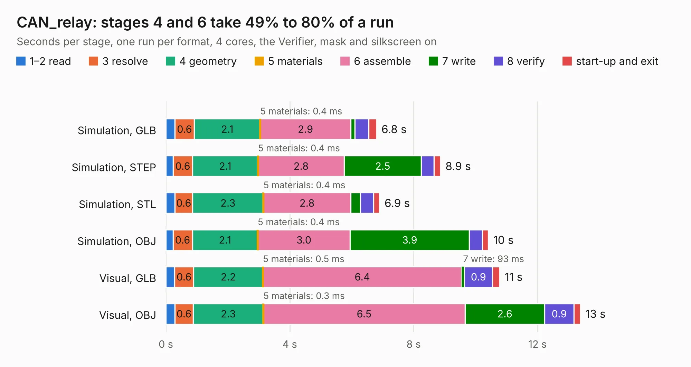

# 2984. CAN_relay

Board 2,984 of the 3,124 of [Corpus Testing](../Corpus-Testing.md), on [Corpus Page 28](../CorpusTestingPages/Corpus-Testing-28.md#2984-can_relay).

| Mode and format | 1–2 read | 3 resolve | 4 geometry | 5 materials | 6 assemble | 7 write | 8 verify | start-up and exit | Total |
|---|---:|---:|---:|---:|---:|---:|---:|---:|---:|
| Simulation, GLB | 0.3 | 0.6 | 2.1 | 0.4&nbsp;ms | 2.9 | 0.1 | 0.4 | 0.3 | 6.8 |
| Simulation, STEP | 0.2 | 0.6 | 2.1 | 0.4&nbsp;ms | 2.8 | 2.5 | 0.4 | 0.2 | 8.9 |
| Simulation, STL | 0.3 | 0.6 | 2.3 | 0.4&nbsp;ms | 2.8 | 0.3 | 0.4 | 0.2 | 6.9 |
| Simulation, OBJ | 0.2 | 0.6 | 2.1 | 0.4&nbsp;ms | 3.0 | 3.9 | 0.4 | 0.2 | 10.4 |
| Visual, GLB | 0.3 | 0.6 | 2.2 | 0.5&nbsp;ms | 6.4 | 93&nbsp;ms | 0.9 | 0.2 | 10.8 |
| Visual, OBJ | 0.3 | 0.6 | 2.3 | 0.3&nbsp;ms | 6.5 | 2.6 | 0.9 | 0.2 | 13.4 |

<table align="center"><tr><td valign="top">

| Board | Repo: [waterloo-rocketry/canhw](https://github.com/waterloo-rocketry/canhw) Board: `CAN_relay.kicad_pcb` |
|---|---|
| Folder | CAN_relay |
| Complexity | 318&nbsp;/&nbsp;1000 (size&nbsp;218, features&nbsp;100) |
| KESE&nbsp;features | through vias, custom pads, rounded, trapezoid or chamfered pads, filled zones, copper drawings, stack-up, dielectric εr and tanδ |
| Tested | 9th November 2026 |
| Copper&nbsp;layers | 4 |
| File&nbsp;format | KiCad 10 (20260206) |
| Parts,&nbsp;tracks,&nbsp;vias | 46, 314, 79 |
| Triangles,&nbsp;simulation | 820,192 in 132 parts |
| Verifier | PASS in all six runs |

</td><td valign="top">

<table>
<tr><th>File type</th><th>File size</th><th>Peak memory used</th></tr>
<tr><th colspan="3" align="left">Simulation</th></tr>
<tr><td>GLB</td><td align="right">28&nbsp;MB</td><td align="right">389&nbsp;MB</td></tr>
<tr><td>STEP</td><td align="right">122&nbsp;MB</td><td align="right">479&nbsp;MB</td></tr>
<tr><td>STL</td><td align="right">41&nbsp;MB</td><td align="right">393&nbsp;MB</td></tr>
<tr><td>OBJ</td><td align="right">82&nbsp;MB</td><td align="right">612&nbsp;MB</td></tr>
<tr><th colspan="3" align="left">Visual</th></tr>
<tr><td>GLB</td><td align="right">20&nbsp;MB</td><td align="right">520&nbsp;MB</td></tr>
<tr><td>OBJ</td><td align="right">60&nbsp;MB</td><td align="right">526&nbsp;MB</td></tr>
</table>

</td></tr></table>

| Previous | Next |
|:---|---:|
| [2983. camera_interface_CAN_board](b2983b_canhw_camera-interface-CAN-board.md) | [2985. AD_Breakout](b2985b_canhw_AD-Breakout.md) |
