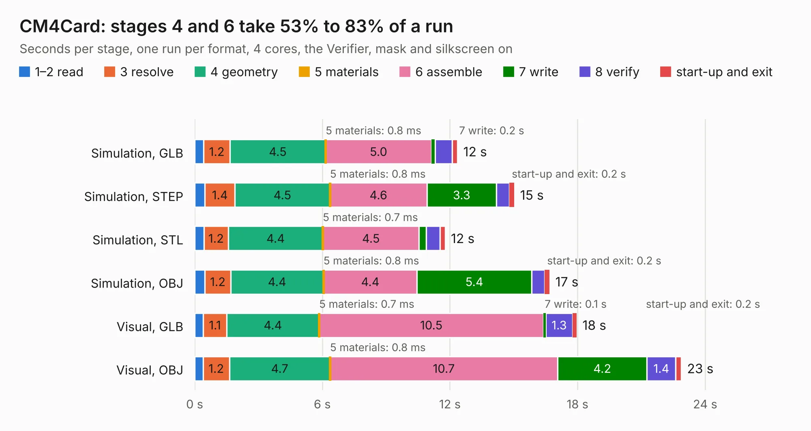

# 2985. CM4Card

Board 2,985 of the 3,103 of [Corpus Testing](../Corpus-Testing.md), on [Corpus Page 28](../CorpusTestingPages/Corpus-Testing-28.md#2985-cm4card).

| Mode and format | 1–2 read | 3 resolve | 4 geometry | 5 materials | 6 assemble | 7 write | 8 verify | start-up and exit | Total |
|---|---:|---:|---:|---:|---:|---:|---:|---:|---:|
| Simulation, GLB | 0.4 | 1.2 | 4.5 | 0.8&nbsp;ms | 5.0 | 0.2 | 0.8 | 0.2 | 12.4 |
| Simulation, STEP | 0.5 | 1.4 | 4.5 | 0.8&nbsp;ms | 4.6 | 3.3 | 0.6 | 0.2 | 15.0 |
| Simulation, STL | 0.4 | 1.2 | 4.4 | 0.7&nbsp;ms | 4.5 | 0.3 | 0.6 | 0.2 | 11.8 |
| Simulation, OBJ | 0.5 | 1.2 | 4.4 | 0.8&nbsp;ms | 4.4 | 5.4 | 0.6 | 0.2 | 16.7 |
| Visual, GLB | 0.4 | 1.1 | 4.4 | 0.7&nbsp;ms | 10.5 | 0.1 | 1.3 | 0.2 | 18.0 |
| Visual, OBJ | 0.4 | 1.2 | 4.7 | 0.8&nbsp;ms | 10.7 | 4.2 | 1.4 | 0.3 | 22.9 |

<table align="center"><tr><td valign="top">

| Board | Repo: [will127534/Miniature-CM4-Cluster](https://github.com/will127534/Miniature-CM4-Cluster) Board: `CM4Card.kicad_pcb` |
|---|---|
| Folder | CM4Card |
| Complexity | 288&nbsp;/&nbsp;1000 (size&nbsp;198, features&nbsp;90) |
| KESE&nbsp;features | through vias, rounded, trapezoid or chamfered pads, filled zones, curved board outline, stack-up, dielectric εr and tanδ, mask and silkscreen colours |
| Tested | 9th November 2026 |
| Copper&nbsp;layers | 4 |
| File&nbsp;format | KiCad 6 (20210925) |
| Parts,&nbsp;tracks,&nbsp;vias | 54, 822, 252 |
| Triangles,&nbsp;simulation | 1,208,432 in 246 parts |
| Verifier | PASS in all six runs |

</td><td valign="top">

<table>
<tr><th>File type</th><th>File size</th><th>Peak memory used</th></tr>
<tr><th colspan="3" align="left">Simulation</th></tr>
<tr><td>GLB</td><td align="right">41&nbsp;MB</td><td align="right">516&nbsp;MB</td></tr>
<tr><td>STEP</td><td align="right">190&nbsp;MB</td><td align="right">629&nbsp;MB</td></tr>
<tr><td>STL</td><td align="right">60&nbsp;MB</td><td align="right">504&nbsp;MB</td></tr>
<tr><td>OBJ</td><td align="right">124&nbsp;MB</td><td align="right">831&nbsp;MB</td></tr>
<tr><th colspan="3" align="left">Visual</th></tr>
<tr><td>GLB</td><td align="right">30&nbsp;MB</td><td align="right">643&nbsp;MB</td></tr>
<tr><td>OBJ</td><td align="right">91&nbsp;MB</td><td align="right">733&nbsp;MB</td></tr>
</table>

</td></tr></table>

| Previous | Next |
|:---|---:|
| [2984. CM4ClusterHat](b2984b_Miniature-CM4-Cluster_CM4ClusterHat.md) | [2986. OneInchEye](b2986b_OneInchEye_OneInchEye.md) |
