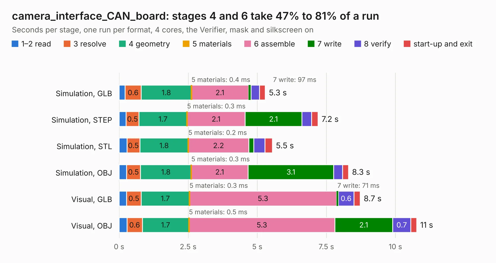

# 2986. camera_interface_CAN_board

Board 2,986 of the 3,127 of [Corpus Testing](../Corpus-Testing.md), on [Corpus Page 28](../CorpusTestingPages/Corpus-Testing-28.md#2986-camera_interface_can_board).

| Mode and format | 1–2 read | 3 resolve | 4 geometry | 5 materials | 6 assemble | 7 write | 8 verify | start-up and exit | Total |
|---|---:|---:|---:|---:|---:|---:|---:|---:|---:|
| Simulation, GLB | 0.2 | 0.6 | 1.8 | 0.4&nbsp;ms | 2.1 | 97&nbsp;ms | 0.3 | 0.2 | 5.3 |
| Simulation, STEP | 0.3 | 0.5 | 1.7 | 0.3&nbsp;ms | 2.1 | 2.1 | 0.3 | 0.2 | 7.2 |
| Simulation, STL | 0.3 | 0.5 | 1.8 | 0.2&nbsp;ms | 2.2 | 0.2 | 0.4 | 0.3 | 5.5 |
| Simulation, OBJ | 0.3 | 0.5 | 1.8 | 0.3&nbsp;ms | 2.1 | 3.1 | 0.3 | 0.2 | 8.3 |
| Visual, GLB | 0.3 | 0.5 | 1.7 | 0.3&nbsp;ms | 5.3 | 71&nbsp;ms | 0.6 | 0.2 | 8.7 |
| Visual, OBJ | 0.3 | 0.6 | 1.7 | 0.5&nbsp;ms | 5.3 | 2.1 | 0.7 | 0.2 | 10.8 |

<table align="center"><tr><td valign="top">

| Board | Repo: [waterloo-rocketry/canhw](https://github.com/waterloo-rocketry/canhw) Board: `camera_interface_CAN_board.kicad_pcb` |
|---|---|
| Folder | camera_interface_CAN_board |
| Complexity | 275&nbsp;/&nbsp;1000 (size&nbsp;175, features&nbsp;100) |
| KESE&nbsp;features | through vias, rounded, trapezoid or chamfered pads, arc tracks, filled zones, curved board outline, stack-up, dielectric εr and tanδ |
| Tested | 9th November 2026 |
| Copper&nbsp;layers | 4 |
| File&nbsp;format | KiCad 10 (20260206) |
| Parts,&nbsp;tracks,&nbsp;vias | 44, 248, 67 |
| Triangles,&nbsp;simulation | 646,922 in 67 parts |
| Verifier | PASS in all six runs |

</td><td valign="top">

<table>
<tr><th>File type</th><th>File size</th><th>Peak memory used</th></tr>
<tr><th colspan="3" align="left">Simulation</th></tr>
<tr><td>GLB</td><td align="right">22&nbsp;MB</td><td align="right">359&nbsp;MB</td></tr>
<tr><td>STEP</td><td align="right">101&nbsp;MB</td><td align="right">413&nbsp;MB</td></tr>
<tr><td>STL</td><td align="right">32&nbsp;MB</td><td align="right">375&nbsp;MB</td></tr>
<tr><td>OBJ</td><td align="right">65&nbsp;MB</td><td align="right">481&nbsp;MB</td></tr>
<tr><th colspan="3" align="left">Visual</th></tr>
<tr><td>GLB</td><td align="right">16&nbsp;MB</td><td align="right">417&nbsp;MB</td></tr>
<tr><td>OBJ</td><td align="right">47&nbsp;MB</td><td align="right">413&nbsp;MB</td></tr>
</table>

</td></tr></table>

| Previous | Next |
|:---|---:|
| [2985. camera](b2985b_canhw_camera.md) | [2987. CAN_relay](b2987b_canhw_CAN-relay.md) |
