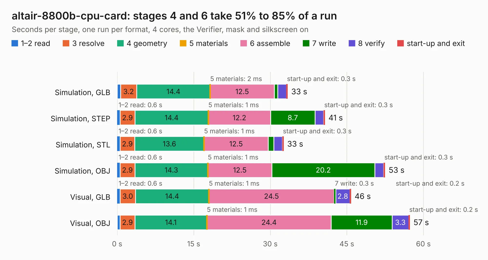

# 2991. altair-8800b-cpu-card

Board 2,991 of the 3,138 of [Corpus Testing](../Corpus-Testing.md), on [Corpus Page 28](../CorpusTestingPages/Corpus-Testing-28.md#2991-altair-8800b-cpu-card).

| Mode and format | 1–2 read | 3 resolve | 4 geometry | 5 materials | 6 assemble | 7 write | 8 verify | start-up and exit | Total |
|---|---:|---:|---:|---:|---:|---:|---:|---:|---:|
| Simulation, GLB | 0.6 | 3.2 | 14.4 | 2&nbsp;ms | 12.5 | 0.7 | 1.7 | 0.3 | 33.4 |
| Simulation, STEP | 0.6 | 2.9 | 14.4 | 1&nbsp;ms | 12.2 | 8.7 | 1.7 | 0.3 | 40.7 |
| Simulation, STL | 0.6 | 2.9 | 13.6 | 1&nbsp;ms | 12.5 | 1.1 | 1.6 | 0.3 | 32.6 |
| Simulation, OBJ | 0.6 | 2.9 | 14.3 | 1&nbsp;ms | 12.5 | 20.2 | 1.8 | 0.3 | 52.5 |
| Visual, GLB | 0.6 | 3.0 | 14.4 | 1&nbsp;ms | 24.5 | 0.3 | 2.8 | 0.2 | 45.8 |
| Visual, OBJ | 0.6 | 2.9 | 14.1 | 1&nbsp;ms | 24.4 | 11.9 | 3.3 | 0.2 | 57.4 |

<table align="center"><tr><td valign="top">

| Board | Repo: [warmech/altair-8800b-cpu-card](https://github.com/warmech/altair-8800b-cpu-card) Board: `altair-8800b-cpu-card.kicad_pcb` |
|---|---|
| Folder | cad |
| Complexity | 261&nbsp;/&nbsp;1000 (size&nbsp;201, features&nbsp;60) |
| KESE&nbsp;features | through vias, filled zones, curved board outline, TrueType text |
| Tested | 9th November 2026 |
| Copper&nbsp;layers | 2 |
| File&nbsp;format | KiCad 7 (20221018) |
| Parts,&nbsp;tracks,&nbsp;vias | 136, 2,087, 314 |
| Triangles,&nbsp;simulation | 3,660,442 in 245 parts |
| Verifier | PASS in all six runs |

</td><td valign="top">

<table>
<tr><th>File type</th><th>File size</th><th>Peak memory used</th></tr>
<tr><th colspan="3" align="left">Simulation</th></tr>
<tr><td>GLB</td><td align="right">123&nbsp;MB</td><td align="right">1.2&nbsp;GB</td></tr>
<tr><td>STEP</td><td align="right">486&nbsp;MB</td><td align="right">1.5&nbsp;GB</td></tr>
<tr><td>STL</td><td align="right">183&nbsp;MB</td><td align="right">1.2&nbsp;GB</td></tr>
<tr><td>OBJ</td><td align="right">382&nbsp;MB</td><td align="right">3.0&nbsp;GB</td></tr>
<tr><th colspan="3" align="left">Visual</th></tr>
<tr><td>GLB</td><td align="right">75&nbsp;MB</td><td align="right">1.4&nbsp;GB</td></tr>
<tr><td>OBJ</td><td align="right">236&nbsp;MB</td><td align="right">2.0&nbsp;GB</td></tr>
</table>

</td></tr></table>

| Previous | Next |
|:---|---:|
| [2990. CM4_MATX](b2990b_CM4-MATX_KiCad_CM4-MATX_2586.md) | [2992. altair-8800b-display-control-pcb](b2992b_altair-8800b-display-control-pcb_altair-8800b-display-control-pcb.md) |
