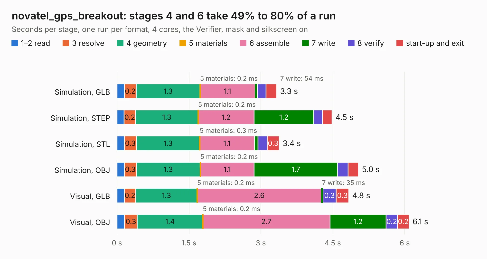

# 2991. novatel_gps_breakout

Board 2,991 of the 3,122 of [Corpus Testing](../Corpus-Testing.md), on [Corpus Page 28](../CorpusTestingPages/Corpus-Testing-28.md#2991-novatel_gps_breakout).

| Mode and format | 1–2 read | 3 resolve | 4 geometry | 5 materials | 6 assemble | 7 write | 8 verify | start-up and exit | Total |
|---|---:|---:|---:|---:|---:|---:|---:|---:|---:|
| Simulation, GLB | 0.2 | 0.2 | 1.3 | 0.2&nbsp;ms | 1.1 | 54&nbsp;ms | 0.2 | 0.2 | 3.3 |
| Simulation, STEP | 0.1 | 0.2 | 1.3 | 0.2&nbsp;ms | 1.2 | 1.2 | 0.2 | 0.2 | 4.5 |
| Simulation, STL | 0.2 | 0.3 | 1.3 | 0.3&nbsp;ms | 1.1 | 80&nbsp;ms | 0.2 | 0.3 | 3.4 |
| Simulation, OBJ | 0.2 | 0.3 | 1.3 | 0.2&nbsp;ms | 1.1 | 1.7 | 0.2 | 0.2 | 5.0 |
| Visual, GLB | 0.2 | 0.2 | 1.3 | 0.2&nbsp;ms | 2.6 | 35&nbsp;ms | 0.3 | 0.3 | 4.8 |
| Visual, OBJ | 0.2 | 0.3 | 1.4 | 0.2&nbsp;ms | 2.7 | 1.2 | 0.2 | 0.2 | 6.1 |

<table align="center"><tr><td valign="top">

| Board | Repo: [waterloo-rocketry/canhw](https://github.com/waterloo-rocketry/canhw) Board: `novatel_gps_breakout.kicad_pcb` |
|---|---|
| Folder | novatel_gps_breakout |
| Complexity | 188&nbsp;/&nbsp;1000 (size&nbsp;118, features&nbsp;70) |
| KESE&nbsp;features | through vias, slotted holes, rounded, trapezoid or chamfered pads, arc tracks, filled zones |
| Tested | 10th November 2026 |
| Copper&nbsp;layers | 2 |
| File&nbsp;format | KiCad 8 (20240108) |
| Parts,&nbsp;tracks,&nbsp;vias | 7, 119, 2 |
| Triangles,&nbsp;simulation | 317,818 in 35 parts |
| Verifier | PASS in all six runs |

</td><td valign="top">

<table>
<tr><th>File type</th><th>File size</th><th>Peak memory used</th></tr>
<tr><th colspan="3" align="left">Simulation</th></tr>
<tr><td>GLB</td><td align="right">11&nbsp;MB</td><td align="right">239&nbsp;MB</td></tr>
<tr><td>STEP</td><td align="right">48&nbsp;MB</td><td align="right">268&nbsp;MB</td></tr>
<tr><td>STL</td><td align="right">16&nbsp;MB</td><td align="right">251&nbsp;MB</td></tr>
<tr><td>OBJ</td><td align="right">31&nbsp;MB</td><td align="right">260&nbsp;MB</td></tr>
<tr><th colspan="3" align="left">Visual</th></tr>
<tr><td>GLB</td><td align="right">7.0&nbsp;MB</td><td align="right">238&nbsp;MB</td></tr>
<tr><td>OBJ</td><td align="right">20&nbsp;MB</td><td align="right">235&nbsp;MB</td></tr>
</table>

</td></tr></table>

| Previous | Next |
|:---|---:|
| [2990. power-splitter](b2990b_canhw_power-splitter.md) | [2992. picdev](b2992b_canhw_picdev.md) |
