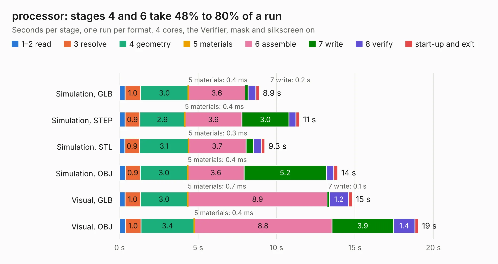

# 2994. processor

Board 2,994 of the 3,123 of [Corpus Testing](../Corpus-Testing.md), on [Corpus Page 28](../CorpusTestingPages/Corpus-Testing-28.md#2994-processor).

| Mode and format | 1–2 read | 3 resolve | 4 geometry | 5 materials | 6 assemble | 7 write | 8 verify | start-up and exit | Total |
|---|---:|---:|---:|---:|---:|---:|---:|---:|---:|
| Simulation, GLB | 0.3 | 1.0 | 3.0 | 0.4&nbsp;ms | 3.6 | 0.2 | 0.5 | 0.2 | 8.9 |
| Simulation, STEP | 0.3 | 0.9 | 2.9 | 0.4&nbsp;ms | 3.6 | 3.0 | 0.4 | 0.2 | 11.5 |
| Simulation, STL | 0.3 | 0.9 | 3.1 | 0.3&nbsp;ms | 3.7 | 0.5 | 0.5 | 0.2 | 9.3 |
| Simulation, OBJ | 0.4 | 0.9 | 3.0 | 0.4&nbsp;ms | 3.6 | 5.2 | 0.5 | 0.3 | 13.9 |
| Visual, GLB | 0.4 | 1.0 | 3.0 | 0.7&nbsp;ms | 8.9 | 0.1 | 1.2 | 0.2 | 14.8 |
| Visual, OBJ | 0.4 | 1.0 | 3.4 | 0.4&nbsp;ms | 8.8 | 3.9 | 1.4 | 0.2 | 19.0 |

<table align="center"><tr><td valign="top">

| Board | Repo: [waterloo-rocketry/canhw](https://github.com/waterloo-rocketry/canhw) Board: `processor.kicad_pcb` |
|---|---|
| Folder | processor |
| Complexity | 352&nbsp;/&nbsp;1000 (size&nbsp;237, features&nbsp;115) |
| KESE&nbsp;features | through vias, rounded, trapezoid or chamfered pads, arc tracks, filled zones, curved board outline, TrueType text, stack-up, dielectric εr and tanδ |
| Tested | 9th November 2026 |
| Copper&nbsp;layers | 4 |
| File&nbsp;format | KiCad 8 (20240108) |
| Parts,&nbsp;tracks,&nbsp;vias | 63, 1,009, 121 |
| Triangles,&nbsp;simulation | 1,275,614 in 130 parts |
| Verifier | PASS in all six runs |

</td><td valign="top">

<table>
<tr><th>File type</th><th>File size</th><th>Peak memory used</th></tr>
<tr><th colspan="3" align="left">Simulation</th></tr>
<tr><td>GLB</td><td align="right">44&nbsp;MB</td><td align="right">489&nbsp;MB</td></tr>
<tr><td>STEP</td><td align="right">183&nbsp;MB</td><td align="right">593&nbsp;MB</td></tr>
<tr><td>STL</td><td align="right">64&nbsp;MB</td><td align="right">521&nbsp;MB</td></tr>
<tr><td>OBJ</td><td align="right">131&nbsp;MB</td><td align="right">902&nbsp;MB</td></tr>
<tr><th colspan="3" align="left">Visual</th></tr>
<tr><td>GLB</td><td align="right">31&nbsp;MB</td><td align="right">680&nbsp;MB</td></tr>
<tr><td>OBJ</td><td align="right">94&nbsp;MB</td><td align="right">722&nbsp;MB</td></tr>
</table>

</td></tr></table>

| Previous | Next |
|:---|---:|
| [2993. picdev](b2993b_canhw_picdev.md) | [2995. PropulsionBoard](b2995b_canhw_PropulsionBoard.md) |
