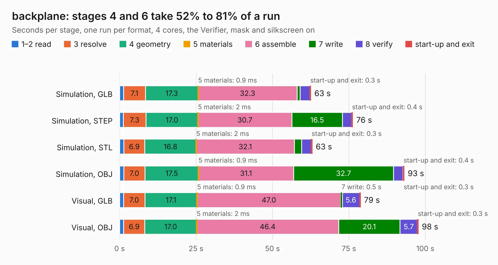

# 2994. backplane

Board 2,994 of the 3,104 of [Corpus Testing](../Corpus-Testing.md), on [Corpus Page 28](../CorpusTestingPages/Corpus-Testing-28.md#2994-backplane).

| Mode and format | 1–2 read | 3 resolve | 4 geometry | 5 materials | 6 assemble | 7 write | 8 verify | start-up and exit | Total |
|---|---:|---:|---:|---:|---:|---:|---:|---:|---:|
| Simulation, GLB | 1.3 | 7.1 | 17.3 | 0.9&nbsp;ms | 32.3 | 1.0 | 3.1 | 0.3 | 62.6 |
| Simulation, STEP | 1.3 | 7.3 | 17.0 | 2&nbsp;ms | 30.7 | 16.5 | 3.0 | 0.4 | 76.2 |
| Simulation, STL | 1.4 | 6.9 | 16.8 | 2&nbsp;ms | 32.1 | 2.4 | 3.1 | 0.3 | 63.0 |
| Simulation, OBJ | 1.3 | 7.0 | 17.5 | 0.9&nbsp;ms | 31.1 | 32.7 | 3.1 | 0.4 | 93.1 |
| Visual, GLB | 1.3 | 7.0 | 17.1 | 0.9&nbsp;ms | 47.0 | 0.5 | 5.6 | 0.3 | 78.8 |
| Visual, OBJ | 1.3 | 6.9 | 17.0 | 2&nbsp;ms | 46.4 | 20.1 | 5.7 | 0.3 | 97.7 |

<table align="center"><tr><td valign="top">

| Board | Repo: [winkleplex10-bit/the-mac-pro-project](https://github.com/winkleplex10-bit/the-mac-pro-project) Board: `backplane.kicad_pcb` |
|---|---|
| Folder | kicad / macpro62-backplane |
| Complexity | 370&nbsp;/&nbsp;1000 (size&nbsp;280, features&nbsp;90) |
| KESE&nbsp;features | through vias, slotted holes, custom pads, rounded, trapezoid or chamfered pads, filled zones, copper drawings, curved board outline |
| Tested | 9th November 2026 |
| Copper&nbsp;layers | 4 |
| File&nbsp;format | KiCad 9 (20241229) |
| Parts,&nbsp;tracks,&nbsp;vias | 149, 6,925, 1,336 |
| Triangles,&nbsp;simulation | 5,498,650 in 349 parts |
| Verifier | PASS in all six runs |

</td><td valign="top">

<table>
<tr><th>File type</th><th>File size</th><th>Peak memory used</th></tr>
<tr><th colspan="3" align="left">Simulation</th></tr>
<tr><td>GLB</td><td align="right">186&nbsp;MB</td><td align="right">1.5&nbsp;GB</td></tr>
<tr><td>STEP</td><td align="right">690&nbsp;MB</td><td align="right">2.3&nbsp;GB</td></tr>
<tr><td>STL</td><td align="right">275&nbsp;MB</td><td align="right">1.6&nbsp;GB</td></tr>
<tr><td>OBJ</td><td align="right">582&nbsp;MB</td><td align="right">3.4&nbsp;GB</td></tr>
<tr><th colspan="3" align="left">Visual</th></tr>
<tr><td>GLB</td><td align="right">108&nbsp;MB</td><td align="right">1.8&nbsp;GB</td></tr>
<tr><td>OBJ</td><td align="right">348&nbsp;MB</td><td align="right">2.2&nbsp;GB</td></tr>
</table>

</td></tr></table>

| Previous | Next |
|:---|---:|
| [2993. backplane](b2993b_the-mac-pro-project_kicad-macpro62-backplane-v3_backplane.md) | [2995. backplane_direct](b2995b_the-mac-pro-project_backplane-direct.md) |
