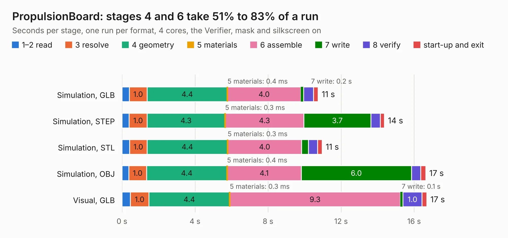

# 2995. PropulsionBoard

Board 2,995 of the 3,123 of [Corpus Testing](../Corpus-Testing.md), on [Corpus Page 28](../CorpusTestingPages/Corpus-Testing-28.md#2995-propulsionboard).

| Mode and format | 1–2 read | 3 resolve | 4 geometry | 5 materials | 6 assemble | 7 write | 8 verify | start-up and exit | Total |
|---|---:|---:|---:|---:|---:|---:|---:|---:|---:|
| Simulation, GLB | 0.4 | 1.0 | 4.4 | 0.4&nbsp;ms | 4.0 | 0.2 | 0.5 | 0.3 | 10.7 |
| Simulation, STEP | 0.4 | 1.0 | 4.3 | 0.3&nbsp;ms | 4.3 | 3.7 | 0.5 | 0.2 | 14.4 |
| Simulation, STL | 0.4 | 1.0 | 4.4 | 0.3&nbsp;ms | 4.0 | 0.4 | 0.5 | 0.3 | 11.0 |
| Simulation, OBJ | 0.4 | 1.0 | 4.4 | 0.4&nbsp;ms | 4.1 | 6.0 | 0.5 | 0.3 | 16.6 |
| Visual, GLB | 0.5 | 1.0 | 4.4 | 0.3&nbsp;ms | 9.3 | 0.1 | 1.0 | 0.3 | 16.7 |
| Visual, OBJ | 0.4 | 1.1 | 4.5 | 0.3&nbsp;ms | 9.4 | 5.0 | 1.3 | 0.2 | 21.8 |

<table align="center"><tr><td valign="top">

| Board | Repo: [waterloo-rocketry/canhw](https://github.com/waterloo-rocketry/canhw) Board: `PropulsionBoard.kicad_pcb` |
|---|---|
| Folder | PropulsionBoard |
| Complexity | 237&nbsp;/&nbsp;1000 (size&nbsp;182, features&nbsp;55) |
| KESE&nbsp;features | through vias, rounded, trapezoid or chamfered pads, filled zones, curved board outline |
| Tested | 10th November 2026 |
| Copper&nbsp;layers | 2 |
| File&nbsp;format | KiCad 7 (20221018) |
| Parts,&nbsp;tracks,&nbsp;vias | 86, 851, 138 |
| Triangles,&nbsp;simulation | 1,003,706 in 76 parts |
| Verifier | PASS in all six runs |

</td><td valign="top">

<table>
<tr><th>File type</th><th>File size</th><th>Peak memory used</th></tr>
<tr><th colspan="3" align="left">Simulation</th></tr>
<tr><td>GLB</td><td align="right">35&nbsp;MB</td><td align="right">480&nbsp;MB</td></tr>
<tr><td>STEP</td><td align="right">178&nbsp;MB</td><td align="right">591&nbsp;MB</td></tr>
<tr><td>STL</td><td align="right">50&nbsp;MB</td><td align="right">496&nbsp;MB</td></tr>
<tr><td>OBJ</td><td align="right">102&nbsp;MB</td><td align="right">693&nbsp;MB</td></tr>
<tr><th colspan="3" align="left">Visual</th></tr>
<tr><td>GLB</td><td align="right">29&nbsp;MB</td><td align="right">696&nbsp;MB</td></tr>
<tr><td>OBJ</td><td align="right">86&nbsp;MB</td><td align="right">758&nbsp;MB</td></tr>
</table>

</td></tr></table>

| Previous | Next |
|:---|---:|
| [2994. processor](b2994b_canhw_processor.md) | [2996. remote_arming](b2996b_canhw_remote-arming.md) |
