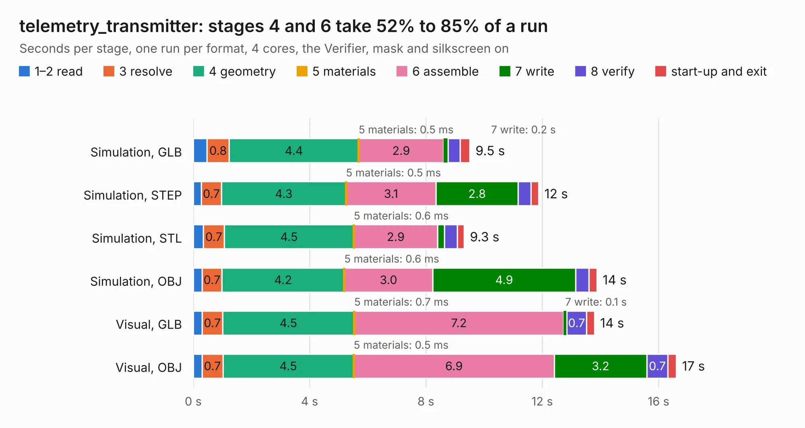

# 2995. telemetry_transmitter

Board 2,995 of the 3,129 of [Corpus Testing](../Corpus-Testing.md), on [Corpus Page 28](../CorpusTestingPages/Corpus-Testing-28.md#2995-telemetry_transmitter).

| Mode and format | 1–2 read | 3 resolve | 4 geometry | 5 materials | 6 assemble | 7 write | 8 verify | start-up and exit | Total |
|---|---:|---:|---:|---:|---:|---:|---:|---:|---:|
| Simulation, GLB | 0.5 | 0.8 | 4.4 | 0.5&nbsp;ms | 2.9 | 0.2 | 0.4 | 0.3 | 9.5 |
| Simulation, STEP | 0.3 | 0.7 | 4.3 | 0.5&nbsp;ms | 3.1 | 2.8 | 0.4 | 0.3 | 11.9 |
| Simulation, STL | 0.4 | 0.7 | 4.5 | 0.6&nbsp;ms | 2.9 | 0.2 | 0.4 | 0.2 | 9.3 |
| Simulation, OBJ | 0.3 | 0.7 | 4.2 | 0.6&nbsp;ms | 3.0 | 4.9 | 0.5 | 0.3 | 13.9 |
| Visual, GLB | 0.3 | 0.7 | 4.5 | 0.7&nbsp;ms | 7.2 | 0.1 | 0.7 | 0.3 | 13.8 |
| Visual, OBJ | 0.3 | 0.7 | 4.5 | 0.5&nbsp;ms | 6.9 | 3.2 | 0.7 | 0.3 | 16.6 |

<table align="center"><tr><td valign="top">

| Board | Repo: [waterloo-rocketry/canhw](https://github.com/waterloo-rocketry/canhw) Board: `telemetry_transmitter.kicad_pcb` |
|---|---|
| Folder | live_telemetry / ARCHIVE / old_telemetry_transmitter |
| Complexity | 232&nbsp;/&nbsp;1000 (size&nbsp;162, features&nbsp;70) |
| KESE&nbsp;features | through vias, rounded, trapezoid or chamfered pads, arc tracks, filled zones, curved board outline |
| Tested | 10th November 2026 |
| Copper&nbsp;layers | 2 |
| File&nbsp;format | KiCad 9 (20241229) |
| Parts,&nbsp;tracks,&nbsp;vias | 46, 305, 88 |
| Triangles,&nbsp;simulation | 758,176 in 67 parts |
| Verifier | PASS in all six runs |

</td><td valign="top">

<table>
<tr><th>File type</th><th>File size</th><th>Peak memory used</th></tr>
<tr><th colspan="3" align="left">Simulation</th></tr>
<tr><td>GLB</td><td align="right">26&nbsp;MB</td><td align="right">369&nbsp;MB</td></tr>
<tr><td>STEP</td><td align="right">139&nbsp;MB</td><td align="right">431&nbsp;MB</td></tr>
<tr><td>STL</td><td align="right">38&nbsp;MB</td><td align="right">381&nbsp;MB</td></tr>
<tr><td>OBJ</td><td align="right">78&nbsp;MB</td><td align="right">542&nbsp;MB</td></tr>
<tr><th colspan="3" align="left">Visual</th></tr>
<tr><td>GLB</td><td align="right">18&nbsp;MB</td><td align="right">438&nbsp;MB</td></tr>
<tr><td>OBJ</td><td align="right">54&nbsp;MB</td><td align="right">450&nbsp;MB</td></tr>
</table>

</td></tr></table>

| Previous | Next |
|:---|---:|
| [2994. injector_sensor_hub](b2994b_canhw_injector-sensor-hub.md) | [2996. LTT](b2996b_canhw_LTT.md) |
