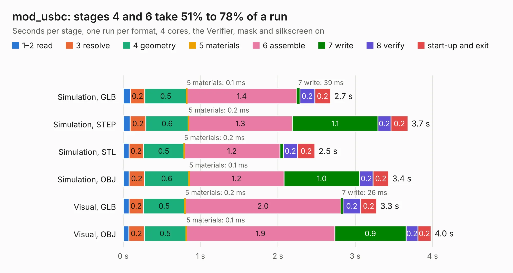

# 2999. mod_usbc

Board 2,999 of the 3,101 of [Corpus Testing](../Corpus-Testing.md), on [Corpus Page 28](../CorpusTestingPages/Corpus-Testing-28.md#2999-mod_usbc).

| Mode and format | 1–2 read | 3 resolve | 4 geometry | 5 materials | 6 assemble | 7 write | 8 verify | start-up and exit | Total |
|---|---:|---:|---:|---:|---:|---:|---:|---:|---:|
| Simulation, GLB | 92&nbsp;ms | 0.2 | 0.5 | 0.1&nbsp;ms | 1.4 | 39&nbsp;ms | 0.2 | 0.2 | 2.7 |
| Simulation, STEP | 91&nbsp;ms | 0.2 | 0.6 | 0.2&nbsp;ms | 1.3 | 1.1 | 0.2 | 0.2 | 3.7 |
| Simulation, STL | 76&nbsp;ms | 0.2 | 0.5 | 0.2&nbsp;ms | 1.2 | 45&nbsp;ms | 0.2 | 0.2 | 2.5 |
| Simulation, OBJ | 77&nbsp;ms | 0.2 | 0.6 | 0.1&nbsp;ms | 1.2 | 1.0 | 0.2 | 0.2 | 3.4 |
| Visual, GLB | 76&nbsp;ms | 0.2 | 0.5 | 0.2&nbsp;ms | 2.0 | 26&nbsp;ms | 0.2 | 0.2 | 3.3 |
| Visual, OBJ | 73&nbsp;ms | 0.2 | 0.5 | 0.1&nbsp;ms | 1.9 | 0.9 | 0.2 | 0.2 | 4.0 |

<table align="center"><tr><td valign="top">

| Board | Repo: [winkleplex10-bit/the-mac-pro-project](https://github.com/winkleplex10-bit/the-mac-pro-project) Board: `mod_usbc.kicad_pcb` |
|---|---|
| Folder | kicad / macpro62-io-modules / mod_usbc |
| Complexity | 209&nbsp;/&nbsp;1000 (size&nbsp;134, features&nbsp;75) |
| KESE&nbsp;features | through vias, slotted holes, rounded, trapezoid or chamfered pads, filled zones, copper drawings, curved board outline |
| Tested | 9th November 2026 |
| Copper&nbsp;layers | 2 |
| File&nbsp;format | KiCad 9 (20241229) |
| Parts,&nbsp;tracks,&nbsp;vias | 4, 361, 29 |
| Triangles,&nbsp;simulation | 184,304 in 30 parts |
| Verifier | PASS in all six runs |

</td><td valign="top">

<table>
<tr><th>File type</th><th>File size</th><th>Peak memory used</th></tr>
<tr><th colspan="3" align="left">Simulation</th></tr>
<tr><td>GLB</td><td align="right">6.9&nbsp;MB</td><td align="right">208&nbsp;MB</td></tr>
<tr><td>STEP</td><td align="right">39&nbsp;MB</td><td align="right">232&nbsp;MB</td></tr>
<tr><td>STL</td><td align="right">9.2&nbsp;MB</td><td align="right">206&nbsp;MB</td></tr>
<tr><td>OBJ</td><td align="right">19&nbsp;MB</td><td align="right">209&nbsp;MB</td></tr>
<tr><th colspan="3" align="left">Visual</th></tr>
<tr><td>GLB</td><td align="right">5.5&nbsp;MB</td><td align="right">192&nbsp;MB</td></tr>
<tr><td>OBJ</td><td align="right">15&nbsp;MB</td><td align="right">188&nbsp;MB</td></tr>
</table>

</td></tr></table>

| Previous | Next |
|:---|---:|
| [2998. mod_usba](b2998b_the-mac-pro-project_mod-usba.md) | [3000. panel_a25](b3000b_the-mac-pro-project_panel-a25.md) |
