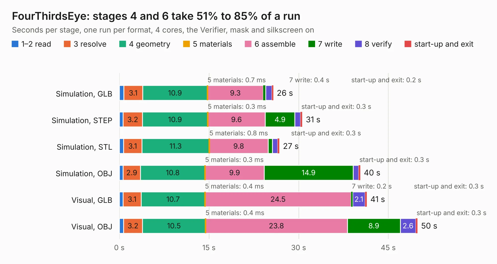

# 3000. FourThirdsEye

Board 3,000 of the 3,123 of [Corpus Testing](../Corpus-Testing.md), on [Corpus Page 28](../CorpusTestingPages/Corpus-Testing-28.md#3000-fourthirdseye).

| Mode and format | 1–2 read | 3 resolve | 4 geometry | 5 materials | 6 assemble | 7 write | 8 verify | start-up and exit | Total |
|---|---:|---:|---:|---:|---:|---:|---:|---:|---:|
| Simulation, GLB | 0.7 | 3.1 | 10.9 | 0.7&nbsp;ms | 9.3 | 0.4 | 1.0 | 0.2 | 25.8 |
| Simulation, STEP | 0.6 | 3.2 | 10.9 | 0.3&nbsp;ms | 9.6 | 4.9 | 1.0 | 0.3 | 30.6 |
| Simulation, STL | 0.7 | 3.1 | 11.3 | 0.8&nbsp;ms | 9.8 | 0.7 | 0.9 | 0.3 | 26.8 |
| Simulation, OBJ | 0.6 | 2.9 | 10.8 | 0.3&nbsp;ms | 9.9 | 14.9 | 0.9 | 0.3 | 40.3 |
| Visual, GLB | 0.6 | 3.1 | 10.7 | 0.4&nbsp;ms | 24.5 | 0.2 | 2.1 | 0.3 | 41.4 |
| Visual, OBJ | 0.7 | 3.2 | 10.5 | 0.4&nbsp;ms | 23.8 | 8.9 | 2.6 | 0.3 | 49.9 |

<table align="center"><tr><td valign="top">

| Board | Repo: [will127534/FourThirdsEye](https://github.com/will127534/FourThirdsEye) Board: `FourThirdsEye.kicad_pcb` |
|---|---|
| Complexity | 341&nbsp;/&nbsp;1000 (size&nbsp;216, features&nbsp;125) |
| KESE&nbsp;features | through vias, custom pads, rounded, trapezoid or chamfered pads, arc tracks, filled zones, copper drawings, curved board outline, stack-up, dielectric εr and tanδ |
| Tested | 9th November 2026 |
| Copper&nbsp;layers | 4 |
| File&nbsp;format | KiCad 8 (20240108) |
| Parts,&nbsp;tracks,&nbsp;vias | 107, 634, 836 |
| Triangles,&nbsp;simulation | 2,604,862 in 89 parts |
| Verifier | PASS in all six runs |

</td><td valign="top">

<table>
<tr><th>File type</th><th>File size</th><th>Peak memory used</th></tr>
<tr><th colspan="3" align="left">Simulation</th></tr>
<tr><td>GLB</td><td align="right">85&nbsp;MB</td><td align="right">1.0&nbsp;GB</td></tr>
<tr><td>STEP</td><td align="right">244&nbsp;MB</td><td align="right">1.2&nbsp;GB</td></tr>
<tr><td>STL</td><td align="right">130&nbsp;MB</td><td align="right">961&nbsp;MB</td></tr>
<tr><td>OBJ</td><td align="right">269&nbsp;MB</td><td align="right">1.7&nbsp;GB</td></tr>
<tr><th colspan="3" align="left">Visual</th></tr>
<tr><td>GLB</td><td align="right">54&nbsp;MB</td><td align="right">1.0&nbsp;GB</td></tr>
<tr><td>OBJ</td><td align="right">166&nbsp;MB</td><td align="right">1.2&nbsp;GB</td></tr>
</table>

</td></tr></table>

| Previous | Next |
|:---|---:|
| [2999. Driverino-Shield](b2999b_Driverino-Shield_Driverino-Shield.md) | [3001. IMUArray_BreakoutBoard](b3001b_IMU-Array_IMUArray-BreakoutBoard.md) |
