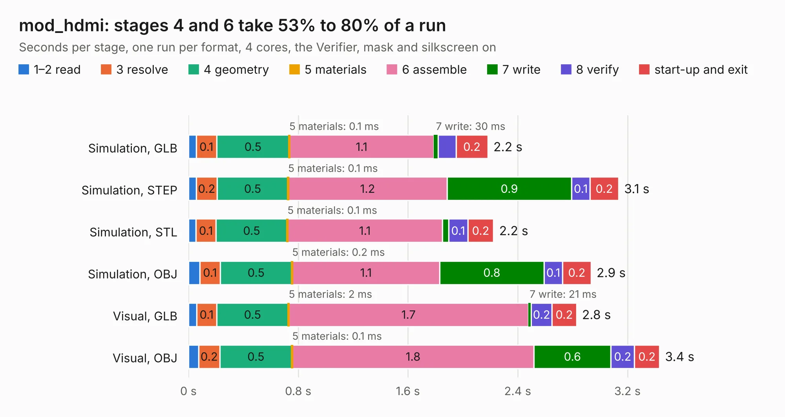

# 3002. mod_hdmi

Board 3,002 of the 3,106 of [Corpus Testing](../Corpus-Testing.md), on [Corpus Page 28](../CorpusTestingPages/Corpus-Testing-28.md#3002-mod_hdmi).

| Mode and format | 1–2 read | 3 resolve | 4 geometry | 5 materials | 6 assemble | 7 write | 8 verify | start-up and exit | Total |
|---|---:|---:|---:|---:|---:|---:|---:|---:|---:|
| Simulation, GLB | 56&nbsp;ms | 0.1 | 0.5 | 0.1&nbsp;ms | 1.1 | 30&nbsp;ms | 0.1 | 0.2 | 2.2 |
| Simulation, STEP | 56&nbsp;ms | 0.2 | 0.5 | 0.1&nbsp;ms | 1.2 | 0.9 | 0.1 | 0.2 | 3.1 |
| Simulation, STL | 55&nbsp;ms | 0.1 | 0.5 | 0.1&nbsp;ms | 1.1 | 46&nbsp;ms | 0.1 | 0.2 | 2.2 |
| Simulation, OBJ | 84&nbsp;ms | 0.1 | 0.5 | 0.2&nbsp;ms | 1.1 | 0.8 | 0.1 | 0.2 | 2.9 |
| Visual, GLB | 60&nbsp;ms | 0.1 | 0.5 | 2&nbsp;ms | 1.7 | 21&nbsp;ms | 0.2 | 0.2 | 2.8 |
| Visual, OBJ | 74&nbsp;ms | 0.2 | 0.5 | 0.1&nbsp;ms | 1.8 | 0.6 | 0.2 | 0.2 | 3.4 |

<table align="center"><tr><td valign="top">

| Board | Repo: [winkleplex10-bit/the-mac-pro-project](https://github.com/winkleplex10-bit/the-mac-pro-project) Board: `mod_hdmi.kicad_pcb` |
|---|---|
| Folder | kicad / macpro62-io-modules / mod_hdmi |
| Complexity | 196&nbsp;/&nbsp;1000 (size&nbsp;131, features&nbsp;65) |
| KESE&nbsp;features | through vias, rounded, trapezoid or chamfered pads, filled zones, copper drawings, curved board outline |
| Tested | 9th November 2026 |
| Copper&nbsp;layers | 2 |
| File&nbsp;format | KiCad 9 (20241229) |
| Parts,&nbsp;tracks,&nbsp;vias | 4, 291, 24 |
| Triangles,&nbsp;simulation | 168,642 in 27 parts |
| Verifier | PASS in all six runs |

</td><td valign="top">

<table>
<tr><th>File type</th><th>File size</th><th>Peak memory used</th></tr>
<tr><th colspan="3" align="left">Simulation</th></tr>
<tr><td>GLB</td><td align="right">6.3&nbsp;MB</td><td align="right">211&nbsp;MB</td></tr>
<tr><td>STEP</td><td align="right">36&nbsp;MB</td><td align="right">223&nbsp;MB</td></tr>
<tr><td>STL</td><td align="right">8.4&nbsp;MB</td><td align="right">205&nbsp;MB</td></tr>
<tr><td>OBJ</td><td align="right">18&nbsp;MB</td><td align="right">207&nbsp;MB</td></tr>
<tr><th colspan="3" align="left">Visual</th></tr>
<tr><td>GLB</td><td align="right">5.0&nbsp;MB</td><td align="right">175&nbsp;MB</td></tr>
<tr><td>OBJ</td><td align="right">14&nbsp;MB</td><td align="right">175&nbsp;MB</td></tr>
</table>

</td></tr></table>

| Previous | Next |
|:---|---:|
| [3001. macpro62-io-board](b3001b_the-mac-pro-project_macpro62-io-board.md) | [3003. mod_usba](b3003b_the-mac-pro-project_mod-usba.md) |
