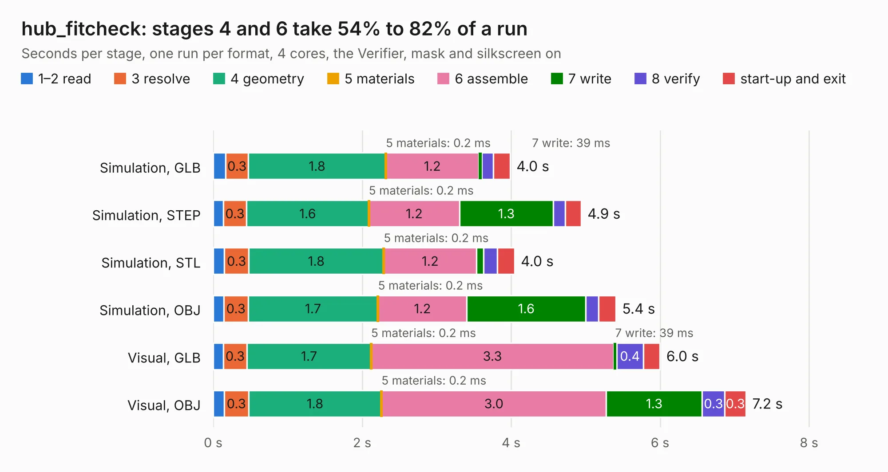

# 3003. hub_fitcheck

Board 3,003 of the 3,111 of [Corpus Testing](../Corpus-Testing.md), on [Corpus Page 28](../CorpusTestingPages/Corpus-Testing-28.md#3003-hub_fitcheck).

| Mode and format | 1–2 read | 3 resolve | 4 geometry | 5 materials | 6 assemble | 7 write | 8 verify | start-up and exit | Total |
|---|---:|---:|---:|---:|---:|---:|---:|---:|---:|
| Simulation, GLB | 0.2 | 0.3 | 1.8 | 0.2&nbsp;ms | 1.2 | 39&nbsp;ms | 0.2 | 0.2 | 4.0 |
| Simulation, STEP | 0.1 | 0.3 | 1.6 | 0.2&nbsp;ms | 1.2 | 1.3 | 0.2 | 0.2 | 4.9 |
| Simulation, STL | 0.1 | 0.3 | 1.8 | 0.2&nbsp;ms | 1.2 | 91&nbsp;ms | 0.2 | 0.2 | 4.0 |
| Simulation, OBJ | 0.1 | 0.3 | 1.7 | 0.2&nbsp;ms | 1.2 | 1.6 | 0.2 | 0.2 | 5.4 |
| Visual, GLB | 0.1 | 0.3 | 1.7 | 0.2&nbsp;ms | 3.3 | 39&nbsp;ms | 0.4 | 0.2 | 6.0 |
| Visual, OBJ | 0.1 | 0.3 | 1.8 | 0.2&nbsp;ms | 3.0 | 1.3 | 0.3 | 0.3 | 7.2 |

<table align="center"><tr><td valign="top">

| Board | Repo: [winkleplex10-bit/the-mac-pro-project](https://github.com/winkleplex10-bit/the-mac-pro-project) Board: `hub_fitcheck.kicad_pcb` |
|---|---|
| Folder | kicad / macpro62-backplane / variants / fitcheck_hub_allMCIO_cable_variant |
| Complexity | 126&nbsp;/&nbsp;1000 (size&nbsp;96, features&nbsp;30) |
| KESE&nbsp;features | slotted holes, rounded, trapezoid or chamfered pads, curved board outline |
| Tested | 9th November 2026 |
| Copper&nbsp;layers | 4 |
| File&nbsp;format | KiCad 9 (20241229) |
| Parts,&nbsp;tracks,&nbsp;vias | 7, 0, 0 |
| Triangles,&nbsp;simulation | 298,708 in 13 parts |
| Verifier | PASS in all six runs |

</td><td valign="top">

<table>
<tr><th>File type</th><th>File size</th><th>Peak memory used</th></tr>
<tr><th colspan="3" align="left">Simulation</th></tr>
<tr><td>GLB</td><td align="right">11&nbsp;MB</td><td align="right">266&nbsp;MB</td></tr>
<tr><td>STEP</td><td align="right">45&nbsp;MB</td><td align="right">296&nbsp;MB</td></tr>
<tr><td>STL</td><td align="right">15&nbsp;MB</td><td align="right">269&nbsp;MB</td></tr>
<tr><td>OBJ</td><td align="right">31&nbsp;MB</td><td align="right">267&nbsp;MB</td></tr>
<tr><th colspan="3" align="left">Visual</th></tr>
<tr><td>GLB</td><td align="right">8.8&nbsp;MB</td><td align="right">285&nbsp;MB</td></tr>
<tr><td>OBJ</td><td align="right">26&nbsp;MB</td><td align="right">291&nbsp;MB</td></tr>
</table>

</td></tr></table>

| Previous | Next |
|:---|---:|
| [3002. backplane_direct](b3002b_the-mac-pro-project_backplane-direct.md) | [3004. backplane_fp6](b3004b_the-mac-pro-project_backplane-fp6.md) |
