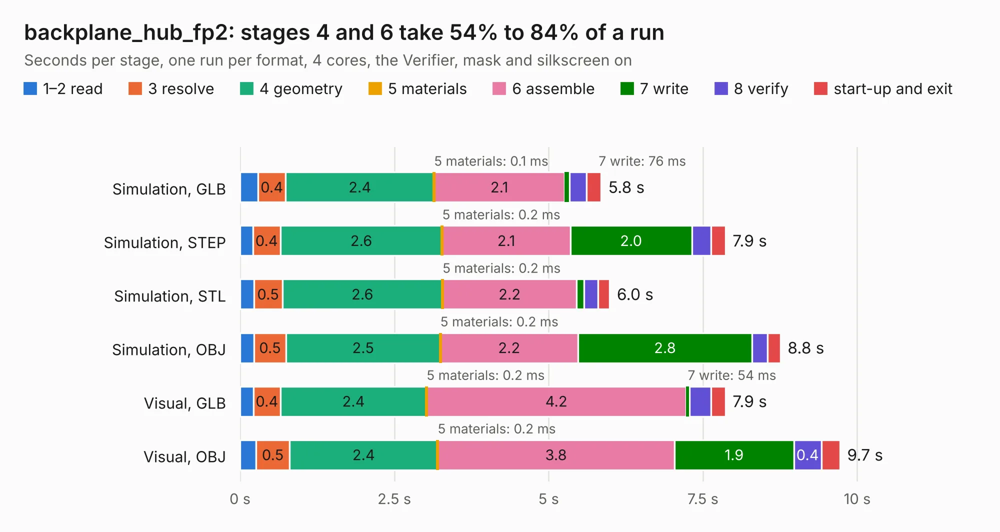

# 3004. backplane_hub_fp2

Board 3,004 of the 3,110 of [Corpus Testing](../Corpus-Testing.md), on [Corpus Page 28](../CorpusTestingPages/Corpus-Testing-28.md#3004-backplane_hub_fp2).

| Mode and format | 1–2 read | 3 resolve | 4 geometry | 5 materials | 6 assemble | 7 write | 8 verify | start-up and exit | Total |
|---|---:|---:|---:|---:|---:|---:|---:|---:|---:|
| Simulation, GLB | 0.3 | 0.4 | 2.4 | 0.1&nbsp;ms | 2.1 | 76&nbsp;ms | 0.3 | 0.2 | 5.8 |
| Simulation, STEP | 0.2 | 0.4 | 2.6 | 0.2&nbsp;ms | 2.1 | 2.0 | 0.3 | 0.2 | 7.9 |
| Simulation, STL | 0.2 | 0.5 | 2.6 | 0.2&nbsp;ms | 2.2 | 0.1 | 0.2 | 0.2 | 6.0 |
| Simulation, OBJ | 0.2 | 0.5 | 2.5 | 0.2&nbsp;ms | 2.2 | 2.8 | 0.2 | 0.2 | 8.8 |
| Visual, GLB | 0.2 | 0.4 | 2.4 | 0.2&nbsp;ms | 4.2 | 54&nbsp;ms | 0.3 | 0.2 | 7.9 |
| Visual, OBJ | 0.3 | 0.5 | 2.4 | 0.2&nbsp;ms | 3.8 | 1.9 | 0.4 | 0.3 | 9.7 |

<table align="center"><tr><td valign="top">

| Board | Repo: [winkleplex10-bit/the-mac-pro-project](https://github.com/winkleplex10-bit/the-mac-pro-project) Board: `backplane_hub_fp2.kicad_pcb` |
|---|---|
| Folder | kicad / macpro62-backplane / variants / hub_fp2_d30_assumed |
| Complexity | 192&nbsp;/&nbsp;1000 (size&nbsp;117, features&nbsp;75) |
| KESE&nbsp;features | slotted holes, rounded, trapezoid or chamfered pads, curved board outline, stack-up, dielectric εr and tanδ, copper finish |
| Tested | 9th November 2026 |
| Copper&nbsp;layers | 6 |
| File&nbsp;format | KiCad 9 (20241229) |
| Parts,&nbsp;tracks,&nbsp;vias | 21, 0, 0 |
| Triangles,&nbsp;simulation | 429,260 in 15 parts |
| Verifier | PASS in all six runs |

</td><td valign="top">

<table>
<tr><th>File type</th><th>File size</th><th>Peak memory used</th></tr>
<tr><th colspan="3" align="left">Simulation</th></tr>
<tr><td>GLB</td><td align="right">15&nbsp;MB</td><td align="right">315&nbsp;MB</td></tr>
<tr><td>STEP</td><td align="right">62&nbsp;MB</td><td align="right">352&nbsp;MB</td></tr>
<tr><td>STL</td><td align="right">21&nbsp;MB</td><td align="right">311&nbsp;MB</td></tr>
<tr><td>OBJ</td><td align="right">46&nbsp;MB</td><td align="right">358&nbsp;MB</td></tr>
<tr><th colspan="3" align="left">Visual</th></tr>
<tr><td>GLB</td><td align="right">12&nbsp;MB</td><td align="right">418&nbsp;MB</td></tr>
<tr><td>OBJ</td><td align="right">37&nbsp;MB</td><td align="right">413&nbsp;MB</td></tr>
</table>

</td></tr></table>

| Previous | Next |
|:---|---:|
| [3003. backplane_fp6](b3003b_the-mac-pro-project_backplane-fp6.md) | [3005. macpro62-io-board](b3005b_the-mac-pro-project_macpro62-io-board.md) |
