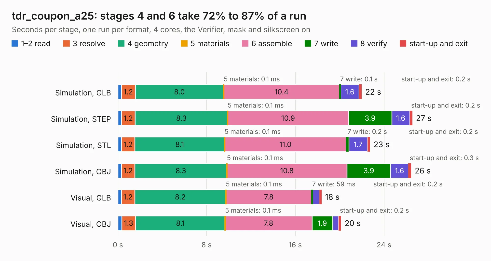

# 3004. tdr_coupon_a25

Board 3,004 of the 3,103 of [Corpus Testing](../Corpus-Testing.md), on [Corpus Page 28](../CorpusTestingPages/Corpus-Testing-28.md#3004-tdr_coupon_a25).

| Mode and format | 1–2 read | 3 resolve | 4 geometry | 5 materials | 6 assemble | 7 write | 8 verify | start-up and exit | Total |
|---|---:|---:|---:|---:|---:|---:|---:|---:|---:|
| Simulation, GLB | 0.3 | 1.2 | 8.0 | 0.1&nbsp;ms | 10.4 | 0.1 | 1.6 | 0.2 | 22.0 |
| Simulation, STEP | 0.3 | 1.2 | 8.3 | 0.1&nbsp;ms | 10.9 | 3.9 | 1.6 | 0.2 | 26.6 |
| Simulation, STL | 0.3 | 1.2 | 8.1 | 0.1&nbsp;ms | 11.0 | 0.2 | 1.7 | 0.2 | 22.7 |
| Simulation, OBJ | 0.3 | 1.2 | 8.3 | 0.1&nbsp;ms | 10.8 | 3.9 | 1.6 | 0.3 | 26.5 |
| Visual, GLB | 0.3 | 1.2 | 8.2 | 0.1&nbsp;ms | 7.8 | 59&nbsp;ms | 0.6 | 0.2 | 18.4 |
| Visual, OBJ | 0.3 | 1.3 | 8.1 | 0.1&nbsp;ms | 7.8 | 1.9 | 0.5 | 0.2 | 20.1 |

<table align="center"><tr><td valign="top">

| Board | Repo: [winkleplex10-bit/the-mac-pro-project](https://github.com/winkleplex10-bit/the-mac-pro-project) Board: `tdr_coupon_a25.kicad_pcb` |
|---|---|
| Folder | kicad / macpro62-io-modules / tdr / tdr_coupon_a25 |
| Complexity | 142&nbsp;/&nbsp;1000 (size&nbsp;107, features&nbsp;35) |
| KESE&nbsp;features | through vias, filled zones |
| Tested | 9th November 2026 |
| Copper&nbsp;layers | 2 |
| File&nbsp;format | KiCad 9 (20241229) |
| Parts,&nbsp;tracks,&nbsp;vias | 6, 33, 12 |
| Triangles,&nbsp;simulation | 610,764 in 12 parts |
| Verifier | PASS in all six runs |

</td><td valign="top">

<table>
<tr><th>File type</th><th>File size</th><th>Peak memory used</th></tr>
<tr><th colspan="3" align="left">Simulation</th></tr>
<tr><td>GLB</td><td align="right">26&nbsp;MB</td><td align="right">561&nbsp;MB</td></tr>
<tr><td>STEP</td><td align="right">166&nbsp;MB</td><td align="right">550&nbsp;MB</td></tr>
<tr><td>STL</td><td align="right">31&nbsp;MB</td><td align="right">558&nbsp;MB</td></tr>
<tr><td>OBJ</td><td align="right">74&nbsp;MB</td><td align="right">571&nbsp;MB</td></tr>
<tr><th colspan="3" align="left">Visual</th></tr>
<tr><td>GLB</td><td align="right">13&nbsp;MB</td><td align="right">379&nbsp;MB</td></tr>
<tr><td>OBJ</td><td align="right">37&nbsp;MB</td><td align="right">434&nbsp;MB</td></tr>
</table>

</td></tr></table>

| Previous | Next |
|:---|---:|
| [3003. panel_c50](b3003b_the-mac-pro-project_panel-c50.md) | [3005. tdr_coupon_c50](b3005b_the-mac-pro-project_tdr-coupon-c50.md) |
