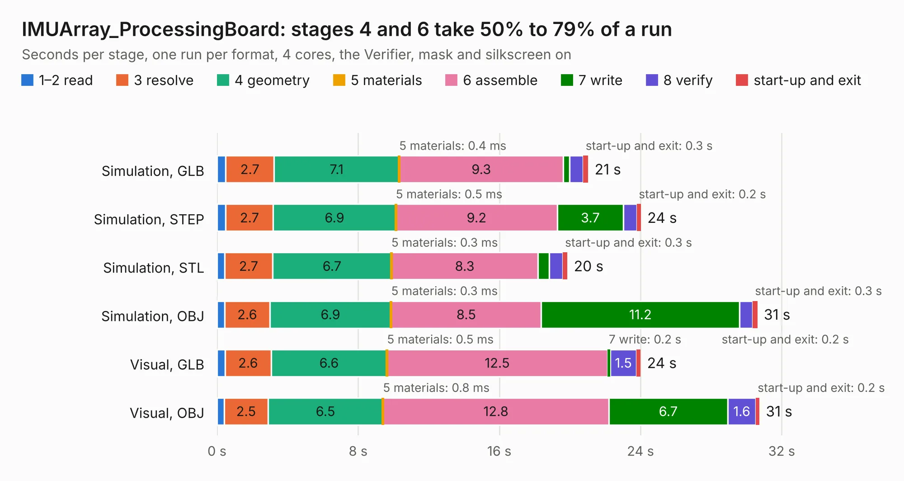

# 3005. IMUArray_ProcessingBoard

Board 3,005 of the 3,126 of [Corpus Testing](../Corpus-Testing.md), on [Corpus Page 28](../CorpusTestingPages/Corpus-Testing-28.md#3005-imuarray_processingboard).

| Mode and format | 1–2 read | 3 resolve | 4 geometry | 5 materials | 6 assemble | 7 write | 8 verify | start-up and exit | Total |
|---|---:|---:|---:|---:|---:|---:|---:|---:|---:|
| Simulation, GLB | 0.5 | 2.7 | 7.1 | 0.4&nbsp;ms | 9.3 | 0.3 | 0.8 | 0.3 | 21.0 |
| Simulation, STEP | 0.5 | 2.7 | 6.9 | 0.5&nbsp;ms | 9.2 | 3.7 | 0.8 | 0.2 | 24.0 |
| Simulation, STL | 0.4 | 2.7 | 6.7 | 0.3&nbsp;ms | 8.3 | 0.6 | 0.8 | 0.3 | 19.9 |
| Simulation, OBJ | 0.4 | 2.6 | 6.9 | 0.3&nbsp;ms | 8.5 | 11.2 | 0.7 | 0.3 | 30.6 |
| Visual, GLB | 0.5 | 2.6 | 6.6 | 0.5&nbsp;ms | 12.5 | 0.2 | 1.5 | 0.2 | 24.0 |
| Visual, OBJ | 0.4 | 2.5 | 6.5 | 0.8&nbsp;ms | 12.8 | 6.7 | 1.6 | 0.2 | 30.7 |

<table align="center"><tr><td valign="top">

| Board | Repo: [will127534/IMU_Array](https://github.com/will127534/IMU_Array) Board: `IMUArray_ProcessingBoard.kicad_pcb` |
|---|---|
| Folder | IMUArray_ProcessingBoard / IMUArray_ProcessingBoard |
| Complexity | 338&nbsp;/&nbsp;1000 (size&nbsp;253, features&nbsp;85) |
| KESE&nbsp;features | through vias, rounded, trapezoid or chamfered pads, filled zones, curved board outline, stack-up, dielectric εr and tanδ |
| Tested | 9th November 2026 |
| Copper&nbsp;layers | 4 |
| File&nbsp;format | KiCad 8 (20240108) |
| Parts,&nbsp;tracks,&nbsp;vias | 85, 390, 880 |
| Triangles,&nbsp;simulation | 2,049,144 in 124 parts |
| Note | panel |
| Verifier | PASS in all six runs |

</td><td valign="top">

<table>
<tr><th>File type</th><th>File size</th><th>Peak memory used</th></tr>
<tr><th colspan="3" align="left">Simulation</th></tr>
<tr><td>GLB</td><td align="right">65&nbsp;MB</td><td align="right">868&nbsp;MB</td></tr>
<tr><td>STEP</td><td align="right">147&nbsp;MB</td><td align="right">988&nbsp;MB</td></tr>
<tr><td>STL</td><td align="right">102&nbsp;MB</td><td align="right">887&nbsp;MB</td></tr>
<tr><td>OBJ</td><td align="right">208&nbsp;MB</td><td align="right">1.4&nbsp;GB</td></tr>
<tr><th colspan="3" align="left">Visual</th></tr>
<tr><td>GLB</td><td align="right">44&nbsp;MB</td><td align="right">827&nbsp;MB</td></tr>
<tr><td>OBJ</td><td align="right">134&nbsp;MB</td><td align="right">942&nbsp;MB</td></tr>
</table>

</td></tr></table>

| Previous | Next |
|:---|---:|
| [3004. IMUArray_BreakoutBoard](b3004b_IMU-Array_IMUArray-BreakoutBoard.md) | [3006. IMUArray_SensorBoard](b3006b_IMU-Array_IMUArray-SensorBoard.md) |
