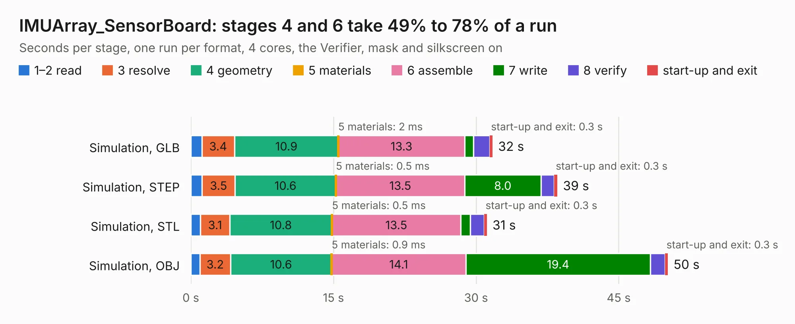

# 3005. IMUArray_SensorBoard

Board 3,005 of the 3,125 of [Corpus Testing](../Corpus-Testing.md), on [Corpus Page 28](../CorpusTestingPages/Corpus-Testing-28.md#3005-imuarray_sensorboard).

| Mode and format | 1–2 read | 3 resolve | 4 geometry | 5 materials | 6 assemble | 7 write | 8 verify | start-up and exit | Total |
|---|---:|---:|---:|---:|---:|---:|---:|---:|---:|
| Simulation, GLB | 1.2 | 3.4 | 10.9 | 2&nbsp;ms | 13.3 | 0.9 | 1.7 | 0.3 | 31.7 |
| Simulation, STEP | 1.2 | 3.5 | 10.6 | 0.5&nbsp;ms | 13.5 | 8.0 | 1.4 | 0.3 | 38.5 |
| Simulation, STL | 1.0 | 3.1 | 10.8 | 0.5&nbsp;ms | 13.5 | 1.0 | 1.5 | 0.3 | 31.1 |
| Simulation, OBJ | 1.0 | 3.2 | 10.6 | 0.9&nbsp;ms | 14.1 | 19.4 | 1.5 | 0.3 | 50.2 |
| Visual, GLB | 1.0 | 3.0 | 11.1 | 1&nbsp;ms | 34.0 | 0.2 | 2.8 | 0.3 | 52.4 |
| Visual, OBJ | 1.1 | 3.2 | 11.4 | 0.5&nbsp;ms | 35.0 | 8.4 | 3.5 | 0.3 | 62.8 |

<table align="center"><tr><td valign="top">

| Board | Repo: [will127534/IMU_Array](https://github.com/will127534/IMU_Array) Board: `IMUArray_SensorBoard.kicad_pcb` |
|---|---|
| Folder | IMUArray_SensorBoard |
| Complexity | 353&nbsp;/&nbsp;1000 (size&nbsp;268, features&nbsp;85) |
| KESE&nbsp;features | through vias, rounded, trapezoid or chamfered pads, filled zones, curved board outline, stack-up, dielectric εr and tanδ |
| Tested | 9th November 2026 |
| Copper&nbsp;layers | 6 |
| File&nbsp;format | KiCad 6 (20211014) |
| Parts,&nbsp;tracks,&nbsp;vias | 148, 1,177, 558 |
| Triangles,&nbsp;simulation | 3,916,240 in 97 parts |
| Note | panel |
| Verifier | PASS in all six runs |

</td><td valign="top">

<table>
<tr><th>File type</th><th>File size</th><th>Peak memory used</th></tr>
<tr><th colspan="3" align="left">Simulation</th></tr>
<tr><td>GLB</td><td align="right">132&nbsp;MB</td><td align="right">1.1&nbsp;GB</td></tr>
<tr><td>STEP</td><td align="right">509&nbsp;MB</td><td align="right">1.3&nbsp;GB</td></tr>
<tr><td>STL</td><td align="right">196&nbsp;MB</td><td align="right">1.0&nbsp;GB</td></tr>
<tr><td>OBJ</td><td align="right">429&nbsp;MB</td><td align="right">2.6&nbsp;GB</td></tr>
<tr><th colspan="3" align="left">Visual</th></tr>
<tr><td>GLB</td><td align="right">62&nbsp;MB</td><td align="right">1.3&nbsp;GB</td></tr>
<tr><td>OBJ</td><td align="right">200&nbsp;MB</td><td align="right">1.5&nbsp;GB</td></tr>
</table>

</td></tr></table>

| Previous | Next |
|:---|---:|
| [3004. IMUArray_ProcessingBoard](b3004b_IMU-Array_IMUArray-ProcessingBoard.md) | [3006. CM4ClusterHat](b3006b_Miniature-CM4-Cluster_CM4ClusterHat.md) |
