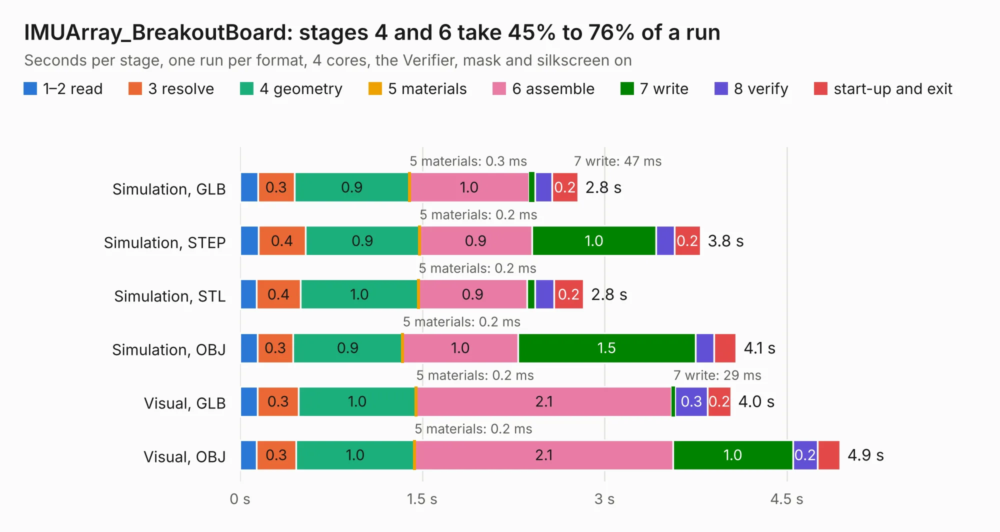

# 3006. IMUArray_BreakoutBoard

Board 3,006 of the 3,128 of [Corpus Testing](../Corpus-Testing.md), on [Corpus Page 28](../CorpusTestingPages/Corpus-Testing-28.md#3006-imuarray_breakoutboard).

| Mode and format | 1–2 read | 3 resolve | 4 geometry | 5 materials | 6 assemble | 7 write | 8 verify | start-up and exit | Total |
|---|---:|---:|---:|---:|---:|---:|---:|---:|---:|
| Simulation, GLB | 0.1 | 0.3 | 0.9 | 0.3&nbsp;ms | 1.0 | 47&nbsp;ms | 0.1 | 0.2 | 2.8 |
| Simulation, STEP | 0.2 | 0.4 | 0.9 | 0.2&nbsp;ms | 0.9 | 1.0 | 0.1 | 0.2 | 3.8 |
| Simulation, STL | 0.1 | 0.4 | 1.0 | 0.2&nbsp;ms | 0.9 | 68&nbsp;ms | 0.2 | 0.2 | 2.8 |
| Simulation, OBJ | 0.1 | 0.3 | 0.9 | 0.2&nbsp;ms | 1.0 | 1.5 | 0.2 | 0.2 | 4.1 |
| Visual, GLB | 0.1 | 0.3 | 1.0 | 0.2&nbsp;ms | 2.1 | 29&nbsp;ms | 0.3 | 0.2 | 4.0 |
| Visual, OBJ | 0.1 | 0.3 | 1.0 | 0.2&nbsp;ms | 2.1 | 1.0 | 0.2 | 0.2 | 4.9 |

<table align="center"><tr><td valign="top">

| Board | Repo: [will127534/IMU_Array](https://github.com/will127534/IMU_Array) Board: `IMUArray_BreakoutBoard.kicad_pcb` |
|---|---|
| Folder | IMUArray_BreakoutBoard |
| Complexity | 240&nbsp;/&nbsp;1000 (size&nbsp;145, features&nbsp;95) |
| KESE&nbsp;features | through vias, rounded, trapezoid or chamfered pads, drill offsets, filled zones, curved board outline, stack-up, dielectric εr and tanδ |
| Tested | 9th November 2026 |
| Copper&nbsp;layers | 4 |
| File&nbsp;format | KiCad 6 (20211014) |
| Parts,&nbsp;tracks,&nbsp;vias | 6, 54, 65 |
| Triangles,&nbsp;simulation | 316,704 in 48 parts |
| Note | panel |
| Verifier | PASS in all six runs |

</td><td valign="top">

<table>
<tr><th>File type</th><th>File size</th><th>Peak memory used</th></tr>
<tr><th colspan="3" align="left">Simulation</th></tr>
<tr><td>GLB</td><td align="right">11&nbsp;MB</td><td align="right">269&nbsp;MB</td></tr>
<tr><td>STEP</td><td align="right">39&nbsp;MB</td><td align="right">278&nbsp;MB</td></tr>
<tr><td>STL</td><td align="right">16&nbsp;MB</td><td align="right">262&nbsp;MB</td></tr>
<tr><td>OBJ</td><td align="right">32&nbsp;MB</td><td align="right">266&nbsp;MB</td></tr>
<tr><th colspan="3" align="left">Visual</th></tr>
<tr><td>GLB</td><td align="right">7.0&nbsp;MB</td><td align="right">235&nbsp;MB</td></tr>
<tr><td>OBJ</td><td align="right">20&nbsp;MB</td><td align="right">234&nbsp;MB</td></tr>
</table>

</td></tr></table>

| Previous | Next |
|:---|---:|
| [3005. FourThirdsEye](b3005b_FourThirdsEye_FourThirdsEye.md) | [3007. IMUArray_ProcessingBoard](b3007b_IMU-Array_IMUArray-ProcessingBoard.md) |
