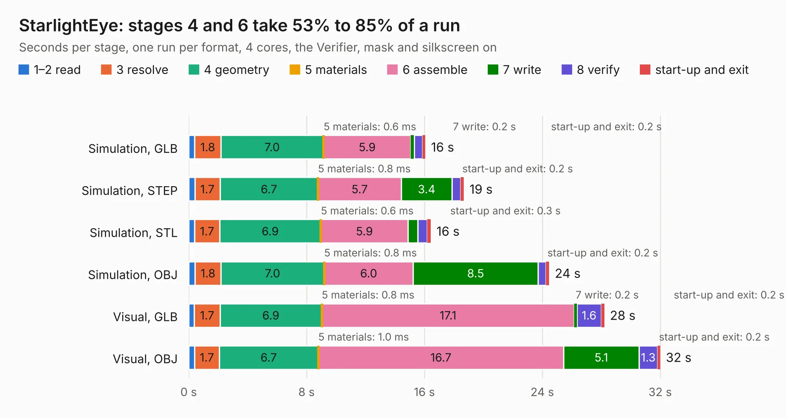

# 3009. StarlightEye

Board 3,009 of the 3,124 of [Corpus Testing](../Corpus-Testing.md), on [Corpus Page 28](../CorpusTestingPages/Corpus-Testing-28.md#3009-starlighteye).

| Mode and format | 1–2 read | 3 resolve | 4 geometry | 5 materials | 6 assemble | 7 write | 8 verify | start-up and exit | Total |
|---|---:|---:|---:|---:|---:|---:|---:|---:|---:|
| Simulation, GLB | 0.4 | 1.8 | 7.0 | 0.6&nbsp;ms | 5.9 | 0.2 | 0.5 | 0.2 | 16.1 |
| Simulation, STEP | 0.4 | 1.7 | 6.7 | 0.8&nbsp;ms | 5.7 | 3.4 | 0.6 | 0.2 | 18.7 |
| Simulation, STL | 0.4 | 1.7 | 6.9 | 0.6&nbsp;ms | 5.9 | 0.7 | 0.6 | 0.3 | 16.4 |
| Simulation, OBJ | 0.4 | 1.8 | 7.0 | 0.8&nbsp;ms | 6.0 | 8.5 | 0.5 | 0.2 | 24.5 |
| Visual, GLB | 0.4 | 1.7 | 6.9 | 0.8&nbsp;ms | 17.1 | 0.2 | 1.6 | 0.2 | 28.2 |
| Visual, OBJ | 0.4 | 1.7 | 6.7 | 1.0&nbsp;ms | 16.7 | 5.1 | 1.3 | 0.2 | 32.0 |

<table align="center"><tr><td valign="top">

| Board | Repo: [will127534/StarlightEye](https://github.com/will127534/StarlightEye) Board: `StarlightEye.kicad_pcb` |
|---|---|
| Complexity | 335&nbsp;/&nbsp;1000 (size&nbsp;210, features&nbsp;125) |
| KESE&nbsp;features | through vias, custom pads, rounded, trapezoid or chamfered pads, arc tracks, filled zones, copper drawings, curved board outline, stack-up, dielectric εr and tanδ |
| Tested | 9th November 2026 |
| Copper&nbsp;layers | 4 |
| File&nbsp;format | KiCad 8 (20240108) |
| Parts,&nbsp;tracks,&nbsp;vias | 111, 601, 524 |
| Triangles,&nbsp;simulation | 2,043,226 in 113 parts |
| Verifier | PASS in all six runs |

</td><td valign="top">

<table>
<tr><th>File type</th><th>File size</th><th>Peak memory used</th></tr>
<tr><th colspan="3" align="left">Simulation</th></tr>
<tr><td>GLB</td><td align="right">69&nbsp;MB</td><td align="right">806&nbsp;MB</td></tr>
<tr><td>STEP</td><td align="right">223&nbsp;MB</td><td align="right">899&nbsp;MB</td></tr>
<tr><td>STL</td><td align="right">102&nbsp;MB</td><td align="right">808&nbsp;MB</td></tr>
<tr><td>OBJ</td><td align="right">211&nbsp;MB</td><td align="right">1.4&nbsp;GB</td></tr>
<tr><th colspan="3" align="left">Visual</th></tr>
<tr><td>GLB</td><td align="right">43&nbsp;MB</td><td align="right">820&nbsp;MB</td></tr>
<tr><td>OBJ</td><td align="right">131&nbsp;MB</td><td align="right">933&nbsp;MB</td></tr>
</table>

</td></tr></table>

| Previous | Next |
|:---|---:|
| [3008. NixieAtomicClock](b3008b_RaspberryPiAtomicNixieClock_NixieAtomicClock.md) | [3010. macpro62_am5](b3010b_the-mac-pro-project_kicad-macpro62-am5-v3_macpro62-am5.md) |
