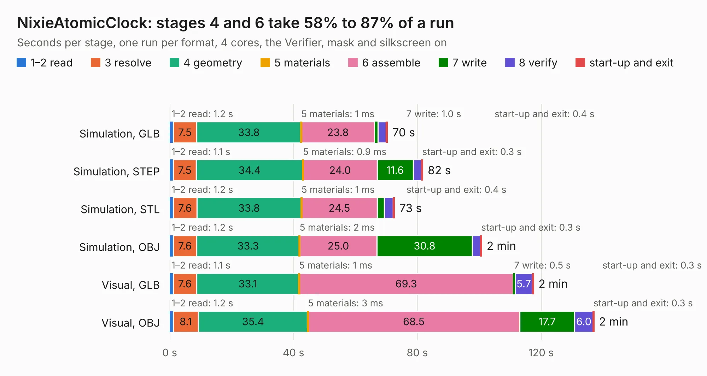

# 3010. NixieAtomicClock

Board 3,010 of the 3,126 of [Corpus Testing](../Corpus-Testing.md), on [Corpus Page 28](../CorpusTestingPages/Corpus-Testing-28.md#3010-nixieatomicclock).

| Mode and format | 1–2 read | 3 resolve | 4 geometry | 5 materials | 6 assemble | 7 write | 8 verify | start-up and exit | Total |
|---|---:|---:|---:|---:|---:|---:|---:|---:|---:|
| Simulation, GLB | 1.2 | 7.5 | 33.8 | 1&nbsp;ms | 23.8 | 1.0 | 2.8 | 0.4 | 70.4 |
| Simulation, STEP | 1.1 | 7.5 | 34.4 | 0.9&nbsp;ms | 24.0 | 11.6 | 2.8 | 0.3 | 81.8 |
| Simulation, STL | 1.2 | 7.6 | 33.8 | 1&nbsp;ms | 24.5 | 2.3 | 2.9 | 0.4 | 72.6 |
| Simulation, OBJ | 1.2 | 7.6 | 33.3 | 2&nbsp;ms | 25.0 | 30.8 | 2.7 | 0.3 | 100.8 |
| Visual, GLB | 1.1 | 7.6 | 33.1 | 1&nbsp;ms | 69.3 | 0.5 | 5.7 | 0.3 | 117.5 |
| Visual, OBJ | 1.2 | 8.1 | 35.4 | 3&nbsp;ms | 68.5 | 17.7 | 6.0 | 0.3 | 137.1 |

<table align="center"><tr><td valign="top">

| Board | Repo: [will127534/RaspberryPiAtomicNixieClock](https://github.com/will127534/RaspberryPiAtomicNixieClock) Board: `NixieAtomicClock.kicad_pcb` |
|---|---|
| Folder | PCB |
| Complexity | 397&nbsp;/&nbsp;1000 (size&nbsp;282, features&nbsp;115) |
| KESE&nbsp;features | through vias, slotted holes, rounded, trapezoid or chamfered pads, filled zones, curved board outline, stack-up, dielectric εr and tanδ, copper finish, mask and silkscreen colours |
| Tested | 9th November 2026 |
| Copper&nbsp;layers | 4 |
| File&nbsp;format | KiCad 6 (20201002) |
| Parts,&nbsp;tracks,&nbsp;vias | 256, 2,400, 2,132 |
| Triangles,&nbsp;simulation | 6,889,714 in 363 parts |
| Verifier | PASS in all six runs |

</td><td valign="top">

<table>
<tr><th>File type</th><th>File size</th><th>Peak memory used</th></tr>
<tr><th colspan="3" align="left">Simulation</th></tr>
<tr><td>GLB</td><td align="right">225&nbsp;MB</td><td align="right">2.5&nbsp;GB</td></tr>
<tr><td>STEP</td><td align="right">718&nbsp;MB</td><td align="right">2.6&nbsp;GB</td></tr>
<tr><td>STL</td><td align="right">345&nbsp;MB</td><td align="right">2.3&nbsp;GB</td></tr>
<tr><td>OBJ</td><td align="right">728&nbsp;MB</td><td align="right">4.3&nbsp;GB</td></tr>
<tr><th colspan="3" align="left">Visual</th></tr>
<tr><td>GLB</td><td align="right">135&nbsp;MB</td><td align="right">2.3&nbsp;GB</td></tr>
<tr><td>OBJ</td><td align="right">436&nbsp;MB</td><td align="right">2.8&nbsp;GB</td></tr>
</table>

</td></tr></table>

| Previous | Next |
|:---|---:|
| [3009. OneInchEye](b3009b_OneInchEye_OneInchEye.md) | [3011. StarlightEye](b3011b_StarlightEye_StarlightEye.md) |
